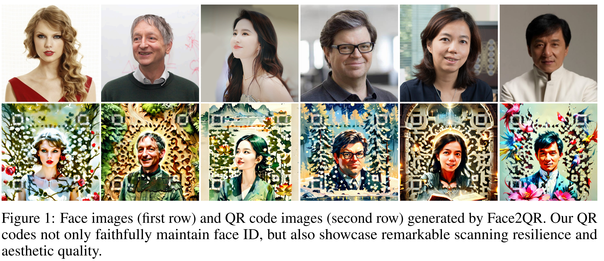
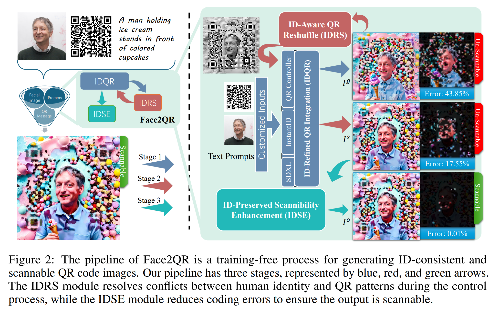
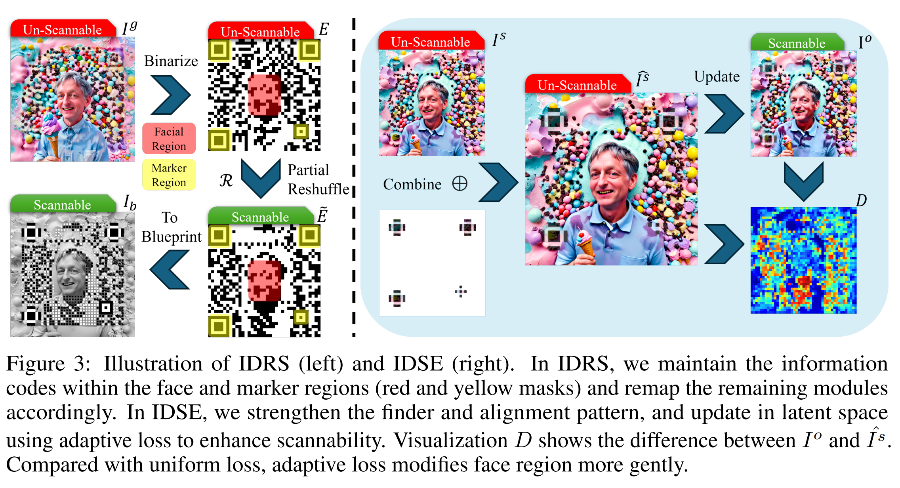

## Face2QR: A Unified Framework for Aesthetic, Face-Preserving, and Scannable QR Code Generation
*Neurips(2024), 1 citation, Shanghai Jiao Tong University, Review Data: 2026.07.15*

[Intro](#intro) 
[Related Work](#related-work) 
[Method](#method) 
[Experiment](#experiment) 
[Conclusion](#conclusion) 

> Core Idea

<strong>"test1"</strong> 

***

### <strong>Intro</strong>

- QR code는 상당한 양의 데이터를 저장할 수 있고 일반적인 카메라 장치를 통해 손쉽게 접근할 수 있다는 장점으로 인해, 디지털 시대의 정보 표현 수단으로 매우 광범위하게 활용되고 있다. 
- QR 코드가 사회 전반에서 널리 사용됨에 따라, 개인의 정체성과 미적 매력을 반영하도록 QR 코드를 사용자화하려는 요구도 증가하고 있다. 그러나 흑백 모듈로만 구성된 일반적인 QR 코드의 단조로운 외형으로는 이러한 요구를 충족하기 어렵다.

- 이미지 변환 기법과 스타일 전이 기법은 얼굴 특징을 부분적으로 보존할 수 있지만, 지각적 품질과 미적 적응성이 제한적이다. 
- 반면, 생성 모델 기반 접근법은 더 높은 품질과 다양성을 갖춘 QR 코드 이미지를 생성할 수 있으나, 생성 콘텐츠를 제어하는 데 어려움이 있으며, 특히 사람의 얼굴 특징을 보존하는 데 한계가 있다. 

- 기존의 aesthetic QR code를 생성하는 방법론들은 human face identity를 통합할 때 visual appeal or scannability를 타협하는 경향이 있다. 

- 이를 해결하고자, Face2QR $-$ aesthetics, face identity, scannability를 조화롭게 섞는 방법론 $-$ 을 제안했다. 
    - ID-refined QR integration (IDQR): control network를 갖춘 SD 기반 프레임워크를 활용하여 배경 스타일링과 얼굴 ID를 매끄럽게 결합
    - ID-aware QR Reshuffle: 얼굴 ID와 QR 패턴 간의 충돌을 효과적으로 해결하며 QR module을 재배치
    - ID-preserved Scannability Enhancement (IDSE): latent code optimization을 통해 스캔 견고성을 현저히 향상

***

### <strong>Related Work</strong>

***

### <strong>Method</strong>

- Pipeline
    - 먼저 IDQR module을 통해 초기 QR image $I^g$를 생성한다. (SDXL, InstantID, QR Controller)
        - InstantID는 얼굴 정체성 정보를 보존하며, QR Controller는 이미지의 휘도 분포를 유도한다. 
        - 그러나 여전히 43%를 초과하는 상당히 높은 오류율을 보인다. 
    - 세밀한 QR blueprint $I^b$ 를 이용하여 이미지를 다시 생성하는 ID-aware QR Reshuffle (IDRS) 모듈을 설계
        - 이 과정을 통해 오류율이 절반 이하로 감소한다. 
    - 마지막으로 IDSE 모듈을 통해 잠재 공간에서 결과 $I^s$를 정제한다. 
    - Text2QR과 다른 점은 얼굴 보존을 위한 InstantID와 얼굴 보존을 위한 reshuffle

- 

***

### <strong>Experiment</strong>

***

### <strong>Conclusion</strong>

***

### <strong>Question</strong>

<a href="">link</a>

> 인용구
