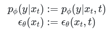
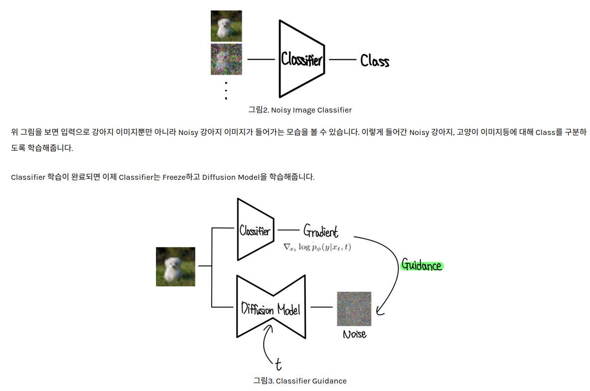
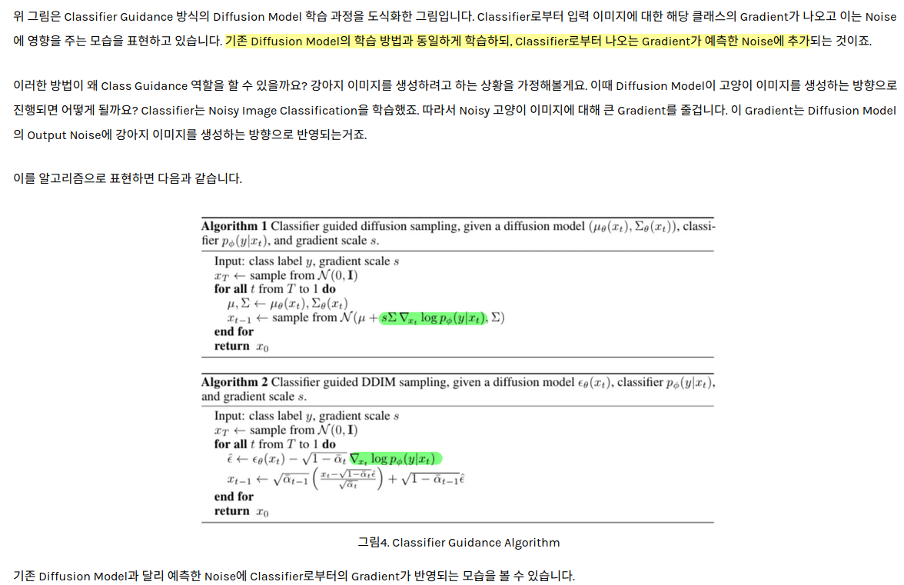

# Diffusion Models Beat GANs on Image Synthesis

*NeurIPS(2021), 2514 citation*

> [!TIP]
> **한 줄 요약** — Noisy image와 time step을 입력으로 받는 classifier의 gradient $\nabla_x \log{p(y|x_t)}$로 diffusion model의 noise 예측을 수정하는 classifier guidance로, condition $y$를 반영한 이미지를 생성한다.
>
> "Conditional DDPM with Guidance"

| 흐름 | 내용 |
|:--|:--|
| **문제** | Unconditional score $\nabla_x \log{p(x_t)}$만으로는 condition $y$를 반영한 이미지를 생성할 수 없다 |
| **아이디어** | Bayes rule로 $\nabla_x \log{p(x_t|y)} = \nabla_x \log{p(x_t)} + \gamma\nabla_x \log{p(y|x_t)}$로 분해하고, noisy image classifier의 gradient로 $\epsilon$을 수정 |
| **결과** | 강도 $\gamma$로 guidance를 조절하는 conditional sampling이 가능해지고, image synthesis에서 기존 SoTA GAN보다 좋은 sample quality를 달성 |

---

## 1. 방법

- 다음의 식을 이용한다. <a href='../../../notes/topics/score-based-generative-models/README.md'>reference</a>

$$ \nabla_x \log{p_{\sigma_i}(x)} \approx s_\theta^{*}(x_t,t\ or \ \sigma) = - \frac{1}{\sqrt{1-\bar\alpha_t}}\epsilon_\theta(x_t, t\ or \ \sigma) $$

- Condition $y$ 를 given 으로 $y$ 를 반영해서 이미지를 생성하고 싶다면 다음과 같이 식이 전개된다. ($\sigma$ 생략)

$$ \nabla_x \log{p(x_t|y)} = \nabla_x \log{\frac{p(x_t)p(y|x_t)}{p(y)}}  $$ 

$$ = \nabla_x \log{p(x_t)} + \nabla_x \log{p(y|x_t)} - \nabla_x \log{p(y)} $$

- $x$ 에 관한 함수가 아닌, $\nabla_x \log{p(y)}$ 는 소거된다. ($\gamma$ 로 강도 조정)

$$ \nabla_x \log{p(x_t|y)} = \nabla_x \log{p(x_t)} + \nabla_x \log{p(y|x_t)} $$

- 이때, 우측 항에 존재하는 텀들은 model(parameter) 로 근사하는 텀이 된다. 즉, $\theta^*$ 를 찾으면 성립하게 된다. 

$$ \therefore \nabla_x \log{p(x_t|y)} = \nabla_x \log{p(x_t)} + \gamma\nabla_x \log{p(y|x_t)} $$

- $\nabla_x \log{p(x_t|y)}$ 를 보면 이 score function 을 우리는 $s_\theta(x_t,t\ or \ \sigma)$ 로 근사했고 given $y$ 로 condition 을 받는다고 생각해보자.
    - 결국, $\nabla_x \log{p(x_t|y)}$ 도 $- \frac{1}{\sqrt{1-\bar\alpha_t}}\epsilon_\theta(x_t, t\ or \ \sigma)$ 의 꼴을 가지게 된다. $\nabla_x \log{p(x_t)}$ 와 $\beta$ 가 상수이기에 다른 점은 $\epsilon$ 뿐이다.
    - 따라서 noise 는 다음과 같이 수정된다.

> [!IMPORTANT]
> **Classifier guidance로 수정된 noise**
>
> $$ \hat{\epsilon}(x_t, t) = \epsilon_\theta(x_t, t) - \gamma\sqrt{1-\bar\alpha_t}\nabla_x \log{p(y|x_t)} $$

- 추가적으로 noisy image & time step 을 입력으로 받는 classifier model 을 학습시켜야 한다.

## 참고

- [Paper](https://arxiv.org/pdf/2105.05233.pdf) · 관련 리뷰: [Score-based Generative Models](../../../notes/topics/score-based-generative-models/README.md)
