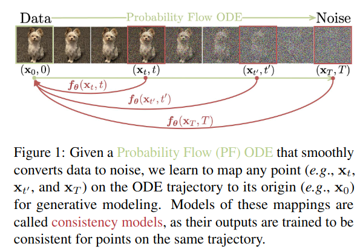

# CM: Consistency Models

*ICML(2023), 144 citation*

> [!TIP]
> **한 줄 요약** — PF-ODE trajectory 위의 어떤 점이 주어져도 그 trajectory의 origin(data)을 바로 출력하도록 학습한 consistency model로, diffusion model의 느린 iterative sampling 없이 one-step 생성을 가능하게 한다.
>
> "Given Any Point on the ODE Trajectory, Models Generates Its Origin"

| 흐름 | 내용 |
|:--|:--|
| **문제** | Diffusion model은 생성 품질이 좋지만 iterative sampling 때문에 생성 속도가 느리다 |
| **아이디어** | ODE trajectory 위의 모든 점을 같은 origin으로 mapping하는 consistency model을 pre-trained diffusion model의 distillation 또는 standalone으로 학습 |
| **결과** | Noise에서 data로의 빠른 one-step 생성, 필요하면 multistep sampling으로 품질과 계산량을 교환, inpainting·colorization·super-resolution 같은 zero-shot editing 지원 |

   
  <b>Figure 1.</b> Consistency model 개요

---

## 참고

- [Paper](https://arxiv.org/abs/2303.01469)
