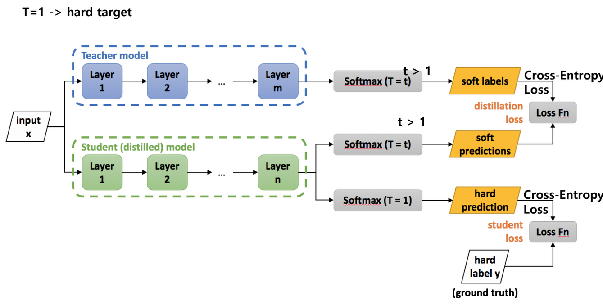
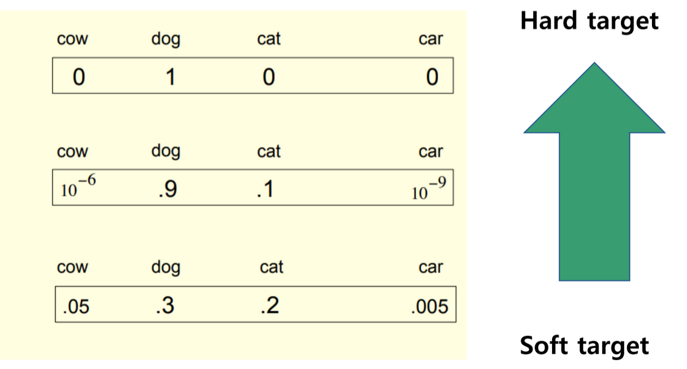
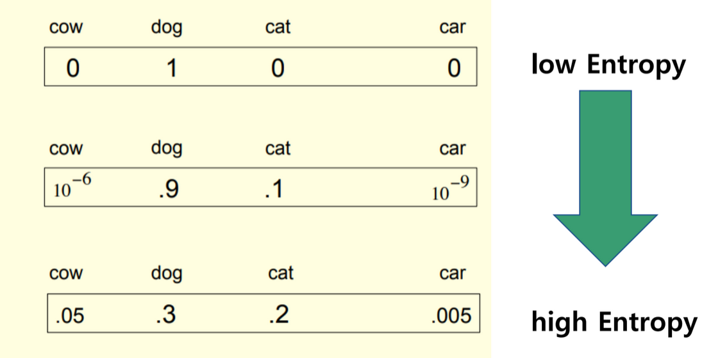
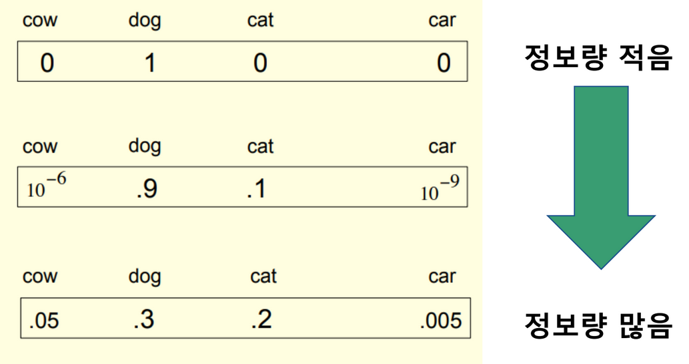
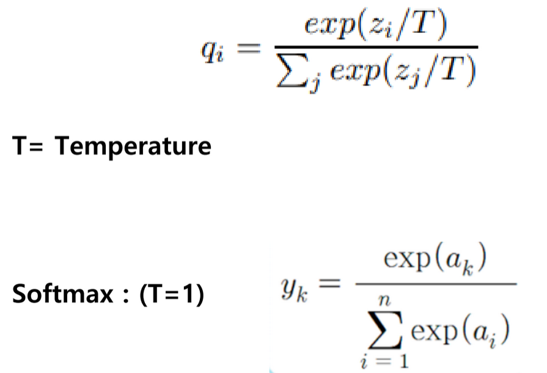
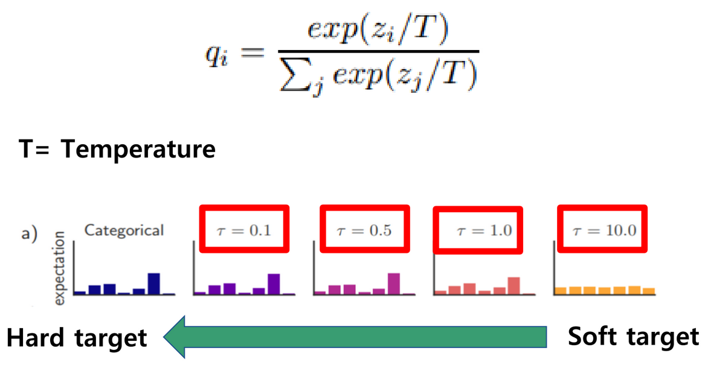
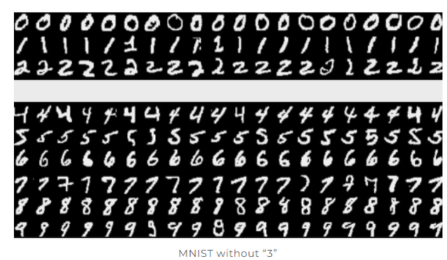

# Distilling the Knowledge in a Neural Network

*NeurIPS Workshop(2014), 16596 citation*

> [!TIP]
> **한 줄 요약** — Softmax에 temperature를 도입한 soft target으로 가장 높은 logit 외의 logit 정보까지 student model에 전달하여, 복잡한 teacher model의 knowledge를 작은 student model로 효과적으로 증류한다.

| 흐름 | 내용 |
|:--|:--|
| **문제** | 경량화된 디바이스에서 쓰려면 낮은 메모리로 높은 정확도를 내는 모델이 필요하지만, 좋은 knowledge를 가진 teacher model은 파라미터 수가 많다 |
| **아이디어** | Temperature로 smooth해진 teacher의 soft target(소외받는 logit 값들 포함)을 student model 학습에 사용하는 knowledge distillation |
| **결과** | MNIST에서 student 단독 $146$개 오류 → 증류 시 $74$개 오류(teacher $67$개), 학습에 쓰지 않은 숫자 $3$도 test 시 $98.6$% 정답 |

> "Effectively Copy Teacher Model using Soft Target" (Use Logit Other Than the Highest Logit)

   
  <b>Figure 1.</b> Knowledge distillation 개요

---

## 1. 문제 정의 — 왜 이 논문이 필요한가

- 현실에선, 복잡한 딥러닝 모델을 경량화된 디바이스에서 사용하기 위해, 낮은 메모리를 필요로 하면서 높은 정확도가 나오는 모델이 필요하다.
- 복잡한 딥러닝 모델(teacher model)은 많은 수의 파라미터를 가지고 있는 반면, 좋은 *Knowledge* 를 가지고 있다.
- 본 논문에서는, teacher model 의 knowledge 를 효과적으로 student model 에게 전달해주는 방식을 제공하고자 한다.

## 2. 방법

- Soft target 는 softmax function 에 temperature 를 도입해 확률 값이 극단적으로 나오는 걸 막아줄 수 있다.
- 이때, 확률 값이 smooth 가 되면서 정보량이 많아지는 효과가 발생하는데 이 많은 정보량을 바탕으로 student model 에게 전달해준다.
- 일반적으로 우리는 가장 높은 값을 가지는 logit 외에는 관심을 가지지 않는다. 하지만 *knowledge Distillation* 에서는 소외받는 logit 값들에 관심을 가진다.
    - E.g., Car image 를 보고 model 이 트럭이라고 잘못 분류하는 것은 드물게 발생할 수 있다. 당근이라고 분류하는 것보다 상대적으로는 그 값이 높을 것이다. 이때, 트럭이 당근보다 더 높은 확률로 나온 이유가 있을 텐데 이 정보들을 유용하다고 가정하고 진행하는 것이다.
- Teacher model 과 student model 은 같은 데이터셋으로 학습한다.

## 3. 실험

- MNIST dataset 에 대해서 실험을 진행
    - Teacher model 은 $67$ 개의 오류, student model 은 $146$ 개의 오류를 냈다.
    - 그리고 teacher model 의 지식을 student model 에 증류했을 때, $74$ 개의 오류를 달성
    - 또한, MNIST dataset 에 대해서 학습을 할 때 (for classification), student model 은 숫자 $3$ image 를 학습 과정에서 사용하지 않았음에도 불구하고, test 시에 $3$ 을 $98.6$% 로 맞췄다.

- 심지어는 transfer set 에 숫자 $7$ 과 $8$ 만으로 증류했을 때는 $47.3$% 의 정확도를 달성했다.

## 4. 정리

- 거대 모델의 지식을 단순하면서도 효과적으로 전이할 수 있는 방법이다.

## 참고

- [Paper](https://arxiv.org/pdf/1503.02531.pdf)
