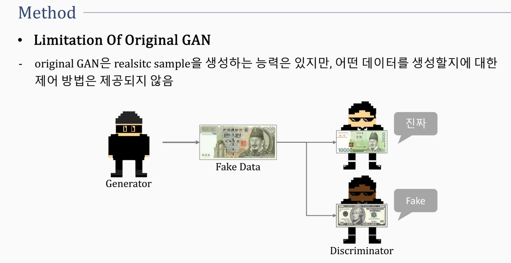
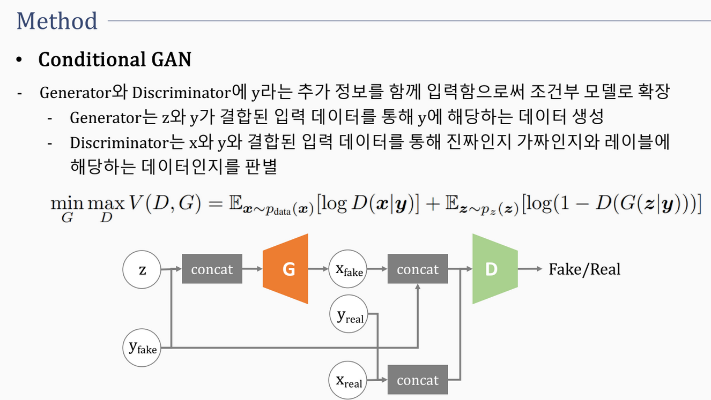
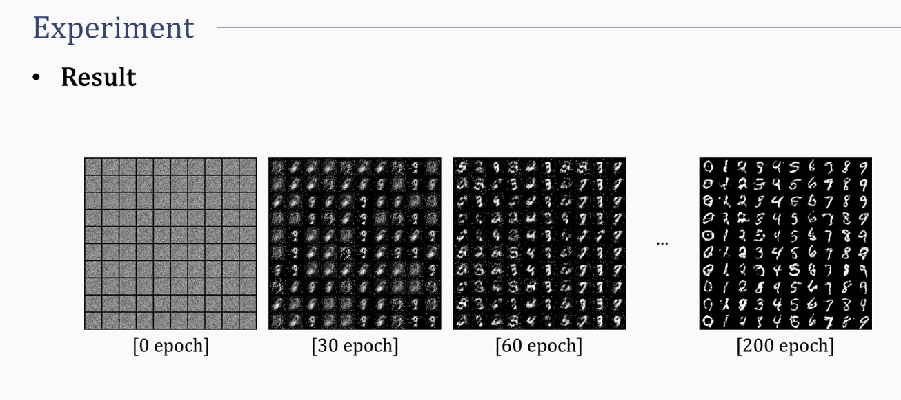
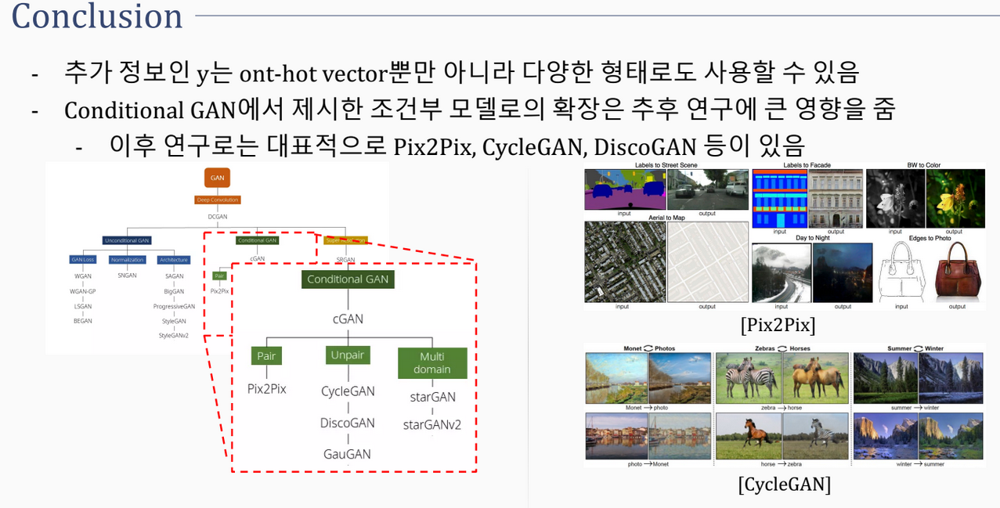

# Conditional Generative Adversarial Nets

*arXiv(2014), 11664 citation*

> [!TIP]
> **한 줄 요약** — Generator와 Discriminator 모두에 condition $y$(e.g., class label)를 추가 입력으로 넣어, 원하는 조건에 맞는 샘플을 생성하는 conditional GAN을 만든다.
>
> "Add Condition in GAN"

| 흐름 | 내용 |
|:--|:--|
| **문제** | 기본 GAN은 unconditional이라 생성되는 데이터의 종류(mode)를 제어할 수 없다 |
| **아이디어** | Condition $y$를 Generator와 Discriminator 양쪽에 함께 입력해 conditional min-max game으로 학습 |
| **결과** | Class label에 조건화된 MNIST 숫자 생성, 그리고 image tagging 같은 multi-modal 학습에 적용 가능함을 보임 |

   
  <b>Figure 1.</b> Conditional GAN 개요

---

## 1. 방법

## 2. 실험

## 3. 정리

## 참고

- [Paper](https://arxiv.org/abs/1411.1784) · 관련 리뷰: [GAN](../gan/README.md)
