# Generative Adversarial Nets

*NeurIPS(2014), 62818 citation*

> [!TIP]
> **한 줄 요약** — Generator와 Discriminator를 min-max game으로 경쟁시키는 adversarial training으로, Markov chain이나 approximate inference 없이 backpropagation만으로 data distribution을 학습하는 생성 모델을 만든다.
>
> "Adversarial Training with Discriminator and Generator" (Min-Max Game)

| 흐름 | 내용 |
|:--|:--|
| **문제** | 생성 모델 학습에 Markov chain이나 unrolled approximate inference network 같은 복잡한 절차가 필요했다 |
| **아이디어** | Data와 생성 샘플을 구분하는 Discriminator $D$와 $D$를 속이려는 Generator $G$를 min-max objective로 동시에 학습 |
| **결과** | 최적의 $D^*$는 $\frac{p_{data}(x)}{p_{data}(x)+p_{g}(x)}$, 최적의 $G^*$는 $p_{data}=p_g$이며 이때 loss가 최솟값 $-\log{4}$임을 증명 |

  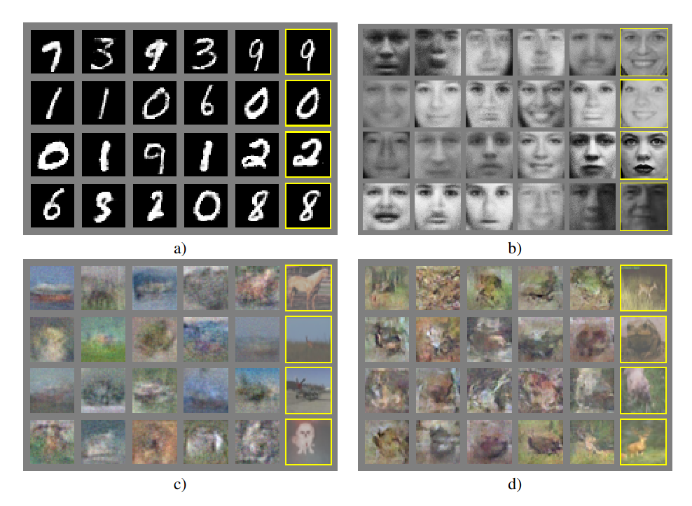 
  <b>Figure 1.</b> GAN 개요

---

## 1. 문제 정의 — 왜 이 논문이 필요한가

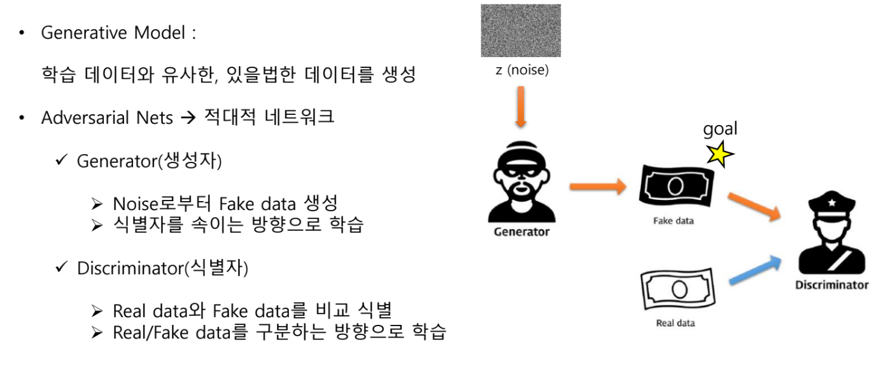

## 2. 방법

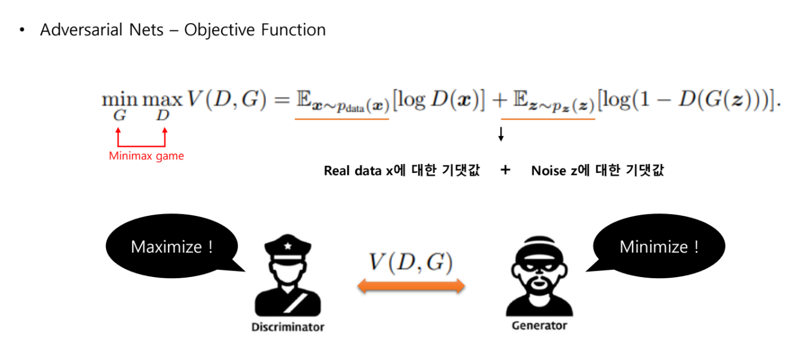

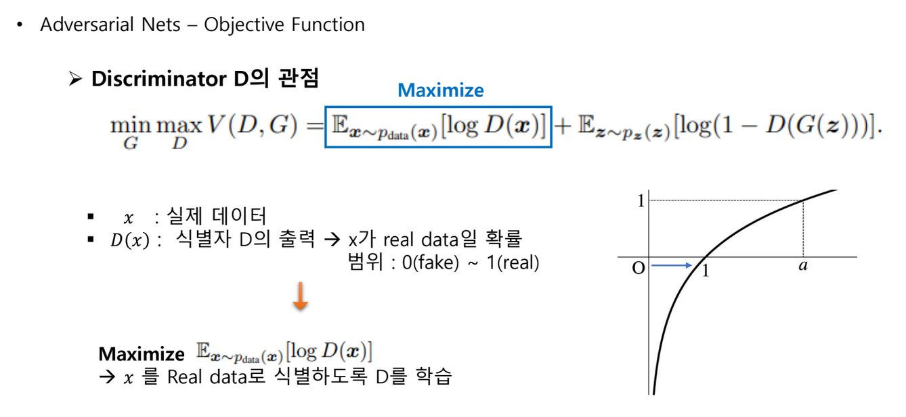

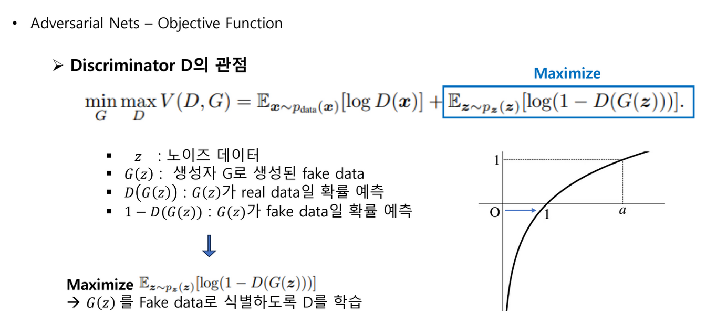

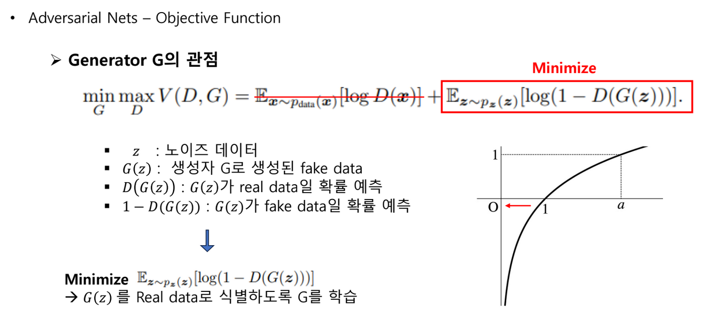

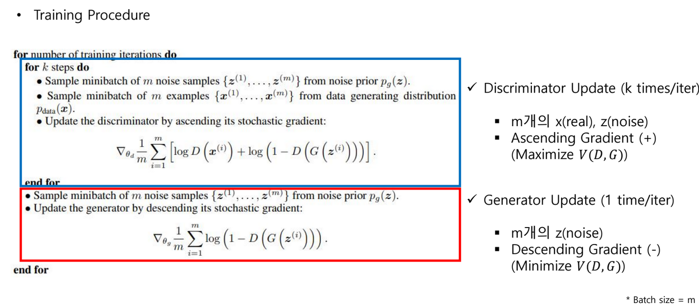

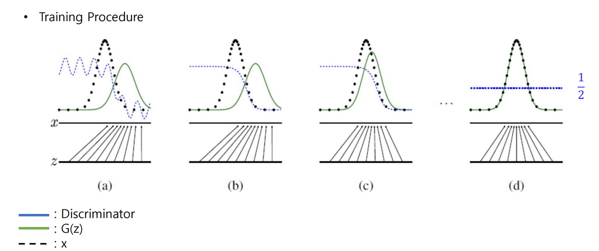

- **Optimal 한 상황을 가정하면, Discriminator 와 Generator 는 각각 어떤 값에 수렴하는가에 대한 증명**

- Discriminator 에 대해서 먼저 보면, loss function 에서 $x$ 에 대한 적분으로 묶어서 하나의 term 으로 볼 수 있다. 
- 이때, Discriminator 를 $y$ 로 치환하고 $y$ 에 대해서 미분 = $0$ 으로 계산하면, 다음의 수식을 만족할 때 최적의 $D^\*$ 인 것을 알 수 있다.

> [!IMPORTANT]
> **Optimal Discriminator**
>
> $$ D_{G}^*(x) = \frac{p_{data}(x)}{p_{data}(x)+p_{g}(x)} $$

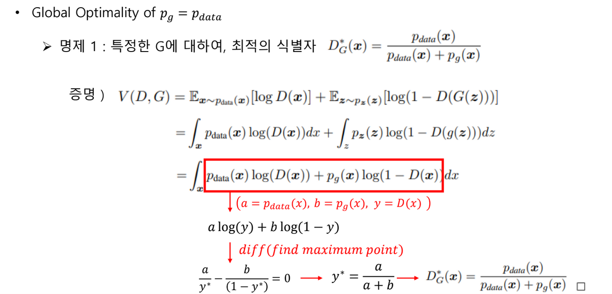

- $D^\*$ 로 고정하고, Generator $G$ 에 대해서 loss function 을 보면, 다음의 수식을 minimize 하는 것이 목적이 되고, $p_{data}(x)=p_{g}(x)$ 일 때, optimal $G^\*$ 인 것을 알 수 있다.

$$ G^*: \ p_{data}(x)=p_{g}(x) $$

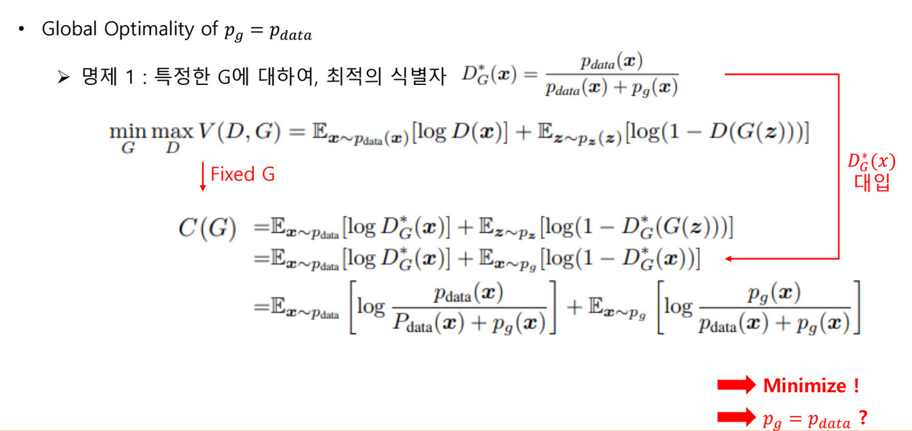

- 따라서, $G^\*$, $D^\*$ 일 때의 loss value 를 보면, $-\log{4}$ 일 때가 최솟값이다.

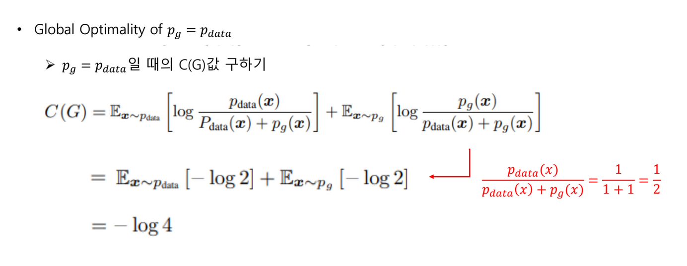

- 다음은 실제로 $-\log{4}$ 일 때가 최솟값인지 증명하는 수식이다.

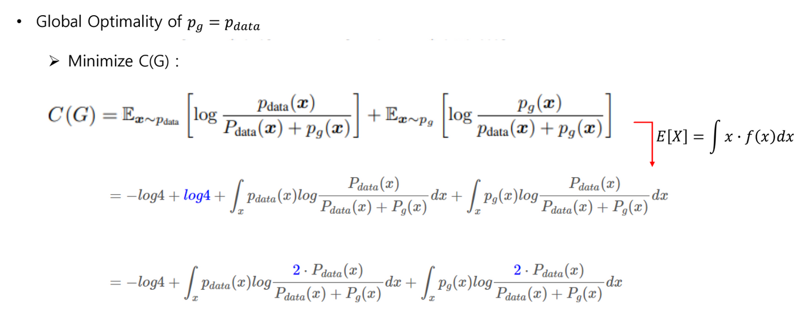

- $JSD$ 가 항상 $0$ 보다 큰 값을 가지니, $-\log{4}$ 일 때가 최솟값이라는 것을 알 수 있다. 

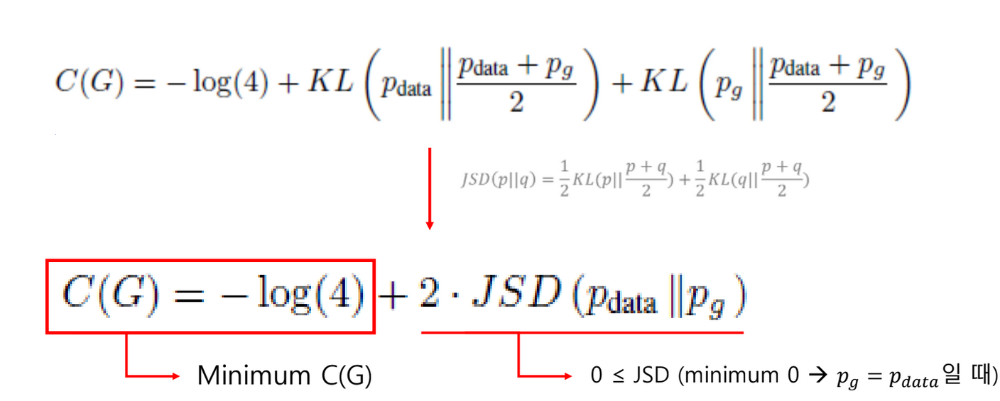

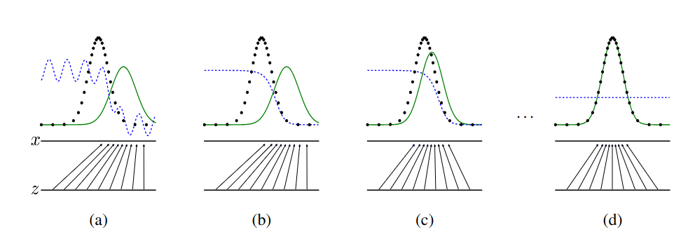

## 3. 실험

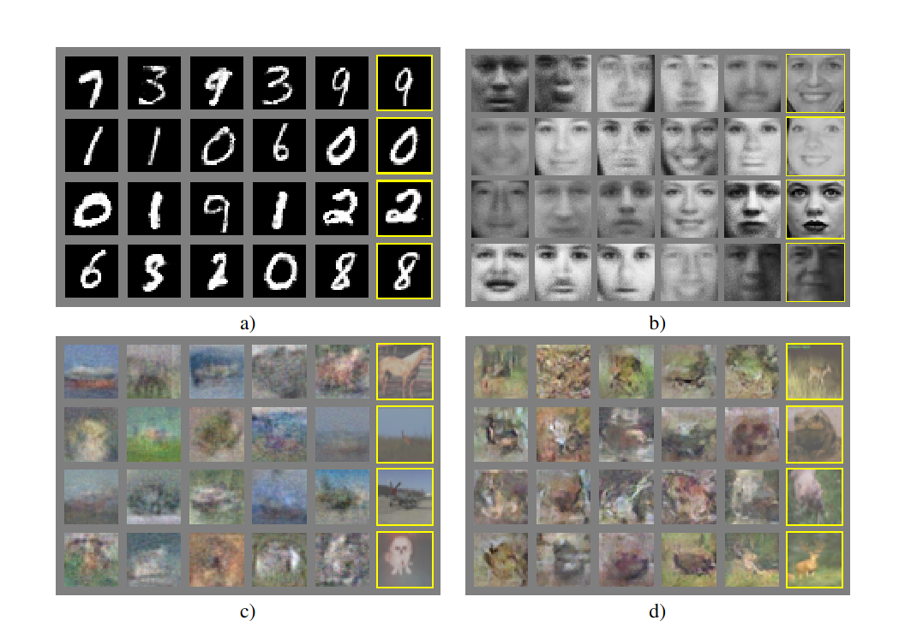

## 참고

- [Paper](https://arxiv.org/abs/1406.2661)
