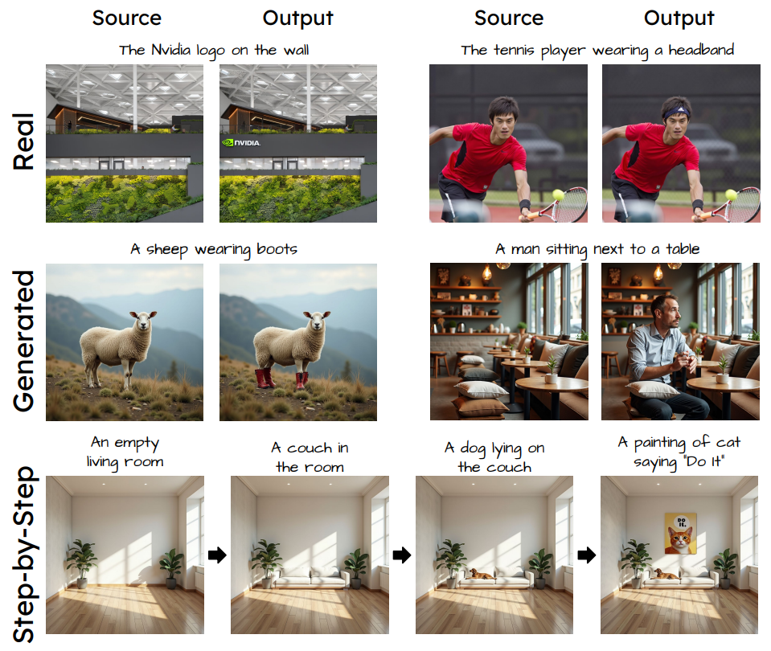
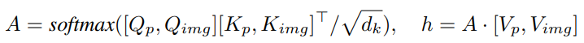

# Add-it: Training-Free Object Insertion in Images with Pretrained Diffusion Models

*ICLR(2025), 15 citation, NVIDIA, Review Data: 2025.10.16*

> [!TIP]
> **한 줄 요약** — MM-DiT(FLUX)의 attention을 scene image·text prompt·생성 이미지 정보를 함께 보도록 weighted extended-attention으로 확장해서, 학습 없이 원본 장면을 보존하면서 자연스러운 위치에 새 object를 삽입한다.
>
> **Core Idea** — "Weighted Extended-Attention Mechanism of Add-it Preserves a Structural Consistency and Fine Details While Ensuring Natural Object Placement"

| 흐름 | 내용 |
|:--|:--|
| **문제** | T2I diffusion 기반 편집은 adding object 성공률이 낮고, 대규모 editing dataset 학습 방식은 out-of data에 대한 generalization이 부족하며, 복잡한 장면에서 *affordance*를 이해해 자연스러운 위치에 넣기 어렵다 |
| **아이디어** | Training-free로 diffusion model의 attention mechanism을 확장해 생성 이미지, text prompt, scene image의 정보를 통합하는 weighted extended-attention |
| **결과** | Task-specific fine-tuning 없이 structural consistency와 fine details를 유지하면서, real/generated image insertion benchmark 모두에서 최고 성능 |

   
  <b>Figure 1.</b> Add-it object insertion 예시

---

## 1. 문제 정의 — 왜 이 논문이 필요한가

**배경.**

- Adding Object: text instruction을 기반으로 이미지에 새로운 object를 추가하는 것은 semantic image editing에서 어려운 작업이다. 이는, 원본 장면을 보존하면서 새로운 객체를 적절한 위치에 원활하게 통합하는 것 사이의 균형이 필요하다.
    - Creator는 복잡한 시각적 장면을 반복적으로 만들기위해 사용할 것이다.
    - Autonomous driving researchers는 그들의 car-perception system을 학습하기위해 새로운 시나리오에 보행자들을 넣고 싶을 것이다.

**기존 방법의 한계.**

- 몇몇 연구들은 최근 text-to-image diffusion model을 활용하여 이 task를 수행하고자 했다. 하지만 다양한 editing task를 잘 수행하는 반면 adding object의 성공률은 낮았다. 
- 이에 따라, 더 직접적인 learning approach를 통해 (training on large image editing datasets) 달성하려고 했지만 out-of data에 대해 generalization이 부족했다. 

- 광범위한 노력에도 불구하고, 기존의 모델들은 이 balance에 대해서 어려움을 겪고있는데, 특히 복잡한 장면에서 물체를 자연스러운 위치에 넣기가 어렵다. 
- Adding object task (Image Additing)를 수행하기 위해선 *affordance*를 이해해야한다. 이는 합리적인 위치로 object를 위치시키기 위해, 사람과 물체간의 상호작용의 deep semantic knowledge를 의미한다. 

**이 논문의 접근.**

- 본 논문에서는 생성된 이미지, text prompt, scene image로부터 정보를 통합하기 위해 diffusion model의 attention mechanism을 확장하는 training-free approach인 **Add-it**을 제안한다. 
    - 이 weighted extended-attention mechanism은 structural consistency와 fine details를 유지하면서 자연스러운 객체의 위치를 보장한다. 

> [!NOTE]
> **Contributions**
> - Task-specific fine-tuning없이 Add-it은 real and generated image insertion benchmark 모두 최고 성능을 달성했다. 

## 2. 방법

### Preliminaries: Attention in MM-DiT Blocks

- SD3와 FLUX와 같은 modern Diffusion Transformers (DiT)은 unified multi-modal self-attention blocks (MM-DiT blocks)를 통해 concatenated textual prompt와 image patch token를 처리한다. 
    - 구체적으로, FLUX는 $2$ 가지 타입의 attention block을 가진다
        - Multi-stream blocks: text와 image token에 대해서 분리된 projection matrices $W_K, W_V, W_Q$ 를 사용한다. 
        - Single-stream blocks: 같은 projection matrices를 사용한다. 
        - 두 가지 block 모두 concat된 token들에 대해서 attention을 계산한다. 
    - 주목할 점은, Flux는 여러 개의 Multi-stream 블록과 그 뒤를 잇는 Single-stream 블록들로 구성되어 있다는 것이다.

  

## 참고

- [Paper](https://arxiv.org/pdf/2411.07232)
