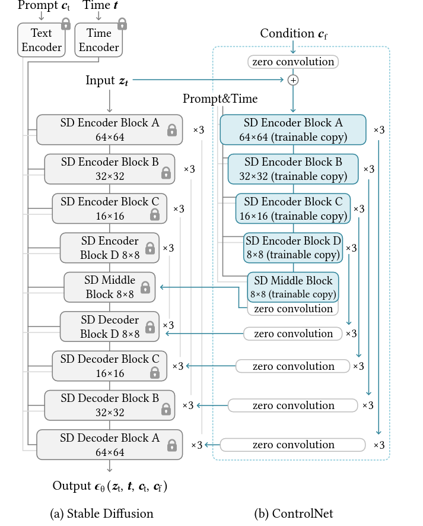

# ControlNet: Adding Conditional Control to Text-to-Image Diffusion Models

*ICCV(2023)*

> [!TIP]
> **한 줄 요약** — Stable Diffusion encoder block의 trainable copy를 만들고 zero convolution을 거쳐 원래 모델에 더해서, 사전학습된 text-to-image diffusion model에 edge·depth·pose 같은 spatial condition 제어를 추가한다.
>
> *Core Idea: "Trainable Copy and Zero Convolution"*

| 흐름 | 내용 |
|:--|:--|
| **문제** | Text prompt만으로는 생성 이미지의 공간적인 구도(spatial composition)를 정밀하게 제어하기 어렵다 |
| **아이디어** | 원래 모델은 고정하고 $12$개 encoding block과 $1$개 middle block의 trainable copy를 학습, zero convolution을 거친 출력을 U-Net의 skip connection과 middle block에 add |
| **결과** | 사전학습된 모델을 그대로 보존하면서 edge, depth, segmentation, human pose 등 다양한 condition으로 생성을 제어할 수 있다 |

   
  <b>Figure 1.</b> ControlNet 개요

---

## 1. 방법

- Zero Conv 가 SD encoder Block 마다 있다는 걸 유념해야 한다.
    - E.g., SD Encoder Block A 가 $3$ 개가 있다면 zero conv 도 $3$ 개가 있다.
    - Concat 이나 cross-attention 이 아닌 add 이다.

- Stable Diffusion 의 $12$ 의 encoding block 과 $1$ 개의 middle block 의 trainable copy 를 만든다.
    - $12$ 개의 block 은 각각 $3$ 개의 block 을 갖는 $4$ 개의 해상도 ($64 \times 64, 32 \times 32, 16 \times 16, 8 \times 8$) 로 이루어져 있다.
    - 출력은 U-Net 의 skip connection $12$ 개와 middle block $1$ 개에 추가 된다.

## 참고

- [Paper](https://arxiv.org/abs/2302.05543) · 관련 리뷰: [IP-Adapter](../../personalization-style/ip-adapter/README.md)
