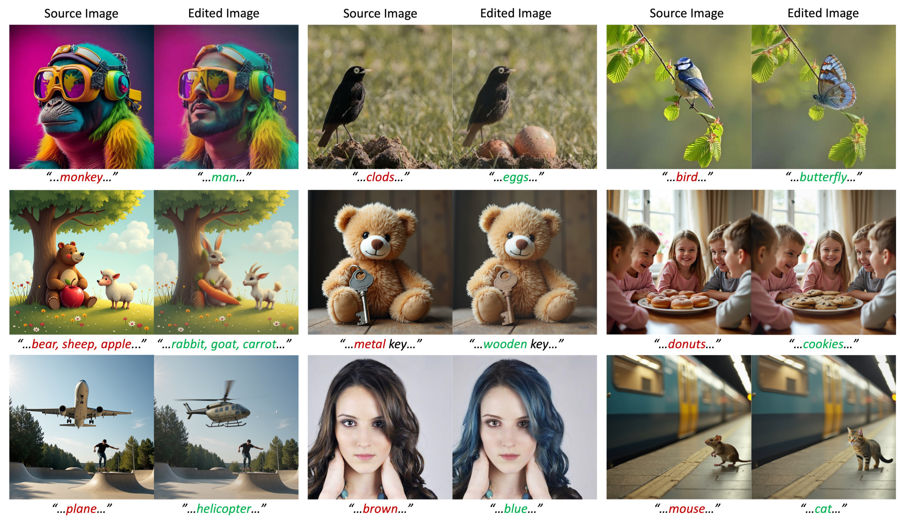
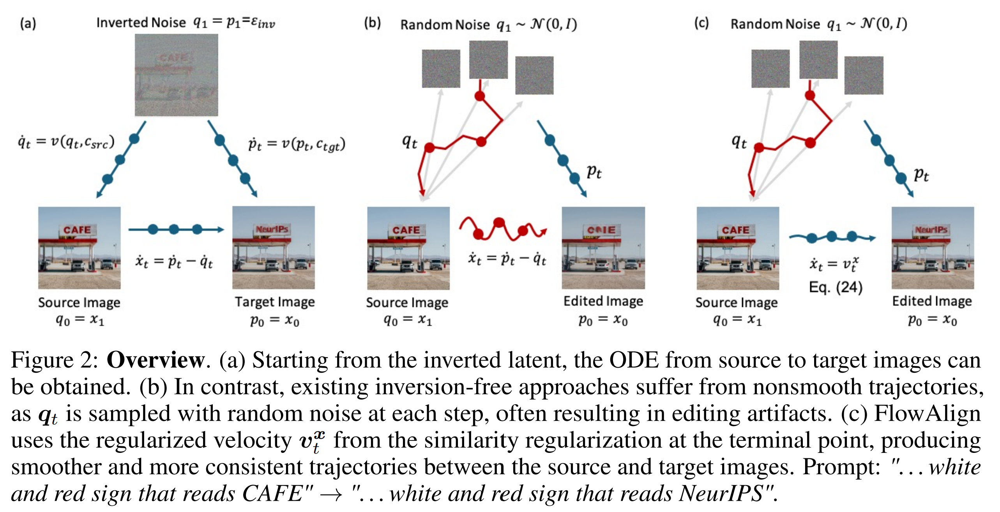

# FlowAlign: Trajectory-Regularized, Inversion-Free Flow-based Image Editing

*ICLR(2026), 21 citation, KAIST, Review Data: 2026.09.13*

> [!TIP]
> **한 줄 요약** — FlowEdit 같은 inversion-free flow 편집의 흔들리는 trajectory를, terminal point에서의 source similarity로 regularize해서 원본을 잘 보존하는 안정적인 편집을 만든다.

| 흐름 | 내용 |
|:--|:--|
| **문제** | Inversion-free flow 편집(FlowEdit)은 매 timestep 랜덤 noise sampling 때문에 편집 trajectory가 불안정하고 source consistency가 떨어진다 |
| **아이디어** | Optimal control 관점에서, Tweedie로 추정한 target/source clean image의 유사도를 regularization term으로 넣어 trajectory를 smooth하게 유도 |
| **결과** | 편집 강도와 원본 보존을 $\zeta$ 하나로 조절하면서, 더 일관된 inversion-free 편집 |

   
  <b>Figure 1.</b> FlowAlign 개요

---

## 1. 문제 정의 — 왜 이 논문이 필요한가

**배경.** Distribution 관점에서 image editing task는 source distribution을 target distribution으로 push-forward하는 continuous normalizing flow (CNF)로 해석할 수 있다.

**기존 방법의 한계.** FlowEdit과 같은 최근 inversion-free flow 기반 이미지 편집 방법은 SD3와 같은 사전학습된 noise-to-image flow model을 활용하여 ODE를 풀어 text-driven manipulation을 수행한다.
- 정확한 latent inversion이 필요하지 않다는 점은 장점이지만, 이로 인해 편집 trajectory가 불안정해지고 source consistency가 저하되는 경우가 많다.

**이 논문의 접근.** 이러한 한계를 해결하기 위해 본 논문은 optimal control 기반 trajectory control을 통해 일관된 이미지 편집을 수행하는 새로운 inversion-free flow 기반 framework인 **FlowAlign** 을 제안한다.
- 편집과정에서 보다 smooth하고 consistent한 trajectory를 유도하기 위해 terminal point에서의 source similarity를 regularization term으로 도입한다.

## 2. 사전 지식

- **FlowEdit** — 사전학습된 flow model로 inversion 없이 source → target ODE를 직접 푸는 편집 방법. FlowAlign의 3.2절까지는 FlowEdit과 동일하다. (관련 리뷰: [FlowEdit](../flowedit/README.md))
- **Tweedie's formula** — noisy sample $x_t$로부터 clean image의 posterior mean을 한 번에 추정.

## 3. 방법

### 3.1 표기와 전체 구조

- 본 논문에서는 $X_1$ 가 noise, $X_0$ 은 data이다. 즉 $1 \rightarrow 0$로 denoising
- $q$ 는 source, $p$ 는 target

  

- 3.2절까지는 FlowEdit과 동일하다. 하지만 여기서 FlowEdit의 문제점을 다음과 같이 얘기한다.
    - 매 timestep마다 epsilon을 random sampling하기에 $q_t$ trajectory가 충분히 smooth하지 않다는 점이다.
    - 이로 인해 Eq. 13을 이용해 $x_t$를 simulation할 때 error 가 발생한다.
    - 이를 완화하기 위해 FlowAlign은 terminal point에서의 structural similarity를 이용하는 explicit trajectory regularization을 제안한다.

### 3.2 Trajectory Regularization using Similarity at Terminal Point

- Random epsilon sampling 때문에 Eq. 13의 $x_t$ trajectory가 반드시 smooth하다고 보장할 수 없다.
- 따라서 FlowAlign의 목표는 smooth trajectory에서 벗어나는 움직임을 명시적으로 penalize하는 regularization을 포함한 ODE를 simulation하는 것이다.
- 즉, 지금 이 방향으로 계속가면 최종 clean image가 원본에서 너무 멀어지는 것은 아닌가?를 매 timestep마다 확인하는 것이다.
- Tweedie's denoising estimate를 통해 각 $q_t, p_t$를 source, target clean을 만들고 서로 비교하는 것이다. 만약 target edit이 적당하다면 같은 자세/배경을 가진 고양이 > 개가 될 수 있다. 하지만 trajectory가 이상하게 흔들리면 전혀 다른 자세, 배경, 구도가 될 수 있다.
- FlowAlign은 이때 target clean > source clean으로 correction을 준다.

> [!IMPORTANT]
> **편집 강도 vs 원본 보존**
>
> $\zeta$ 라는 weight를 도입하여 작은 값이면 editing을 강하게, 값이 크면 source preservation을 강하게 조절 할 수 있다.

## 참고

- [Paper](https://arxiv.org/pdf/2505.23145) · 관련 리뷰: [FlowEdit](../flowedit/README.md)
