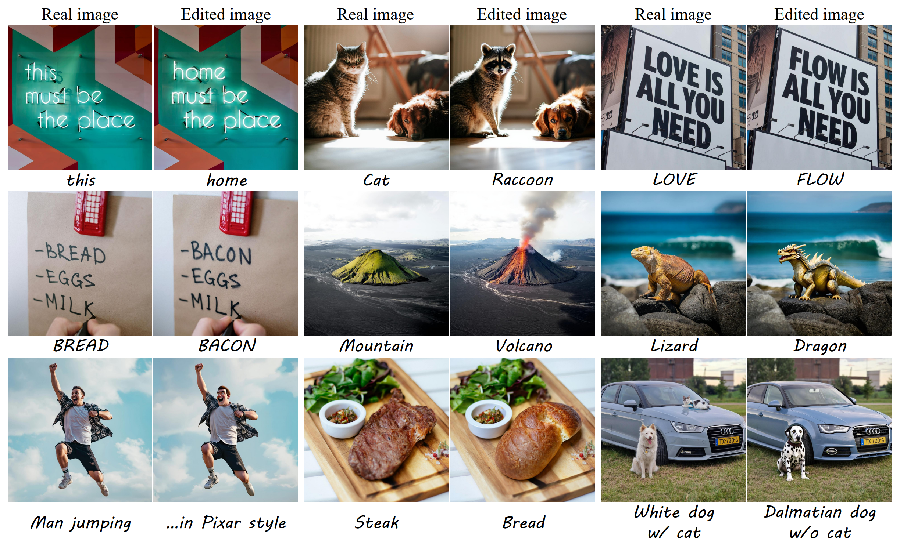
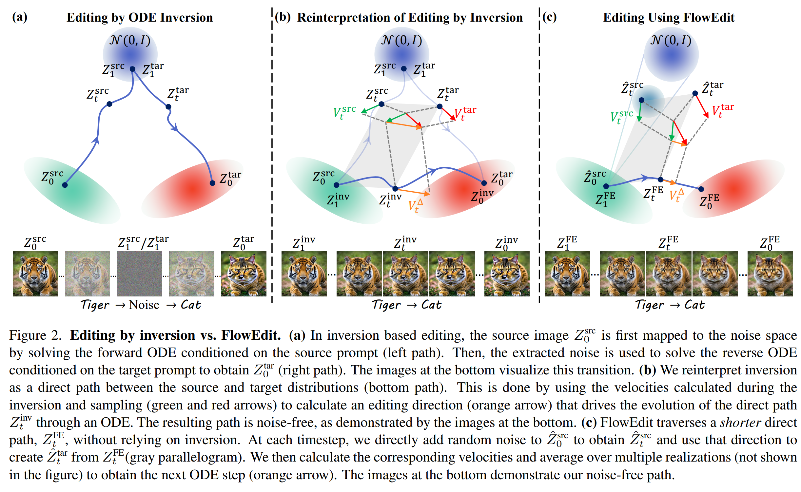
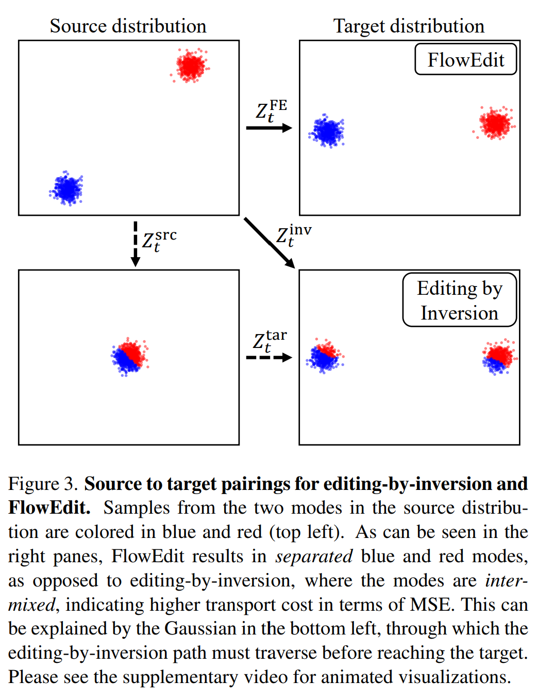
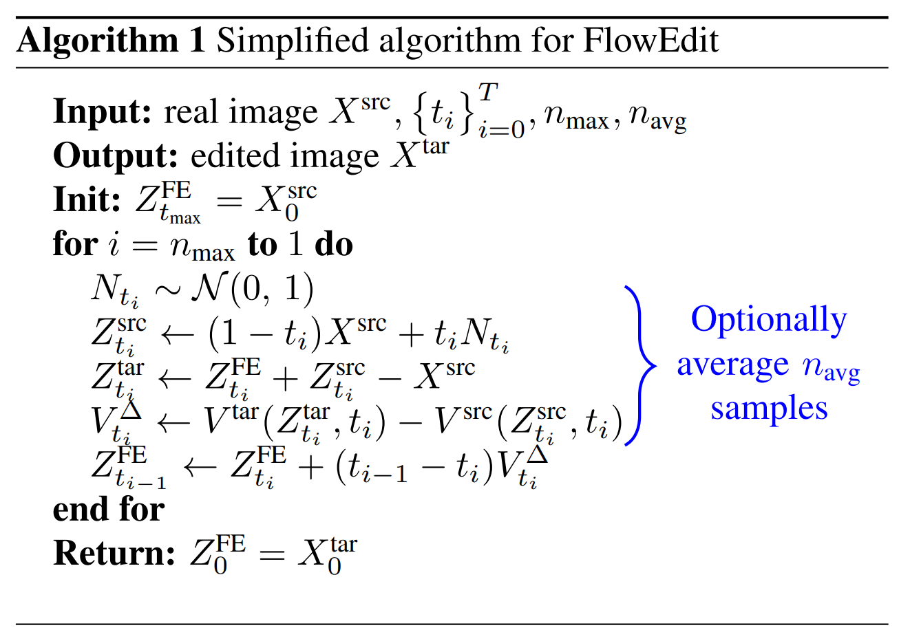

# FlowEdit: Inversion-Free Text-based Editing using Pre-trained Flow Models

*ICCV(2025), 196 citation, Israel Institute, Review Data: 2026.08.26*

> [!TIP]
> **한 줄 요약** — Source image를 noise로 inversion하지 않고, source distribution에서 target distribution으로 직접 가는 ODE를 구성해 사전학습된 flow model만으로 inversion-free·optimization-free·model agnostic 편집을 한다.

| 흐름 | 내용 |
|:--|:--|
| **문제** | Inversion 기반 편집은 inversion만으로는 결과가 부족해 attention map 재주입 등 sampling 개입이 필요하고, 이는 다른 모델 아키텍처에 그대로 적용하기 어렵다 |
| **아이디어** | 매 timestep 새 random noise로 source/target noisy sample을 만들고, 두 velocity의 차이 $V^{tar} - V^{src}$ 를 따라 source → target으로 직접 이동 (여러 noise에 대해 방향을 평균) |
| **결과** | Gaussian noise를 거치지 않는 noise-free path로 원본 구조를 더 잘 보존하며, SD3·FLUX에서 inversion 기반/inversion-free 방법 대비 SOTA 편집 성능 |

   
  <b>Figure 1.</b> FlowEdit 개요

---

## 1. 문제 정의 — 왜 이 논문이 필요한가

**기존 방법의 한계.**

- Pre-trained T2I diffusion/flow model을 이용해 image editing을 할 때는 일반적으로 해당 이미지를 그에 대응되는 noise map으로 inversion하는 과정이 필요하다. 
    - 하지만 inversion만으로는 만족스러운 결과를 얻기 어려운 경우가 많아서 많은 기존 방법들은 추가적으로 sampling 과정에도 개입한다. 
        - 모델 내부 표현 (e.g., attention map) 등을 sampling 과정에서 재주입
    - 이러한 방법들은 더 나은 결과를 얻을 수 있지만, 서로 다른 모델 아키텍처 사이에서 그대로 적용하기 어렵다.

**이 논문의 접근.**

- Inversion-free, optimization-free, model agnostic method
    - FlowEdit constructs an ODE that directly maps the source image distribution to the target image distribution (corresponding to the source and target prompts)

- Source distribution과 target distribution 사이의 직접적인 경로를 구성한다. 여기서 source와 target distribution은 각각 source text prompt와 target text prompt에 대응하는 분포를 의미한다. 

## 2. 방법

- 실제 이미지 $X^{src}$ 가 주어졌을 때, 이미지를 편집하기 위해 두 가지 프롬프트를 사용한다. 
    - $c_{src}$ : 원본 이미지를 설명하는 source prompt
    - $c_{tar}$ : 원하는 편집 결과를 설명하는 target prompt 

- 일반적으로는 사전 학습된 모델을 사용하여 inversion을 수행한다. 
    - (a): Source image를 초기 noise map으로 inversion 한 뒤, reverse ODE (target)을 사용한다. 즉, 초기 noise만 source initial noise map을 사용
    - (b):
        - (a)의 inversion 기반 편집은 source distribution > Gaussian noise distribution > target distribution의 과정이며 중간에 Gaussian noise distribution이 존재한다. 
        - 하지만, 이러한 과정은 사실 source distribution > target distribution을 직접 연결하는 하나의 경로로도 표현할수 있다. $Z_t^{inv}$ 
        - $Z_t^{inv} = Z_0^{src} + Z_t^{tar} - Z_t^{src}$
        - $t=1$ 에서 $t=0$ 으로 이동한다고 했을 때, $t=1$ 에서는 $Z_1^{inv}=Z_0^{src} = X_{src}$. 초기 노이즈 맵이 동일하다고 가정.
        - $t=0$ 에서는 $Z_0^{inv}=Z_0^{tar}$
        - 즉, Gaussian distribution을 거치지 않고 바로 target distribution까지의 path인 $Z_t^{inv}$를 구할 수 있다. 
        - 그리고 이 path의 update direction ($Z_t^{inv}$에서 어디로 가야하는지)은 미분해서 ($t$에 대해서) 계산하면 $V^{tar}(Z_t^{tar},t) - V^{src}(Z_t^{src}, t)$
        - 이 path의 특징은 noise-free, 즉 노이즈가 거의 없는 상태를 유지한다. 그 이유는 noisy image인 $Z_t^{tar}, Z_t^{src}$ 가 대략적으로 동일한 noise 성분을 가지고 있기 때문이다. 
        - 따라서 각각 source와 target distribution을 향하는 velocity vector인 $V^{tar}, V^{src}$는 동일한 noise component를 제거하여 결과적으로 두 clean image prediction 사이의 차이만 주로 남게 된다. 주황색 화살표가 바로 이 difference vector를 나타낸다. 
        - 이 말은 실제 source image를 inversion하여 실제 inversion trajectory를 만드는 것이 아닌, timestep마다 그냥 새 noise를 뽑아서 forwarding 후, 그 noisy latent/image를 model에 통과시켜서 velocity를 뽑으면 된다. 

- 추가로 (a)의 inversion 방식은 $Z_t^{src}, Z_t^{tar}$이 특정 초기 noise에 의해 묶여 있다. 따라서 source와 target이 pairing 되어 있는데, 문제는 반드시 이 pair가 좋은 pair가 아니라는 것이다. 
    - 즉, inversion이 만드는 연결 관계는 source와 가장 가까운 target이 아니라 그저 같은 initial noise에서 생성되는 target이다. 
    - 고양이 이미지의 구도와 가장 비슷한 강아지가 있는데도 inversion으로 인해 구조가 다른 강아지가 나올 수 있다.

- 따라서, FlowEdit은 특정 noise하나가 source-target pairing을 결정하는 게 아니라, 여러 random noise에서 target으로 가야 할 방향을 평균낸다. 
    - FlowEdit은 실제 inversion을 하지 않고 noisy latent/image를 만들기 위해 그저 $t$ 수준에 맞는 random noise만 섞으면 된다. 즉, source image에서 inversion해서 얻은 noise가 아니라 그냥 새로 랜덤 샘플링한 noise
    - 그래서 같은 timestep에서도 여러 source 후보를 만들 수 있다. 

- 그럼 target의 noisy sample은 어떻게 만드느냐
    - $Z_t^{tar} = Z_t^{inv} + Z_t^{src} - Z_0^{src}$ 이고
    - $t=0$을 먼저 대입하면, $Z_0^{inv}=Z_0^{src}$

## 참고

- [Paper](https://arxiv.org/pdf/2412.08629) · 관련 리뷰: [FlowAlign](../flowalign/README.md)
