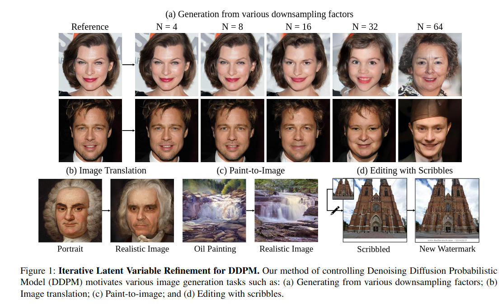
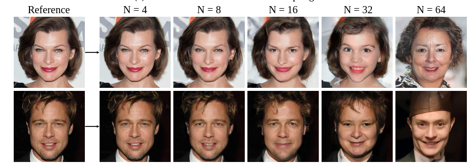
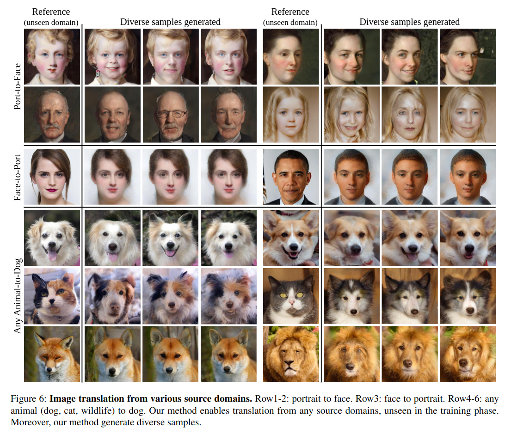
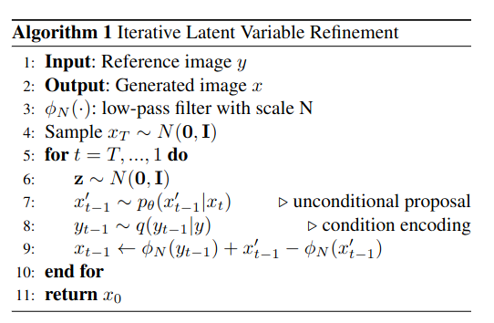
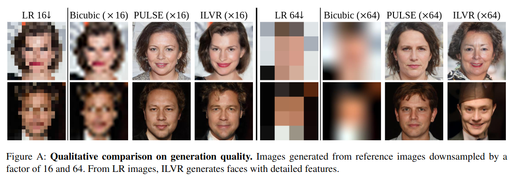

# ILVR: Conditioning Method for Denoising Diffusion Probabilistic Models

*ICCV(2021), 317 citation*

> [!TIP]
> **한 줄 요약** — 매 reverse step마다 생성 중인 이미지의 low frequency를 reference image의 low frequency로 교체해서, 추가 학습 없이 사전학습된 DDPM으로 reference의 다양한 variation을 생성한다.
>
> **Core Idea** — "Image Variation with Replacing Low Frequency"

| 흐름 | 내용 |
|:--|:--|
| **문제** | 무조건부 DDPM은 stochastic한 생성 과정 때문에 원하는 semantics를 가진 이미지를 만들도록 제어하기 어렵다 |
| **아이디어** | Iterative Latent Variable Refinement: low-pass filter $\phi_N$으로 $x_{t-1}$의 low frequency만 perturb된 reference $y_{t-1}$의 것으로 바꾸고 high frequency는 model이 생성 |
| **결과** | 추가 학습 없이 reference의 coarse structure를 유지한 variation 생성, unseen domain 이미지의 translation까지 가능하며 downsampling factor $N$으로 보존 정도를 조절 |

   
  <b>Figure 1.</b> ILVR 개요

---

## 1. 문제 정의 — 왜 이 논문이 필요한가

- Image 의 variation 을 만들고자 한다. Iterative Latent Variable Refinement (ILVR) 을 통해 reference image 가 주어졌을 때, reference image 의 high-resolution variation 을 생성한다. 
- 추가적인 학습이 필요없다. 

## 2. 방법

- Image 의 low resolution 을 base 로 image variation 을 만들고자 했다.

- 중요한 hyper-parameter 는 downsampling 을 얼마나 할 것이냐이다. 

  

- Unseen domain 으로부터 온 image 도 image translation 도 할 수 있다. 이때, 당연하게도 diffusion model 이 학습한 분포로 끌고온다.
    - 강아지 데이터 분포를 학습한 diffusion model 이라면, 고양이 이미지가 들어왔을 때 coarse structure 는 유지하면서 강아지로 탈바꿈할 것이다. 

  

- Algorithm
    - 1. Standard Gaussian Noise 에서 sampling 해서 초기 noise 로 시작한다.
    - 2. Diffusion model 과 Reverse process 를 통해 noisy image 에서 less noisy image 를 만든다.
    - 3. Forward process 를 통해 reference image 에 perturbation 을 준 $y_{t-1}$ 을 만든다. (None model)
    - 4. $x_{t-1}$ 과 $y_{t-1}$ 을 low-pass filter $\phi_N(-)$ 에 통과시켜 low frequency 를 만든다.
    - 5. High frequency 는 그대로 두고, low frequency 만 reference image 의 low frequency 로 교체한다. 
        - Replace LF (low frequency)
    - 직관적으로 봤을 때, reference image 의 low frequency 를 유지하면서 high frequency 만 생성하기 때문에 다양한 variation 이 생성될 수 있다.
    - 하지만, low-pass filter 의 $N$ 을 크게 준다면 reference image 의 정보가 많이 사라지기에 아예 다른 이미지가 생성될 수 있다. 

  

## 3. 실험

- Low-pass filter 로 너무 많은 정보를 없애면 reference image 가 보존되지 않는다.

  

## 참고

- [Paper](https://arxiv.org/pdf/2108.02938.pdf)
