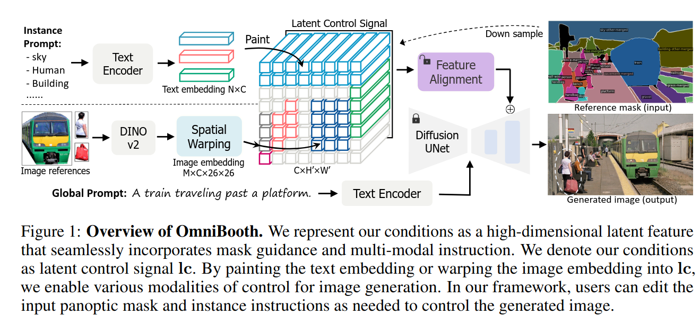
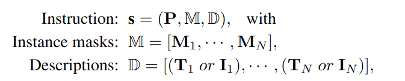
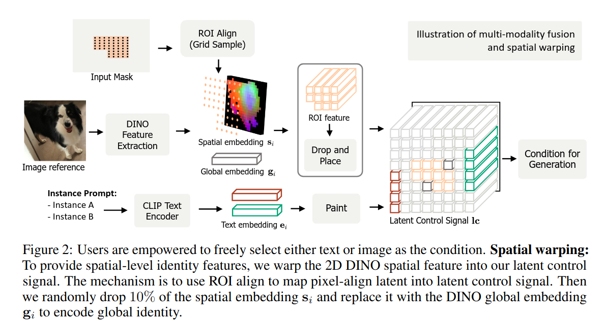

# OmniBooth: Learning Latent Control For Image Synthesis with Multi-Modal Instruction

*arXiv(2024), 0 citation, HKUST (홍콩과기대), Review Data: 2024.10.09*

> [!TIP]
> **한 줄 요약** — User mask마다 text 또는 image instruction을 받아 공간·텍스트·이미지 조건을 하나의 고차원 latent control signal($lc$)로 통합하고 향상된 ControlNet으로 학습해서, instance-level spatial control이 가능한 multi-modal 이미지 생성을 한다.
>
> **Core Idea** — "Image Generation Framework that Enables Spatial Control with Instance-Level via Multi-Modal"

| 흐름 | 내용 |
|:--|:--|
| **문제** | Global text description은 정확하고 복잡한 layout/shape을 표현하기 어렵고, ControlNet·GLIGEN 같은 image condition 방법은 instance-level visual character를 세밀하게 조작하기 힘들다 |
| **아이디어** | Instance별 mask와 CLIP text embedding 또는 image reference(spatial warping으로 인코딩)를 latent control signal $lc$로 통합하고, latent input의 feature alignment를 학습하는 향상된 ControlNet 사용 |
| **결과** | User-defined mask set과 text/image guidance로 특정 위치에 다수의 물체를 생성하며, text로 개체 수준 open-vocabulary 생성, image로 개인화된 identity 제어가 가능 |

   
  <b>Figure 1.</b> OmniBooth 개요

---

## 1. 문제 정의 — 왜 이 논문이 필요한가

**배경.**

- Diffusion model로 인해 image generation은 큰 발전을 이뤘다. 
- User는 원하는 위치에 특정 객체를 생성하고 싶다. 하지만, text-to-image 문맥에서 user는 원하는 이미지를 global text description으로 생성해야 한다. 이는 시각적 환경에서 coarse description만을 제공한다. 언어를 사용해 정확하고 복잡한 layout이나 shape을 표현하기에는 어려움이 있다. 

**기존 방법의 한계.**

- 이전의 work들은 spatial control을 제공하기 위해 image condition을 이용했다. 하지만 이는 instance-level customization을 제공하는 데 한계가 있다. 
    - ControlNet과 GLIGEN은 다양한 조건의 signal (semantic mask, bounding box layout, depth map)을 사용하지만 instance-level visual character를 조작하는 fine-grained description과 정확한 제공은 힘들다.

**이 논문의 접근.**

- OmniBooth: spatial control을 multi-modal을 이용해 instance-level로 가능하게 하는 framework
    - Text prompt나 image reference를 통해 multi-modal instruction이 가능하다. 
    - User-defined mask set과 관련된 text/image guidance가 주어지면 특정 위치에 다수의 물체를 생성하는 게 목적이다. 
    - 본 논문의 핵심 기여는 latent control signal ($lc$)에 있다. 이는 고차원 공간적 특징으로, 공간적, 텍스트, 이미지 조건을 통합적으로 연결하는 통합된 표현을 제공한다. 
    - Text condition은 ControlNet을 확장하여 개체 수준의 개방형 어휘 생성을 가능하게 한다. 
    - Image condition은 더 나아가 개인화된 정체성으로 세밀한 제어를 가능하게 한다. 
        - Image modality는 더 복잡한 구조를 포함하고 있으므로 공간 왜곡 (spatial warping)을 제안하여 불규칙한 image identity를 $lc$에 인코딩하고 변환한다. 
    - Latent input의 feature alignment를 학습하기 위해 향상된 ControlNet framework를 개발했다.

## 2. 방법

  

### Problem Definition

- $\mathbf{P}$: global prompt
- $\mathbf{M}_i$: a binary mask of each instance that indicates their spatial location
- $D$: instance description
    - $\mathbf{T}_i$: text description of each instance
    - $\mathbf{I}_i$: image description of each instance

  

### Text Embedding

- Textual description $\mathbf{T}_i$가 주어졌을 때, CLIP text encoder를 사용해 textual embedding을 추출한다. 
    - The output (textual embedding) is a 1D embedding $e_i \in \mathbb{R}^{1024}$
    - 생성되는 이미지의 전체 feature map과 상호작용하는 global prompt $g_i$와는 다르게 지역적 control을 위한 instance prompt이다. 

  

## 참고

- [Paper](https://arxiv.org/pdf/2410.04932)
