# PaintBench: Deterministic Evaluation of Precise Visual Editing

*arXiv(2026), 0 citation, New York University, Review Data: 2026.06.28*

> [!TIP]
> **한 줄 요약** — 정답이 정확히 하나인 편집 문제를 rule-based 코드로 절차적으로 생성하고 pixel-level로 결정론적으로 채점하는 정밀 visual editing benchmark를 제안해, 최신 이미지 편집 모델들도 정밀 편집에 크게 실패함을 보인다.

| 흐름 | 내용 |
|:--|:--|
| **문제** | 기존 image editing benchmark는 사람 판단이나 VLM·perceptual metric(SSIM, LPIPS, FID) 기반 평가에 의존하고 single correct answer가 없어, 평가가 정확한 검증보다 선호도에 가깝다 |
| **아이디어** | Random seed + parameter configuration으로 (입력 이미지, 지시문, 유일한 정답 이미지)를 생성하는 4개 범주·20개 task·8개 시각적 조건(총 1,920 문제)의 benchmark와, LAB 색공간 허용 오차 $t$ 기반 CE/IE/CP/IP 픽셀 분류 및 mIoU 평가 |
| **결과** | 11개 모델 중 최고인 NB-2도 mIoU 17.1%에 그쳤고, 기하학적 변환·색상 계산 작업과 과도한 편집(over-editing)이 공통 약점. 차트 편집 benchmark TinyGrafixBench 성능과 강한 선형 상관관계 |

**Core Idea:** 한 개의 답만이 존재하는 결정론적 image editing benchmark 제안

  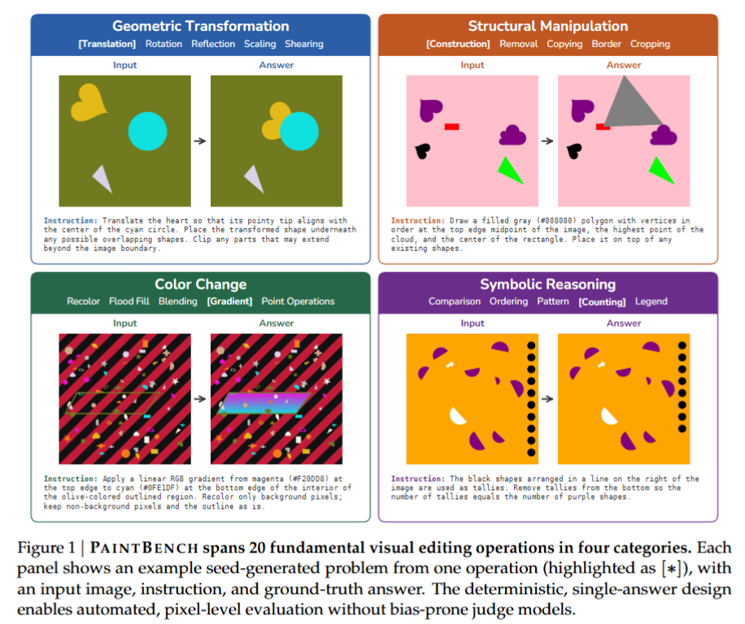 
  <b>Figure 1.</b> PaintBench 개요

---

## 1. 문제 정의 — 왜 이 논문이 필요한가

- 최근 멀티모달 모델은 자유로운 형식의 시각적 편집에는 능숙하지만, 정밀하고 단일한 결과값을 요구하는 편집을 수행하는 것은 여전히 중요한 난제로 남아있다. 
    - 이러한 과제를 탐구하기 위해, 본 논문은 기하학적 변환, 구조적 조작, 색상 변경, 기호적 추론 등 4가지 범주에 걸쳐 20가지의 기본적인 정밀 시각 편집 작업을 다루는 동적 확장 가능 벤치마크인 PaintBench를 도입한다. 
        - 즉, 한 카테고리마다 5가지의 세분화된 task가 존재한다. e.g., `Geometric transformation: [Translation, Rotation, Reflection, Scaling, Shearing]`
    - 복잡도 설정이 가능한 절차적 생성을 통해 사실상 무한하며 오염 방지 기능이 있는 평가 제품군을 구축했으며, 결정론적 픽셀 수준 평가를 통해 편향되기 쉬운 판단 모델에 대한 의존성을 제거했다. 
    - 11개의 이미지 편집 모델을 대상으로 수행한 결과, 전반적으로 낮은 성능을 보였으며 SoTA model 조차 17.1% (mIoU)의 점수를 기록하는 데 그쳤다. 작업 분해를 통해 특히 어려운 작업 유형 (기하학적 변환, 대부분의 구조적 조작, 수식 기반 색상 변경)과 모델별 특화 영역을 확인했다. 

- PaintBench 점수가 실제 작업 성능으로 일반화되는지 테스트하기 위해 데이터 시각화 편집을 위한 절차적 결정론적 평가 TinyGrafixBench를 만들었으며, PaintBench 점수와 강한 선형 상관관계가 있음을 확인했다. 

- 기존의 image editing benchmark는 사람의 판단이나 vision-language model과 perceptual metrics (e.g., SSIM, LPIPS, FID)를 통한 model-based evaluation 에 크게 의존한다. 하지만, 이는 single correct answer가 없다. 
    - `make the sky more blue` 는 무한한 output을 허용한다. 따라서 평가는 정확한 검증 보다는 선호도에 더 가깝다. 
    - 그러나 많은 editing task에는 고유한 정답이 존재하며, 이 경우 모델 기반 eval이나 인간의 판단에서 비롯될 수 있는 잠재적 편향 없이 결정론적으로 평가를 수행할 수 있다. e.g., 도형을 오른쪽으로 50 pixel 이동, 도형 중 가장 작은 개체 제거 
    - 이러한 작업들은 현재의 다중 모달 모델들에게는 결코 쉬운 task가 아니다.

- PaintBench는 절차적 방식으로 문제를 생성한다: random seed + parameter configuration을 통해 input image, natural-language instruction, unique correct answer를 생성한다. 

## 2. 방법

- 각 문제는 seed를 기반으로 생성된 (입력 이미지, 지시문, 답 이미지)로 구성된다. 
    - Scene은 단색 또는 줄무늬 배경 위에 렌더링된 다양한 유형과 색상의 기하학적 도형으로 구성된다.
    - 20개의 task가 있고, 각 task마다 8가지의 시각적 조건별로 12개의 문제를 생성하여 총 1,920 개의 문제가 있다. (20 x 8 x 12)

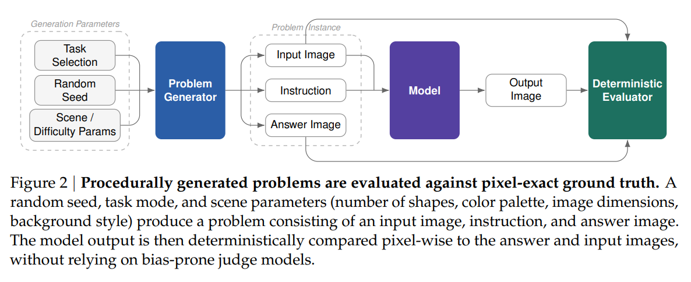

### Design Principles

- 모든 문제는 정확히 하나의 정답 이미지를 가진다. 이 정답 이미지는 input image와 description에 대해 결정론적 변환을 통해 생성된다. 따라서, 평가는 모델의 출력을 정답 이미지 및 입력 이미지와 pixel-level로 직접 비교하는 방식으로 수행된다.
    - 별도의 평가 모델, perceptual metric 또는 평가의 모호성이 존재하지 않는다. 

- 동적 생성: 문제는 무작위 시드를 기반으로 절차적으로 생성되므로, 새로운 문제 세트를 필요할 때마다 생성할 수 있다. 이를 통해 모델이 문제를 암기하거나 데이터 오염이 발생하는 것을 방지한다. 

- 난이도 제어: 각 작업은 캔버스 크기, 객체 개수, 배경 텍스처, 색상 팔레트와 같은 명시적인 매개변수를 제공하며, 이를 조절하여 다양한 장면 조건을 구성할 수 있다. 

### Task Categories

- 네 가지 범주로 구성된 총 20개의 task를 포함한다. 
    - 기하학적 변환: 이동, 회전, 반사, 크기 조절, 전단을 포함하며, 도형의 affine transformation 능력을 평가한다. 
    - 구조적 조작: 생성, 제거, 복사, 테두리 추가, 크롭을 포함하며, 요소의 추가·삭제 및 장면 구성 변경 능력을 평가한다. 
    - 색상 변경: 재색칠, 플러드 필, 블렌딩, 그라디언트, 점 연산을 포함하며, 픽셀 색상값을 조작하는 능력을 평가한다.
    - 상징적 추론: 비교, 정렬, 패턴, 계수, 범례를 포함하며, 실행 전에 공간적 또는 수치적 추론이 필요한 편집을 평가한다. 

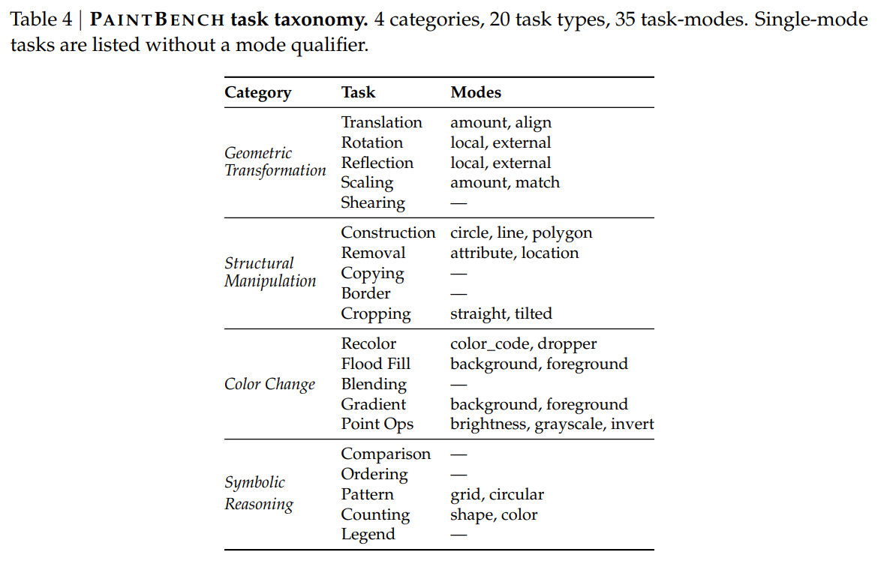

### Visual Conditions

- 모든 task는 8가지 시각적 조건에서 평가되며, 각 조건은 기준 조건에 비해 정확히 하나의 장면 매개변수만 변경한다. 
    - 기준 조건은 $1024 \times 1024$ 해상도, 도형 수는 $n=3$, 표준 색상 팔레트, 단색 배경으로 설정된다. 
    - 모델 성능이 조건을 바꿨을 때 떨어졌다면, 왜 떨어졌는지 알아야 한다. 따라서 항상 하나의 변수만 변경한다.

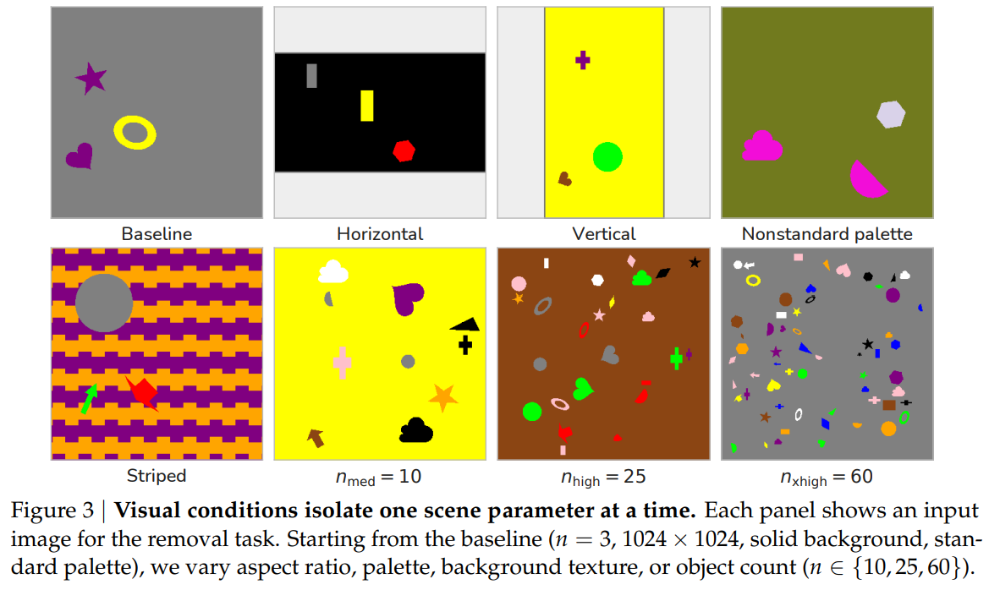

- 8개의 조건임을 확인할 수 있다. 

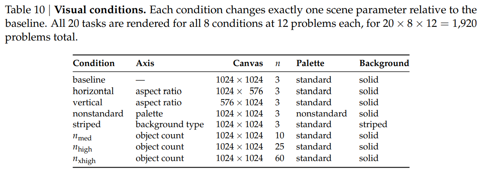

- PAINTBENCH의 Ground Truth는 생성 모델(Diffusion, GPT-Image 등)이 만든 것이 아니라, 규칙 기반(rule-based) 코드가 생성한 이미지이다. 
    - E.g., `Move the red circle 100 pixels right.` $\rightarrow$ `circle.x += 100`

## 3. 실험

- Input image와 GT 이미지 간의 XOR 연산을 해서 변경된 영역 및 보존 영역 표시

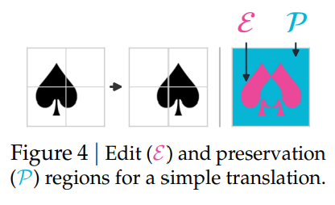

- Model이 output을 생성하면 GT와 비교를 한다. 
    - 단순히 RGB space 상에서의 비교는 아니고, LAB color space에서의 거리를 본다. 
    - $\Delta E_{76}^* > 10$ 일때 색깔이 구분된다. 
    - 이를 $t$를 기준으로 구역을 나눈다. E.g., $t=1, \Delta E_{76}^* \leq1$ 의 의미를 가진다. 

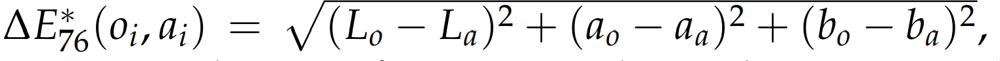

- 논문은 모든 픽셀을 CE/IE/CP/IP로 구분한다. 
    - CE: Correct Edit, 수정해야 하는 영역을 잘 수정함
    - IE: Incorrect Edit, 수정해야 하는데 틀림
    - CP: Correct Preservation, 수정하면 안 되는 영역을 잘 보존함 
    - IP: Incorrect Preservation, 수정하면 안 되는 곳을 수정함
    - 논문은 IoU를 기준으로 계산한다. $IoU = \frac{CE}{CE + IE + IP}$

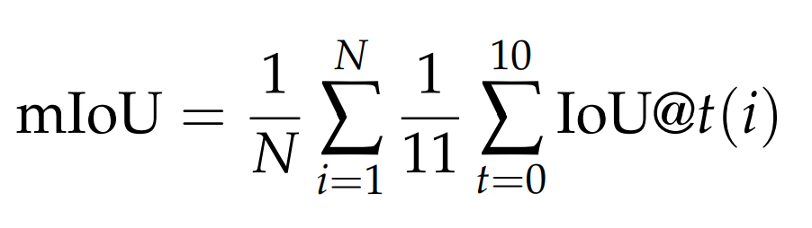

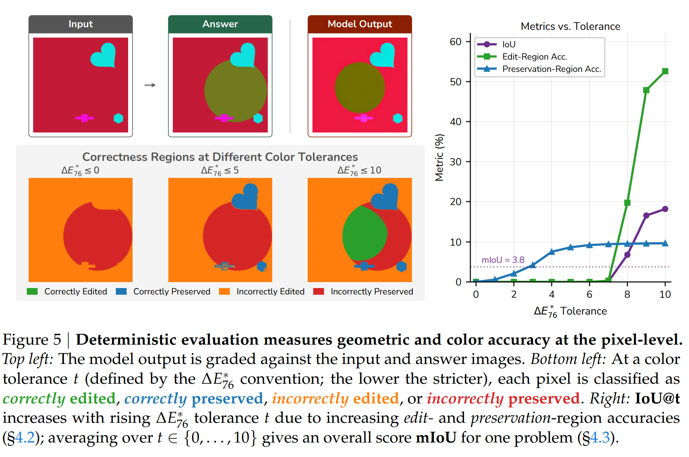

- 11개의 모델을 PaintBench에 대해서 평가를 진행했고, 작업 유형별 난이도와 모델별 전문성, 공통적인 실패 유형, 장면(Scene) 변화에 대한 민감도, 대부분의 모델에서 나타나는 과도한 편집(Over-editing) 경향의 관점에서 결과를 분석한다.
    - 각 모델은 각 문제당 하나의 출력 이미지만 생성하여 평가했다. 

- 총 1,920 개의 PaintBench 문제에서 각 모델의 mIoU를 task별로 나타낸 것이다.
    - 가장 높은 성능을 보인 모델은 NB-2였지만, mIoU는 17.1%에 불과했다. 
    - 흥미로운 점은 80B 규모의 가장 큰 공개 모델인 HY-3조차 거의 모든 작업에서 0%에 가까운 성능을 보였다는 것이다. 
    - 즉, 단순히 모델 크기가 크다고 해서 정밀한 이미지 편집 능력이 뛰어난 것은 아니었다. 또한 단순 평균 성능만으로는 모델의 특성을 충분히 설명할 수 없으며, 작업별 성능을 살펴보면 작업 유형 난이도 차이와 모델별 전문성이 명확하게 드러난다. 
    - 기하학적 변환은 모든 모델에서 일관되게 어려운 작업이였다. 
    - 구조적 조작 역시 대부분 어려운 편이였는데 특히 gradient, blending, point operations와 같은 색상 변경 작업은 단일 색상을 채우는 작업과 달리 픽셀마다 서로 다른 색상을 계산해야 해서 모든 모델에서 매우 낮은 성능을 기록했다.
    - GPT-IMAGE-2와 NANO-BANANA-2는 서로 다른 분야에 특화되어 있다. 두 최고 성능 모델은 네 개의 작업 범주를 서로 나누어 강점을 보였다. GPT-I2는 기하학적 변환, 구조적 조작에서 우수하였다.
    - 반면 NB-2는 색상 변경, 상징적 추론에서 더 높은 성능을 보였다.

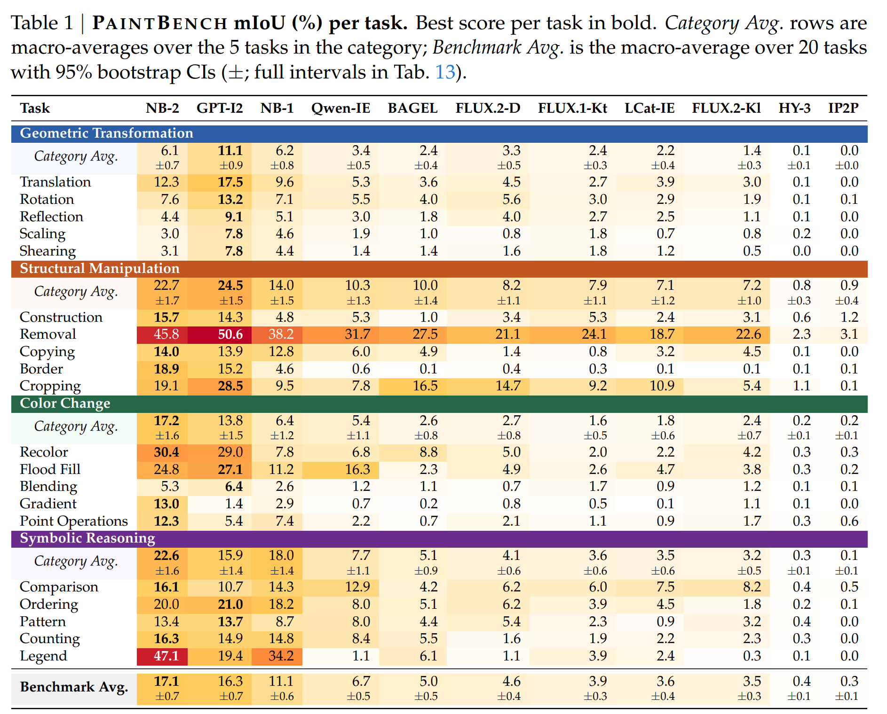

- 네 가지 공통적인 실패 유형 
    - 단순한 mIoU가 아니라, 색상 허용 오차 $t$ 에 따른 성능 곡선을 분석하면 각 모델이 어떤 방식으로 실패하는지 살펴볼 수 있다. 
    - 색상 부정확 (Color Imprecision)
        - 편집 자체는 올바르게 했지만, 출력 색상이 목표 색상과 정확히 일치하지 않는 경우이다. 
        - $\Delta E_{76}^* = 0$ 에서는 정확도가 거의 0에 가깝지만, 허용 오차를 늘리면 정확도가 급격히 상승하는 경우이다. 
    - 편집 수행 실패 (Execution Omission)
        - 편집 영역의 정확도는 모든 허용 오차 $t$에서 거의 0에 머물지만, 보존 영역의 정확도는 매우 높은 경우
        - 원본 이미지를 거의 그대로 출력한 경우이다.
    - 구조적 붕괴 (Structural Catastrophe)
        - 모델의 출력이 입력 이미지와 정답 이미지 모두와 크게 다른 경우이다. 
        - 이 경우, 편집 영역 정확도, 보존 영역 정확도, 전체 정확도가 모두 0에 가까운 값을 보인다. 
    - 구조적 부정확 (Structural Imprecision)
        - 모델이 올바른 편집을 시도했지만, 위치나 형태가 부정확한 경우이다. 
        - 편집 영역 정확도는 중간 수준에서 머무르며, $t$를 증가시켜도 성능이 거의 향상되지 않는다. 
        - 즉, 문제는 색상이 아니라 구조적 위치 오차라는 것이다. 

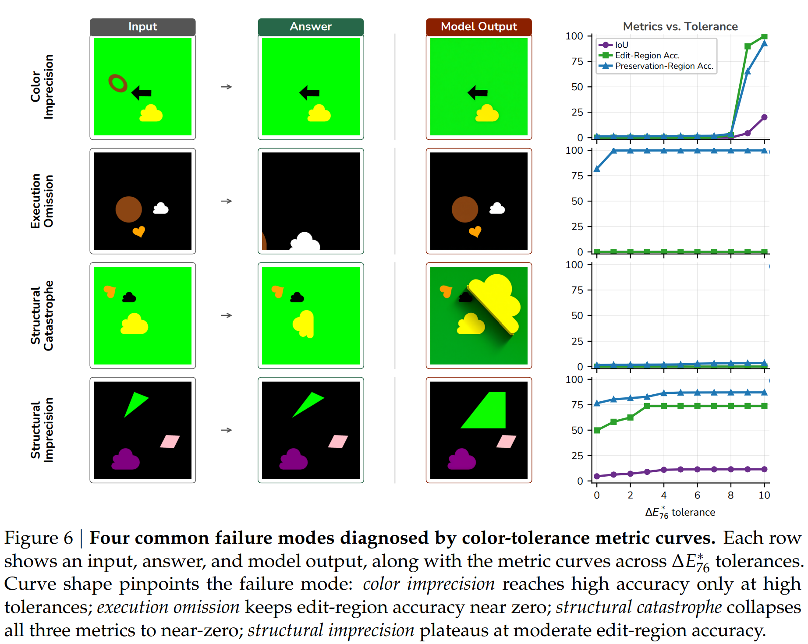

- 장면 변화에 대한 취약성 
    - PaintBench는 모든 작업을 $8$ 가지 시각적 조건에서 평가한다. 

- $20$ task의 평균 mIoU를 각 시각적 조건별로 나타냈다.
    - 줄무늬 배경(Striped Background)은 대부분의 모델 성능을 크게 감소시켰다.
    - 객체(Object)의 개수가 증가할수록 성능도 지속적으로 감소하였다.
    - 가로 또는 세로로 긴 이미지(Non-square Aspect Ratio)의 영향은 상대적으로 작다. 
    - 비표준 색상은 정확한 색 재현을 어렵게 만든다. 전체 mIoU만 보면 비표준 색상 팔레트는 성능에 큰 영향을 주지 않는 것처럼 보이지만, 완전한 픽셀 일치 $\Delta E_{76}^*$ 만 살펴보면 결과는 크게 감소한다. 이러한 현상이 학습 데이터에서 표준 색상이 훨씬 많이 등장했기 때문이라고 추정하였다.

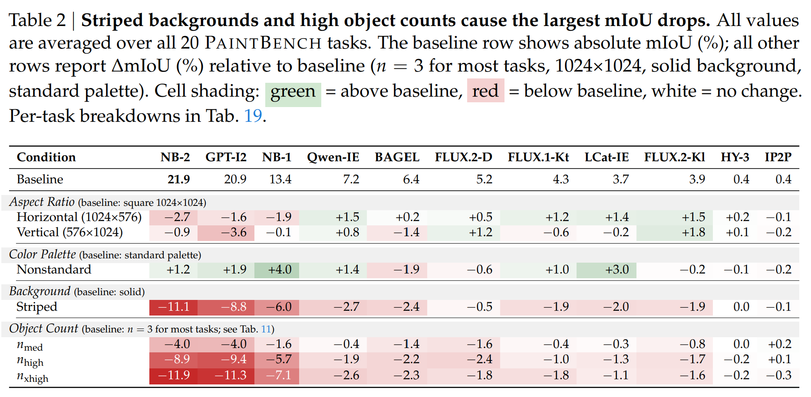

- Models over-edit relative to the target region
    - 연구진은 모델이 필요한 편집 영역보다 훨씬 많은 픽셀을 수정하는 현상을 관찰했다. 
    - 이를 정량적으로 측정하기 위해 `변경된 픽셀 수 / 실제 편집 영역 크기` 를 정의했다. 완벽한 편집이라면 이 비율이 $1$ 이 되어야 한다. 
    - 작은 편집일수록 과도한 수정이 심했다. 

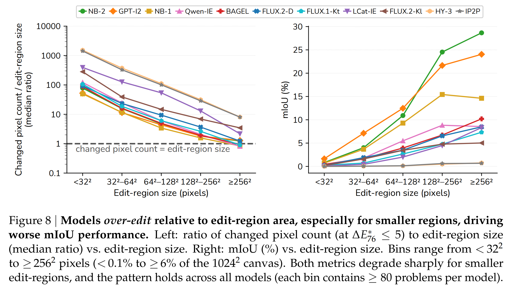

- TinyGrafixBench
    - 도형을 합성하는 것을 넘어서 실제 시각 자료로의 일반화
    - PaintBench를 만드는 방식을 그대로 데이터 시각화 편집에 적용한 벤치마크이다. 
    - 이를 통해 PaintBench에서 평가하는 기본 편집 연산들이 실제 차트 편집 작업에도 일반화되는지 검증한다. 
    - 총 600개의 문제로 구성되며, 다음 5가지 차트 유형을 포함한다. 
        - 막대그래프, 산점도, 선 그래프, 히트맵, 네트워크 그래프 
        - 각 차트 유형마다 4개의 편집 작업을 포함한다. (Construction, Transformation, Removal, Recoloring)
    - 모든 차트는 Matplotlib를 이용하여 $1024 \times 768$ 해상도로 생성되며, 랜덤 시드를 이용한 결정론적 방식으로 렌더링 된다. 
    - 평가는 동일하게 mIoU를 사용한다. 

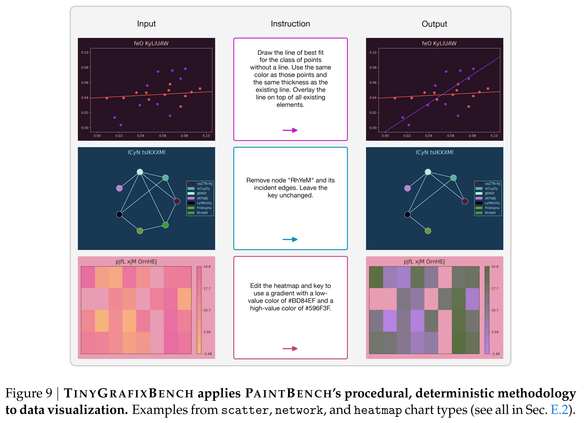

- 전체적으로 TINYGRAFIXBENCH에서의 성능은 PAINTBENCH보다 다소 낮았다.
    - 이는 모델이 단순 도형뿐 아니라 차트 구조 자체를 이해하고 편집해야 하기 때문에 더 어려운 문제이기 때문으로 보인다.
    - 그러나 두 벤치마크에서의 모델 성능은 매우 높은 상관관계를 보였다.
    - PAINTBENCH에서 높은 성능을 보인 모델일수록 TINYGRAFIXBENCH에서도 높은 성능을 보였다.

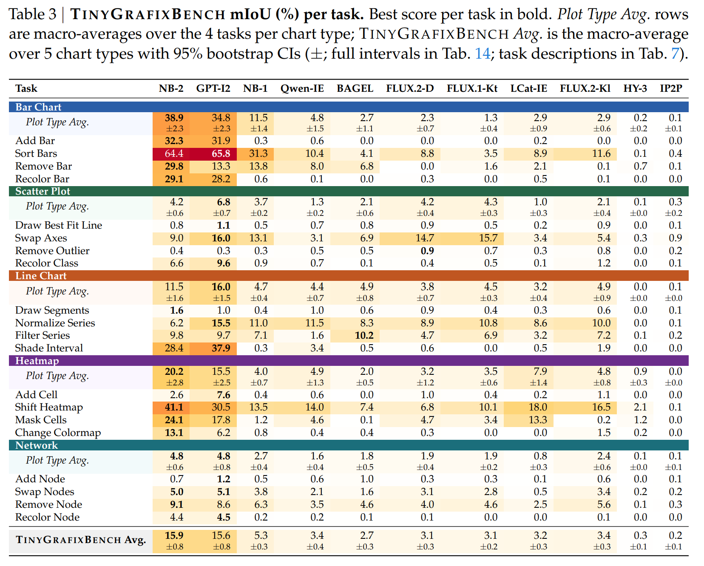

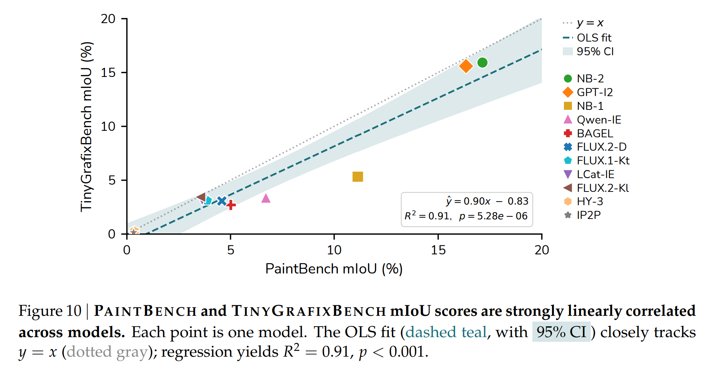

## 참고

- [Paper](https://arxiv.org/pdf/2606.00188)
