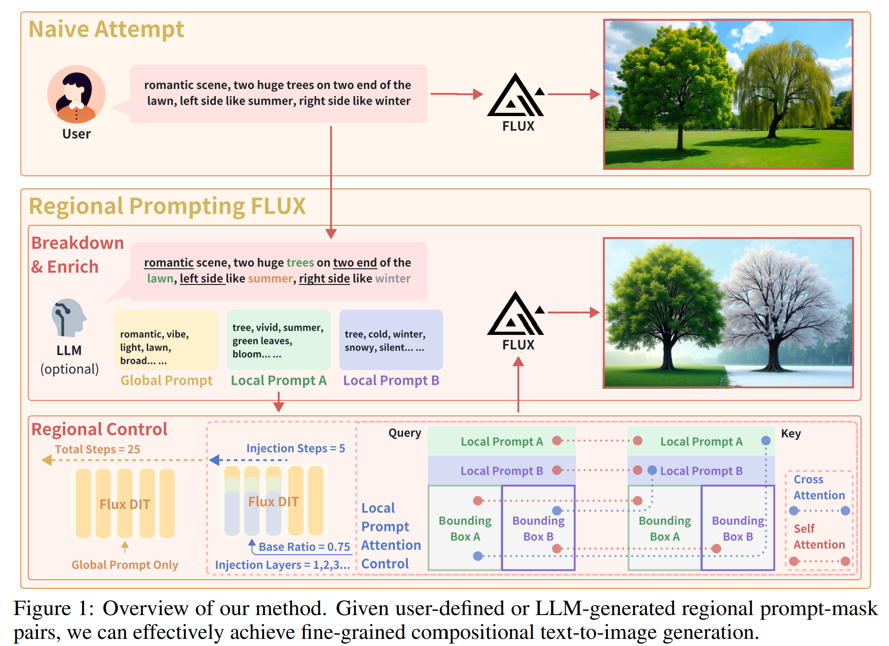
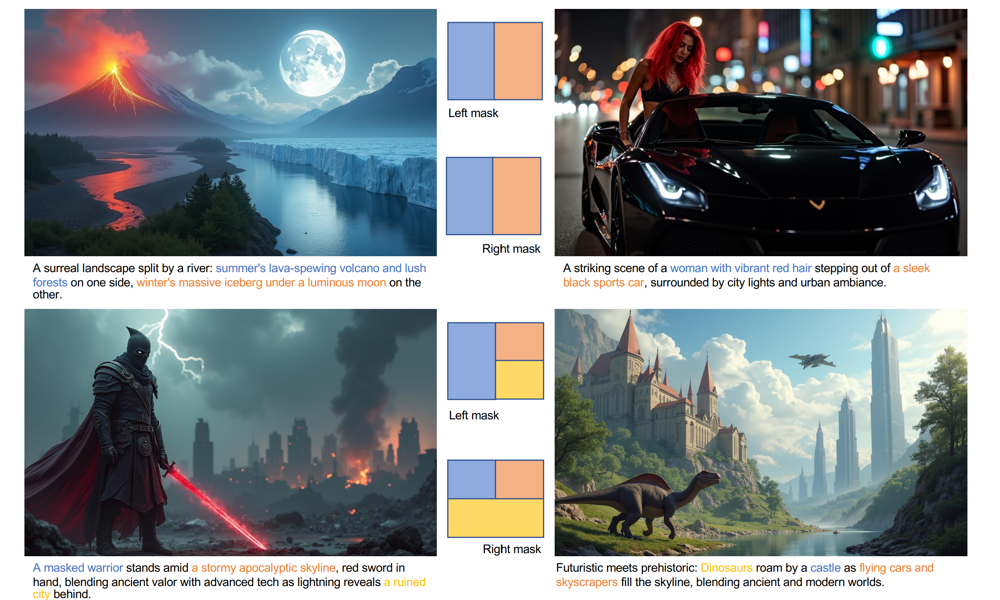
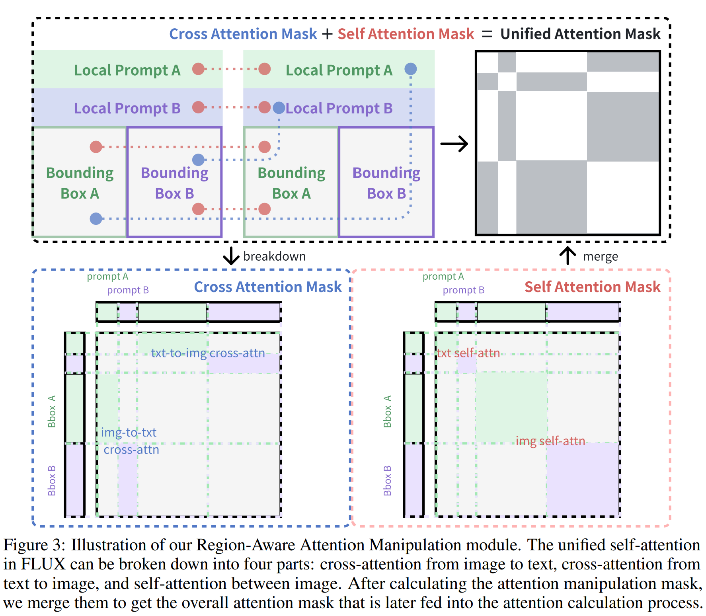

# Training-free Regional Prompting for Diffusion Transformers

*arXiv(2024), 30 citation, Peking, UC Berkeley, CMU, Review Data: 2026.07.26*

> [!TIP]
> **한 줄 요약** — FLUX.1의 attention을 sub-region별 description과 binary mask에 맞게 조작하는 regional prompting으로, 추가 학습 없이 DiT에서 fine-grained compositional text-to-image 생성을 한다.

| 흐름 | 내용 |
|:--|:--|
| **문제** | 기존 T2I 모델은 수많은 attribute와 공간 관계를 가진 여러 object를 포함하는 길고 복잡한 prompt를 다루지 못하고, regional prompting 방법은 UNet 기반(SD1.5, SDXL)에만 제안되었다 |
| **아이디어** | Global description과 $N$개의 $(c_i, m_i)$ (sub-region description, binary mask) tuple을 받아 FLUX.1 기반 attention manipulation으로 반영 |
| **결과** | 별도의 학습 없이 텍스트 조건과 공간 조건을 모두 반영하는 fine-grained compositional 생성을 DiT 구조에서 구현 |

   
  <b>Figure 1.</b> Regional prompting 결과 예시

---

## 1. 문제 정의 — 왜 이 논문이 필요한가

**배경.** Diffusion model의 text-to-image generation 능력은 완벽한 능력을 보여주고 있다. Semantic understanding (i.e., prompt following) 능력 또한 large language models (e.g., T5, Llama)와 함께 향상되고 있다. 

**기존 방법의 한계.** 하지만, 기존의 모델들은 완벽하게 길고 복잡한 text prompt를 다루지 못한다. 특히 text prompt가 수 많은 attributes와 상호연결된 공간적인 관계의 다양한 objects를 포함하면 그렇다. 

- 많은 regional prompting method들은 UNet-based models (SD1.5, SDXL)에 대해 제안됐지만, 최근 DiT 구조 (SD3나 FLUX.1)를 기반으로는 구현되지 않았다. 

**이 논문의 접근.** 따라서 본 논문에서는 training-free로 fine-grained compositional T2I generation을 가능하게 하는 FLUX.1 based attention manipulation **regional prompting** 을 제안 및 구현한다.  

  

## 2. 방법

  

- 본 연구의 주요 목적은 별도의 학습 없이 텍스트 조건과 공간 조건을 모두 반영하도록 조합적 생성 능력을 향상시키는 것이다. 

- Input 
    - global description
    - $N$ tuples: $(c_i, m_i)$ - sub region의 description 및 binary mask 

## 참고

- [Paper](https://arxiv.org/pdf/2411.02395)
