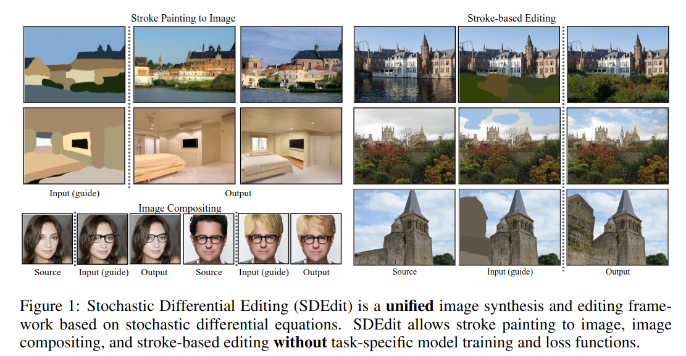
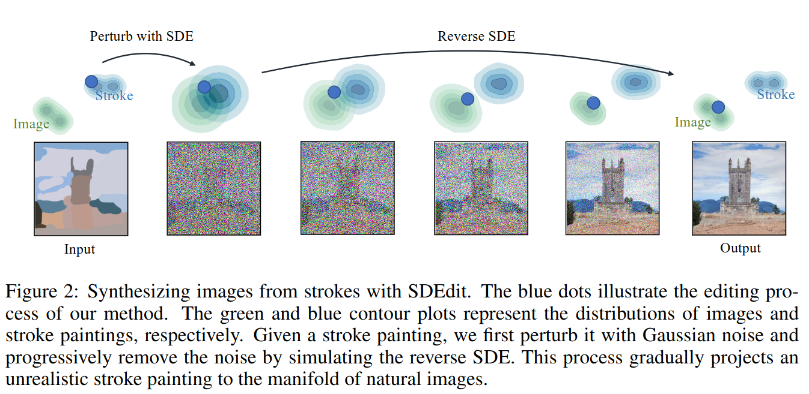
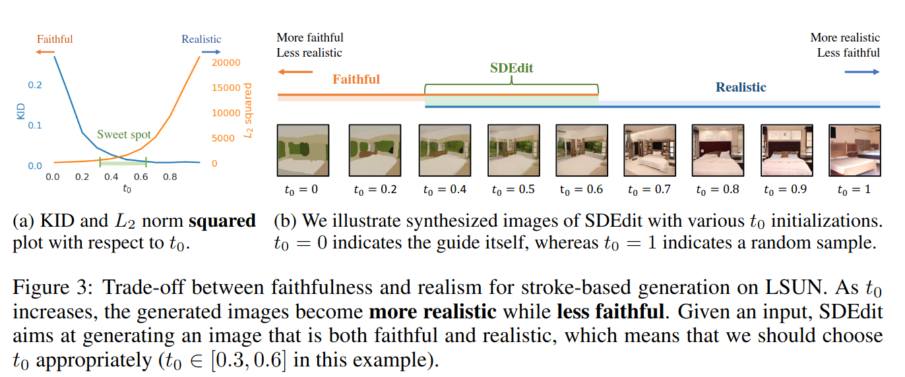
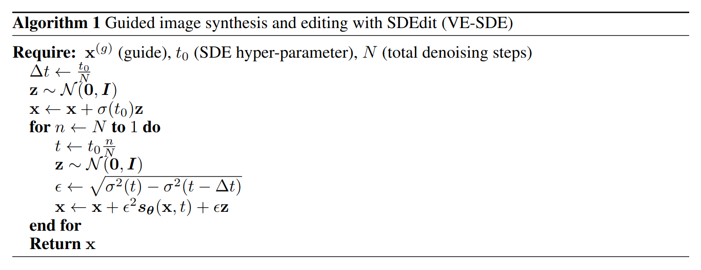
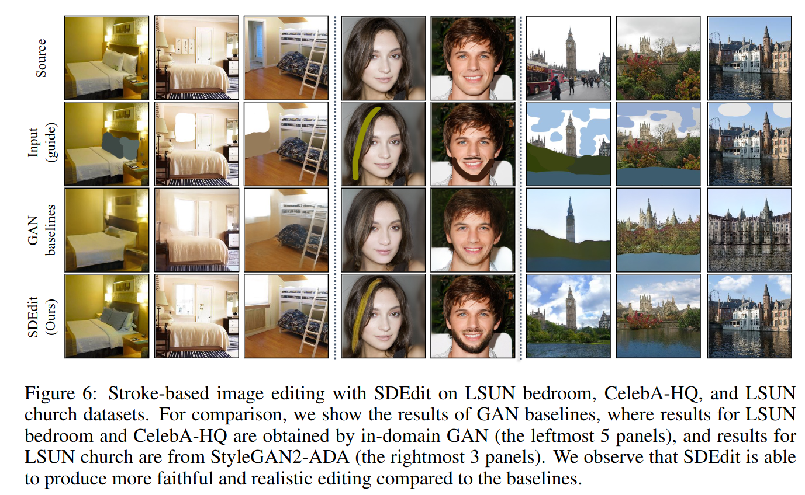
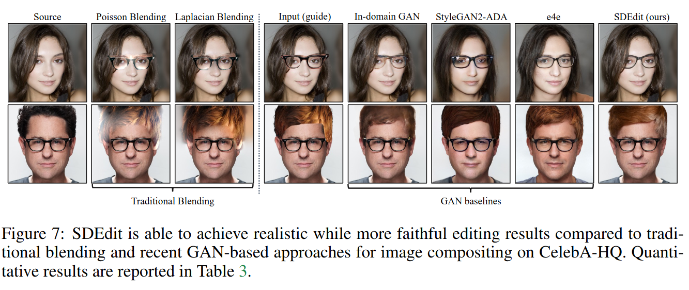

# SDEdit: Guided Image Synthesis and Editing with Stochastic Differential Equations

*ICLR(2022), 462 citation*

> [!TIP]
> **한 줄 요약** — 대충 그린 stroke painting이나 합성 이미지에 적당한 noise를 뿌린 뒤 사전학습된 diffusion model의 reverse SDE로 denoise해서, 추가 학습 없이 사실적인 이미지로 바꾼다.
>
> **Core Idea** — "Convert Stroke Painting to Natural image using Perturbation without Fine-tuning"

| 흐름 | 내용 |
|:--|:--|
| **문제** | Conditional GAN/GAN inversion 기반 방법은 guided synthesis/editing을 위해 추가적인 학습 데이터나 task-specific loss function이 필요하다 |
| **아이디어** | Noise perturbation으로 stroke painting 분포와 model이 학습한 분포를 겹치게 한 뒤, reverse SDE로 noise를 제거하며 natural image 분포로 끌고 간다 |
| **결과** | Task-specific training 없이 stroke-to-image 생성과 image blending을 수행하며, perturbation time step $t_0$로 원본 충실도와 realism의 trade-off를 조절 |

   
  <b>Figure 1.</b> SDEdit 개요

---

## 1. 문제 정의 — 왜 이 논문이 필요한가

- User 가 최소한의 노력으로 사실적인 image 를 만들고 편집할 수 있게 하는 방법이다. 
- 주요 과제는 손으로 그린 그림 (hand-drawn colored strokes)이나 합성된 이미지 현실성의 균형을 잡는 것이다.
    - 즉, 대충 그린 그림을 가지고 이미지를 만들거나 
    - 대충 합성한 이미지를 가지고 blending 을 잘 해서 실제 이미지처럼 보이게 하는 것이다.
- Task-specific model training/loss function 이 없다는 게 특징이다.  

## 2. 사전 지식

- GAN-based
    - Conditional GAN/GAN inversion 을 통해 이 문제를 해결하려고 했지만, 이는 추가적인 학습 데이터나 loss function 을 필요로 했다.

## 3. 방법

- Stroke painting distribution 과 pre-trained diffusion model 이 학습한 distribution 은 다르다. 하지만, noise perturbation 을 통해 두 분포를 겹치게 하고 reverse SDE 를 통해 noise 를 제거하는 순간, stroke painting sample 은 model 이 학습한 distribution 을 타고 올라간다. 즉, stroke painting sample 을 diffusion model 이 학습한 분포로 끌고 감으로써 natural 이미지를 생성한다. 
    - Stroke painting 에 충분한 noise 를 뿌린 순간, model 은 input 이미지가 stroke image 에서 noise 를 뿌린 건지 natural image 에서 noise 를 뿌린 건지 알 수 없다. 
    - 따라서 가장 중요한 hyper-parameter 는 어떤 time step 의 noise 를 뿌려야 하는 가이다.

  

- Noise 를 너무 많이 뿌리면, 원본 stroke painting 의 정보가 너무 많이 사라지기에 원본 stroke painting 과의 $L_2 \ norm$ 의 값이 커지지만, 초기부터 이미지를 생성했기에 natural image 와의 KID score 는 낮다 (낮을수록 성능이 좋다).
    - 반대로 noise 를 너무 적게 뿌리면, 원본 stroke painting 의 정보가 너무 많아서 KID score 는 높아지고 $L_2 \ norm$ 의 값은 작아진다. 
    - 우리는 이 trade-off 관계에서 sweet spot 을 찾아야 한다. 

  

- 구체적으로, noise 를 더하는 과정을 SDE framework 안에서 봤을 때, 크게 VE/VP SDE 가 존재한다. (SMLD/DDPM)
    - 자세한 내용은 <a href='../../../notes/topics/score-based-generative-models/README.md'>Score-based Generative Models</a> 에 담았다.
    - 본 논문에서는, VE SDE 를 이용했다. 

- Stroke painting 이 perturbation 된 time step 을 $t_0 \in [0.3,0.6]$ 으로 잡았을 때가 가장 합리적인 guide 라고 한다. 
- Reverse SDE 는 Euler-Maruyama method (reverse diffusion sampling) 방식으로 이산화해서 sampling 을 진행한다. 

- Algorithm
    - 실제 코드 구현으로는 $t_0 = 400$, $N=1000$, $\Delta t = 1$
    - 그냥 이산화해서 계산

  

## 4. 실험

  

- Blending 도 잘한다.

  

## 참고

- [Paper](https://arxiv.org/abs/2108.01073) · 관련 리뷰: [Score-based Generative Models](../../../notes/topics/score-based-generative-models/README.md)
