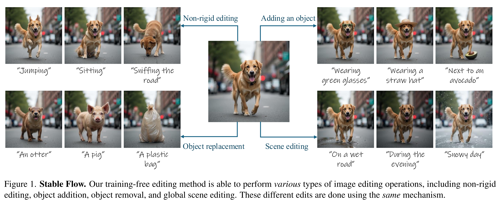
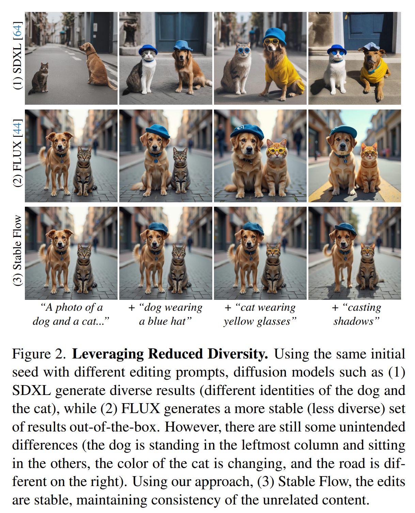
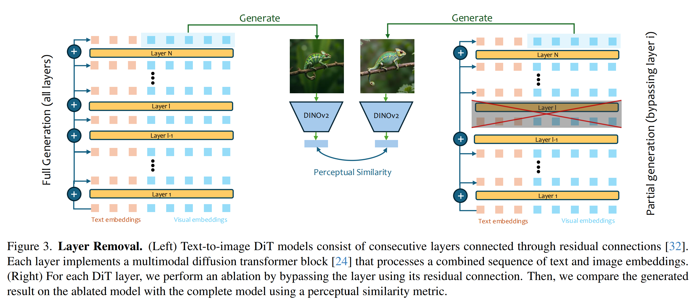
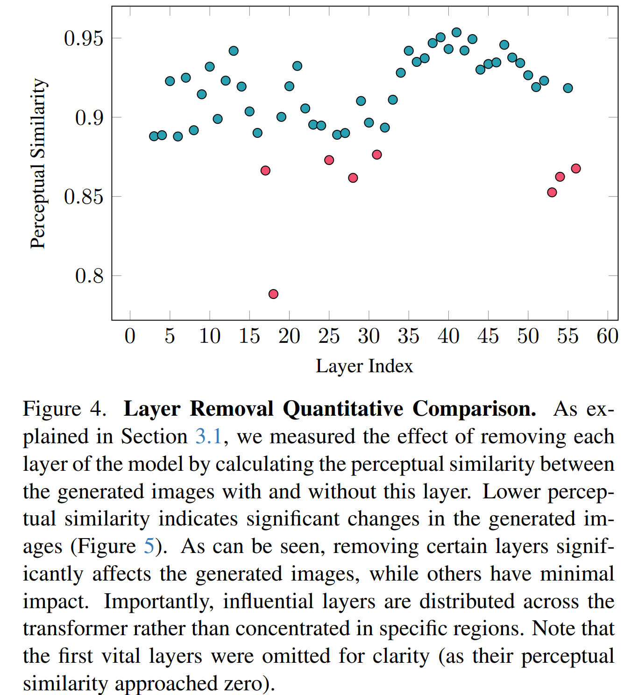

# Stable Flow: Vital Layers for Training-Free Image Editing

*CVPR(2025), 136 citation, Snap research, Review Data:*

> [!TIP]
> **한 줄 요약** — DiT(FLUX)에서 이미지 형성에 결정적인 vital layer를 자동으로 찾아 그 레이어에만 원본의 attention feature를 주입하고, latent nudging으로 실제 이미지 inversion까지 개선해 training-free로 안정적인 편집을 한다.

| 흐름 | 내용 |
|:--|:--|
| **문제** | Parallel generation 기반 feature 주입 편집은 U-Net에서는 레이어 역할이 잘 알려져 있지만, DiT는 Fine-Coarse-Fine 구조가 없어 어떤 레이어를 조작해야 하는지 명확하지 않다 |
| **아이디어** | 각 레이어를 residual connection으로 bypass했을 때의 DINOv2 perceptual similarity 변화로 vital layer를 탐지하고, 그 레이어에만 attention feature를 selective injection. 실제 이미지는 Inverse Euler ODE + OOD latent nudging으로 inversion |
| **결과** | 텍스트 프롬프트가 지정한 부분만 바꾸고 나머지는 유지하는 stable edit을, flow model의 낮은 다양성을 역이용해 학습 없이 하나의 mechanism으로 수행 |

<p align="center">
  <br>
  <sub><b>Figure 1.</b> Stable Flow 개요</sub>
</p>

---

## 1. 문제 정의 — 왜 이 논문이 필요한가

- 최근 diffusion model들은 전통적인 UNet architecture를 Diffusion Transformer (DiT)로 교체하고 있다. 또한, 향상된 학습과 sampling을 위해 flow-matching을 사용한다. 

- Flow Matching: 최적 수송 조건부 확률 경로를 따라 직선 궤적으로 샘플링을 수행해, 기존 디퓨전 모델보다 학습 및 샘플링이 빠른 대안 기술입니다. 다만, 생성 다양성이 상대적으로 낮다는 특징이 있는데, 이 연구에서는 이 '낮은 다양성'을 오히려 역이용하여 일관성 있는 이미지 편집에 활용했습니다.

<p align="center">

</p>

- 본 논문에서는 낮은 다양성을 활용하여 attention feature의 selective injection을 통해 일관성있는 consistent image edit을 수행한다. 

- DiT, Diffusion Transformer: 최근 FLUX나 SD3 같은 최신 생성 모델에 쓰이는 아키텍처로, 기존의 UNet 구조를 대체하여 고품질 합성을 수행하지만, 레이어들의 역할이 직관적으로 파악되지 않는 특징이 있습니다.

- 핵심 레이어 (Vital Layers): DiT 모델 내에서 이미지 형성에 결정적인 역할을 하는 레이어들을 자동으로 찾아낸 것입니다. 이 레이어들에만 소스(원본) 이미지의 어텐션(attention) 특징을 선택적으로 주입하면, 원본의 무관한 부분은 그대로 유지하면서 프롬프트가 요구하는 부분만 안정적으로 수정할 수 있습니다.

- 본 논문은 병렬 생성을 통한 이미지 편집을 연구한다. 이 방식에서는 원본 이미지의 생성 궤적에서 추출한 feature를 편집 이미지의 생성 궤적에 주입한다. 
    - 이러한 접근법은 합성곱 기반 U-Net 확산 모델에서 효과적인 것으로 입증됐다. U-Net 기반 모델에서는 서로 다른 Attention Layer들이 수행하는 역할이 비교적 잘 알려져 있기 때문이다.
    - 그러나 DiT(Diffusion Transformer) 에서는 각 Attention Layer의 역할에 대한 이해가 아직 충분히 확립되지 않았다. 특히 DiT는 U-Net과 같은 Fine-Coarse-Fine 구조를 갖지 않는다. 따라서 원하는 이미지 편집 결과를 얻기 위해 어떤 레이어를 조작해야 하는지 명확하지 않다.
    - 이러한 한계를 해결하기 위해, 우리는 DiT 아키텍처를 구성하는 여러 요소의 중요도를 분석하여 이미지 편집 과정에서 특징을 주입해야 할 레이어의 부분집합을 결정한다. 보다 구체적으로, 우리는 Vital Layer(핵심 레이어), 즉 이미지 형성에 필수적인 레이어들을 자동으로 탐지하는 방법을 제안한다. 이를 위해 각 레이어를 우회(Bypass)했을 때 발생하는 이미지 콘텐츠의 변화 정도를 측정한다.

- 분석 결과, 레이어의 중요도(Vitality)와 아키텍처 내 위치 사이에는 단순한 관계가 존재하지 않는다는 사실을 확인했다. 다시 말해, Vital Layer들은 Transformer의 특정 구간에 집중되어 있지 않고, 전체 아키텍처에 걸쳐 분포한다.

- Vital Layer들을 자세히 분석한 결과, 해당 레이어에 특징을 주입하면 멀티모달 Attention에서 참조 이미지의 콘텐츠와 편집 프롬프트 사이에 적절한 균형을 형성할 수 있음을 확인했다.

- 따라서 특징 주입을 Vital Layer에만 제한하면 안정적인 이미지 편집(Stable Edit)이 가능해지는 경향이 있다. 여기서 안정적인 편집이란 텍스트 프롬프트에서 지정한 부분만 변경하고, 이미지의 나머지 부분은 그대로 유지하는 편집을 의미한다.

- 실제 이미지를 편집하기 위해서는 일반적으로 먼저 해당 이미지를 역변환(Inversion)하는 과정이 필요하다. FLUX 모델에서 실제 이미지의 Inversion을 수행하기 위해 Inverse Euler 상미분방정식(ODE) Solver를 사용한다.
    - 그러나 이 방법만으로는 입력 이미지를 만족스러운 수준으로 재구성하지 못한다.
    - 재구성 정확도를 개선하기 위해, OOD(Out-of-Distribution) Nudging 기법을 제안한다. 이 방법은 Inversion을 수행하기 전에 노이즈가 없는 잠재 표현(Clean Latent)에 작은 스칼라 교란(Scalar Perturbation)을 가하는 방식이다.

- 잠재 누딩 (Latent Nudging): 실제 이미지를 편집하려면 먼저 모델의 잠재 공간(latent space)으로 역변환(inversion)해야 하는데, 플럭스(FLUX) 모델에서 기존 역오디(ODE) 방식만 쓰면 이미지가 깨지는 문제가 발생합니다. 이를 해결하기 위해 정제된 잠재 벡터에 미세한 스칼라 값($\lambda = 1.15$)을 곱해 약간 오프셋을 주는 OOD(Out-of-Distribution) 넛징 기법을 도입하여 복원 정확도를 높였습니다.

```
1. UNet 기반 > DiT로 옮겨갔다 (flow-matching)
2. 이러한 flow-based model의 특징은 diversity가 부족 (consistent는 향상)하다는 것이고 이를 이용하겠다
3. 구체적으로 parallel generation을 사용하는데, 원본 이미지의 feature를 edited image에 주입하는 것이 특징이다.
4. UNet 기반에서는 layer마다의 역할이 잘 보였는데, DiT에서는 그런 연구가 없다.
5. 따라서 분석했고, 어떤 결과들이 나왔다.
6. 이제 이미지를 편집하려면 inversion이 필요한데, 재구성이 잘 안돼서 OOD Nudging 기법을 제안한다. 

```

## 2. 방법

제안하는 방법은 다음과 같이 구성된다. 1) 레이어 제거가 생성 이미지에 미치는 perceptual impact를 분석하여 각 레이어가 갖는 중요도를 평가; 2) 가장 영향력이 큰 레이어들을 vital layer라고 정의, 해당 레이어에 attention feature를 주입하여 이미지 편집을 수행; 3) Euler Inverse ODE solver와 latent nudging을 활용하여 실제 이미지를 잠재 공간으로 역변환함으로써, 제안 방법을 실제 이미지 편집으로 확장한다. 

### Measuring the Importance of DiT Layers

- UNet
    - 판별 작업(Discriminative Tasks)에서 초기 레이어는 에지(Edge)와 같은 단순한 특징을 감지하는 반면, 깊은 레이어는 보다 높은 수준의 의미적 개념(Semantic Concepts)을 포착한다.
    - 마찬가지로 생성 모델(Generative Models)에서는 초기 및 중간 레이어가 형태(Shape)와 색상(Color)을 결정하고, 깊은 레이어는 보다 세밀한 디테일(Fine Details)을 제어한다.

- U-Net과 달리 DiT에서는 서로 다른 레이어들이 어떤 역할을 수행하는지 직관적으로 명확하지 않다. 따라서 이미지 편집에 가장 적합한 레이어를 결정하기 어렵다.

- FLUX 모델에서 각 레이어의 중요도를 정량적으로 평가하기 위해, 우리는 체계적인 평가 방법(Systematic Evaluation Approach)을 설계하였다.
    - Figure 3(오른쪽)에 나타난 것처럼 Residual Connection을 이용하여 해당 레이어를 우회(Bypass)하는 Ablation 실험을 수행하였다.
    - 각 레이어가 이미지 생성에 미치는 영향을 평가하기 위해, 우리는 DINOv2를 사용하여 참조 이미지 집합과 레이어가 제거된 이미지 집합 사이의 perceptual similarity를 측정했다. 
    - Figure 4에 제시된 결과는 일부 레이어를 제거했을 때 생성 이미지가 크게 달라지는 반면, 다른 레이어를 제거했을 때는 영향이 미미하다는 사실을 보여준다.

<p align="center">

</p>

- 특히 중요한 점은 영향력이 큰 레이어들이 Transformer의 특정 구간에 집중되어 있지 않고, 전체 아키텍처에 걸쳐 분포한다는 것이다.

<p align="center">

</p>
