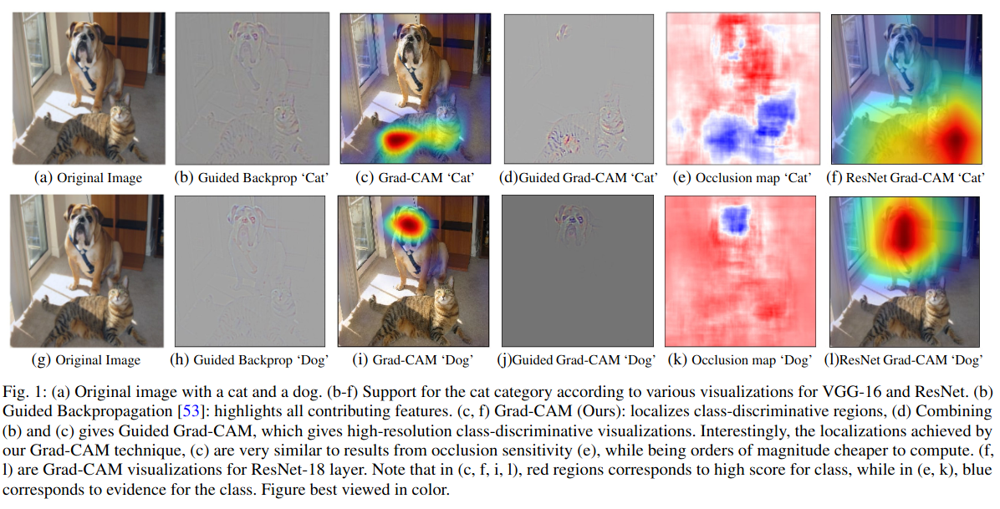
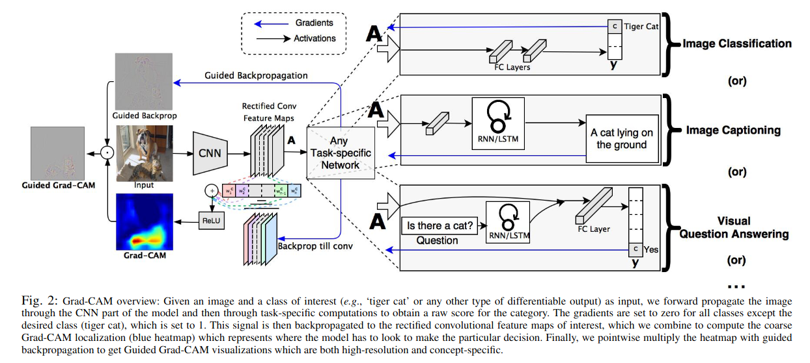
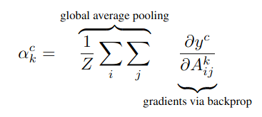
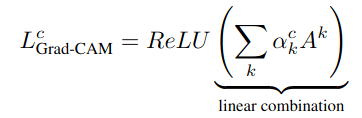
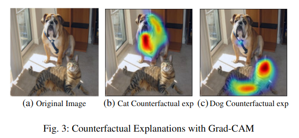

# Grad-CAM: Visual Explanations from Deep Networks via Gradient-based Localization

*ICCV(2017), 19262 citation*

> [!TIP]
> **한 줄 요약** — Class score를 feature map에 대해 편미분한 gradient를 CAM의 weight처럼 channel 중요도로 사용해, GAP 구조에 구애받지 않고 어떤 CNN에서든 class activation map을 시각화한다.

| 흐름 | 내용 |
|:--|:--|
| **문제** | CAM은 GAP (Global Average Pooling) 구조를 전제로 하기 때문에 모델 구조가 제한적이다 |
| **아이디어** | 예측 class 값 $y^c$를 feature map에 대해 편미분한 gradient를 channel의 영향력(CAM의 weight와 동일한 의미)으로 보고, feature map에 곱해 합친 뒤 ReLU로 음의 값을 무시 |
| **결과** | 모델 구조 변경이나 재학습 없이 다양한 CNN 계열에 적용 가능한 class-discriminative 시각화 |

**Core Idea:** "Visualize Attention Map via Gradients Equal to Importance of Channel like Weights"

   
  <b>Figure 1.</b> Grad-CAM 시각화 예시

---

## 1. 방법

- CAM 과 달리, GAP (Global Average Pooling) 에 구애받지 않고 사용할 수 있다. 즉, 모델 구조가 제한적이지 않음 

- 모델이 예측한 class 값을 feature map 값에 대해 편미분을 진행한다. 
    - 특정 channel pixel value 의 activation value 가 바뀜에 따라 class $y^c$ 의 값이 많이 흔들린다는 얘기는, class $y^c$ 를 결정할 때 해당 channel 의 영향력이 크다는 얘기이다. (즉, gradient 값의 크기가 크다) 
    - 이때, gradient 의 값의 부호와는 상관이 없다고 볼 수 있다. Gradient 가 음수인 큰 값이어도 이 값은 class 를 결정하는데 중요하다. (Negative Influence)
    - CAM 의 구조에선, CAM 에서의 weight 와 동일한 수식으로 볼 수 있다.

- Class $y^c$ prediction 할 때의 feature (channel) map 에다가, 각 channel 의 영향력과 동일한 의미를 가진 gradient 값들을 곱해줌으로써 중요도를 반영한 class activation map 을 만들 수 있다. 
    - ReLU 를 취해서 음의 값은 무시한다. 

## 2. 실험

## 3. 정리

- 한 가지 의문점은 CAM 에서의 weight 와 동일한 역할을 하는 gradient 가 모든 case 에 대해서는 적용되지 않는다는 점이다. 
    - 우리는 앞서, gradient 의 부호와는 상관없이 크기가 그 channel 의 영향력을 정하는 척도임을 알 수 있었다. 
        - 실제로 어느 방향으로든 update 를 진행하지 않기 때문에, 고정된 지점에서 바라봤을 때 크기로 영향력을 체크해야 한다. 
    - 하지만, channel 값이 해당 class 에 대해서 중요한 값이라고 가정했을 때
        1. gradient 는 음수인 큰 값, channel 은 양수인 값이라면 오히려 시각화가 되지 않는다.
        2. 반대로 gradient 는 양수인 큰 값, channel 은 음수인 값이라면 오히려 시각화가 되지 않는다. 
        3. 즉, channel 은 중요한데 시각화가 되지 않는다는 말이다. 
        - 이는 gradient 에 ReLU 를 취한 Grad-CAM++ 이나 임의로 activation function 을 ReLU 로 써도 해결되지 않는 문제이다. 

| always gradient is positive | positive | negative | always channel is positive | positive | negative |
|:-------------------------:|:--------:|:--------:|:--------------------------:|:--------:|:--------:|
|      gradient * channel     | positive | negative |      gradient * channel      | positive | negative |

- 아는 지인들과 토론 $4$ 시간을 해도, 답이 안나와서 교수님께도 여쭤봤는데 역시나 동일
    - 카이스트가 구현한 코드에는 수식의 ReLU 대신, abs() 를 사용했는데 이러면 가능하다. 
    - 즉, abs() 를 사용하면 모든 case 에서 사용할 수 있다. 

## 참고

- [Paper](https://arxiv.org/abs/1610.02391) · [Code](https://github.com/qkrwnstj306/CAM) · 관련 리뷰: [CAM](../cam/README.md)
