# RePaint: Inpainting using Denoising Diffusion Probabilistic Models

*CVPR(2022), 441 citation*

> [!TIP]
> **한 줄 요약** — Inpainting을 따로 학습하지 않은 pretrained unconditional DDPM으로, 매 step known 영역은 원본의 forward sample로 채우고 resample로 원본 정보를 모델에 충분히 전달해 어떤 형태의 mask에도 의미적으로 어우러지는 free-form inpainting을 한다.

| 흐름 | 내용 |
|:--|:--|
| **문제** | 대부분의 inpainting 방법은 특정 분포의 mask로 학습해 unseen mask type에 일반화가 부족하고, standard DDPM sampling은 texture는 맞아도 의미적으로 부정확할 때가 있다 |
| **아이디어** | $x_{t-1} = m \odot x_{t-1}^{known} + (1-m) \odot x_{t-1}^{unknown}$ 으로 known/unknown 영역을 합치고, 합친 sample에서 다시 noise를 더해 $x_t$를 재생성하는 resample로 원본과의 조화를 확보 |
| **결과** | CelebA-HQ·ImageNet에서 free-form mask에 대해 좋은 성능, 다양한 output 생성. 단, GAN/autoregressive 보다 느리고 넓은 mask에서는 GT와 많이 다른 이미지를 생성 |

**Core Idea:** "Image Inpainting using DDPM" — without Condition such as Text

  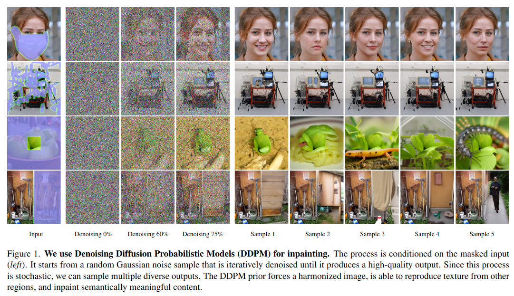 
  <b>Figure 1.</b> RePaint inpainting 결과

---

## 1. 문제 정의 — 왜 이 논문이 필요한가

- Image inpainting 은 masking 된 부분을 생성했을 때, 나머지 영역과 의미적으로 합리적이어야 한다. 심지어는 극단적인 형태의 masked region 도 처리해야 한다.
- 대부분의 존재하는 방법들은 특정 분포의 마스크를 학습하기 때문에, unseen mask type 에 대해서 일반화 능력이 부족하다.
- 본 논문에서는, pretrained unconditional DDPM 을 사용하여 free-form inpainting task 를 해결하고자 한다. Probabilistic modeling 에 기반함에도 (not deterministic) diverse and high-quality image를 생성할 수 있다.
- Inpainting task 를 학습하지 않는다. 이로 인해 얻을 수 있는 이점은 2가지 이다.
    - inference 시에 어떤 형태의 mask 가 들어와도 일반화 할 수 있다.
    - image 생성에 강력한 능력을 갖춘 DDPM 을 사용했기 때문에, 더욱 의미론적인 이미지 생성을 할 수 있다. 
- Standard DDPM sampling strategy 를 사용하면 texture 는 일치하지만, 종종 의미적으로 부정확할 때가 존재한다. 따라서 본 논문에서는 개선된 denoising 전략(= **resample**)을 도입한다.

## 2. 사전 지식

1. Deterministic Image Inpainting 
2. Diverse Image Inpainting 
3. Usage of Image Prior
4. Image Conditional Diffusion Models 

## 3. 방법

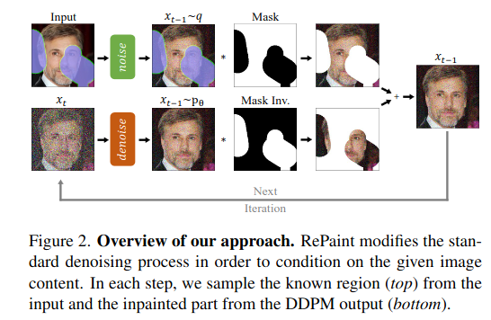

1. DDPM 을 downstream task 인 inpainting task 에 대해서는 학습하지는 않는다. 
    - 단, DDPM 의 pre-trained 는 "Improved denoising diffusion probabilistic models" 라는 논문에서 제안한 방법으로 학습한다.
    - 위의 논문은 variance 까지 학습 대상으로 보고 reverse process의 sampling step 을 줄여주는 method 를 제안한 논문이다.   
    - 또한, "Diffusion models beat gans on image synthesis" 라는 논문을 기반으로 training & inference 를 진행한다. 
    - 최종적으로 inference time 을 4배 줄였다. 
    - 예상컨대, loss setting & inference -> "Improved ..." | model architecture ->  "... beat gans ..." 로 보인다. 
  
2.  Definition
    - Ground Truth image $x$ 
    - Mask region $m$ (made of 0)
    - Unknown pixels $m \odot x$
    - Known pixels $(1-m) \odot x$

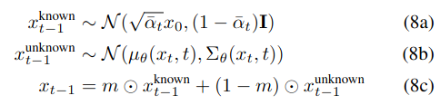

3. Process 
- $x^{known}_{t-1}$ 는 clean data $x_0$ 에서 forward process 를 통해 구한다.
- $x^{unknown}_{t-1}$ 는 $x_T \sim N(0,I)$ 를 sampling 하고 model 에 input 으로 제공하여, noise 를 예측한 값을 통해서 iterative 하게 denoising 하여 구한다.
- $new\ sample\ x_{t-1} = m \odot x_{t-1}^{known} + (1-m) \odot x_{t-1}^{unknown}$
- forward process 로 구한 $x^{known}_{t-1}$ 은 원본의 정보를 가진다. 
- reverse process(model) 로 구한 $x^{unknown}_{t-1}$ 의 source(근원)은 $x_T \sim N(0,I)$ 이다. 
    - $x_T$ 가 원본의 정보를 함유하고 있지 않는다는 특징으로 인해 추후에 문제가 발생. 본 논문의 method 인 resample 이 등장한다.

4. Resample
- *3. Process* 를 적용하여 inpainting 을 진행해보면, generated image 가 content/texture 면에서만 일치하고 의미적으로 일치하지 않는 것을 확인할 수 있다.

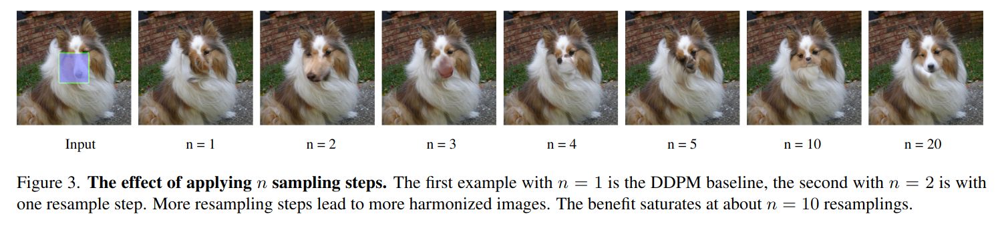

- $n =1$ 인 경우가 *3. Process* 를 그대로 적용한 결과이다. masking 한 부분에 대해서 생성하는 과정인 $(1-m) \odot x_{t-1}^{unknown}$ 에서 뒷 부분인 $x_{t-1}^{unknown}$ 가 어떻게 생성됐는지를 보면, $x_{T} \sim N(0,I)$ 에서 sampling 한 뒤에, model 을 통해 iterative 하게 구한 값이다. 다시 말해, time step $T$ 에선 원본의 정보를 고려하지 않은 채 $x_{T-1}$ 을 generation 하기 때문에 문제가 발생한다. 
- $x_{T-1}$ 이후에는  $new\ sample  \; x_{t-1} = m \odot x_{t-1}^{known} + (1-m) \odot x_{t-1}^{unknown}$ 로 인해 new sample $x_{t-1}$ 에 원본의 정보가 들어온 상태에서, model($x_{t-1}$, $t-1$) 에 입력으로 들어오고 self-attention 으로 인해서 원본의 정보를 고려해서 $\epsilon$ 을 output 으로 내뱉긴 하지만 완전한 조화를 이루기에는 어려움이 존재한다. 
- '그럼 조화를 이루기 위해, 어떤 조건이 필요할까' 라고 고민해보면 $\epsilon$ 으로 $x_{t-1}^{unknown}$ 를 만들기 때문에, 결국 model 이 원본의 정보를 충분히 받아들여서 $\epsilon$ 을 생성할 수 있어야 한다. 
- 해당 조건을 해결해주는게 본 논문에서 제안하는 *resample* 이다. 
- 원본의 정보를 가지고 $\epsilon$ 을 잘 prediction 할 수 있도록, 원본의 정보가 담긴 $new\ sample\ x_{t-1}$ 에서 $x_t$ 를 다시 sampling(=add noise) 한 뒤, 원본의 정보가 담긴 $x_t$ 를 다시 model 에게 전달해서 원본을 고려해 $x_{t-1}^{unknown}$ 을 재생성할 수 있게 setting 했다.
> Resample의 core idea
>> Data $x_0$ 가 주어지므로 $x_{t-1}^{known}$은 고정이라고 볼 수 있다. 의미론적으로 원본과 어우러지기 위해선, 결국 model 이 원본 정보를 잘 보고 $\epsilon$ 을 prediction 하는 문제로 볼 수 있다. 이 문제를 해결하기 위해선 model 이 충분한 양의 원본 정보를 어떤 방식으로든 입력으로 받으면 된다. (model 내부에는 self-attention 이 있기 때문에 각 pixel의 정보가 알아서 섞임) 따라서, model input 인 $x_t, t$ 에 원본의 정보를 넣어주기 위해 $new\ sample\ x_{t-1}$ 을 resampling 하는 것이다.
  
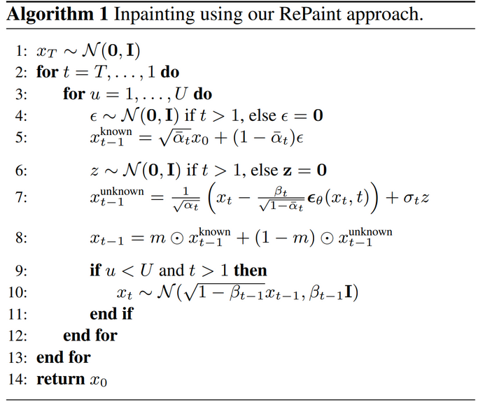

* 5번째 줄에, $x_{t-1}^{known}$ 을 forward process 로 만드는 과정은 notation 오류로 보인다.

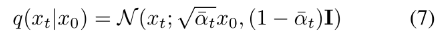 

* 10번째 줄에, $x_t$ 를 re-sampling 하는 과정은 오류로 보인다. 논문에서는 글로 다음과 같이 설명하고 있다. 
  
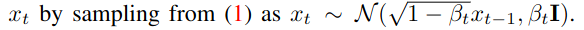

- 내가 생각하는 RePaint Algorithm
 
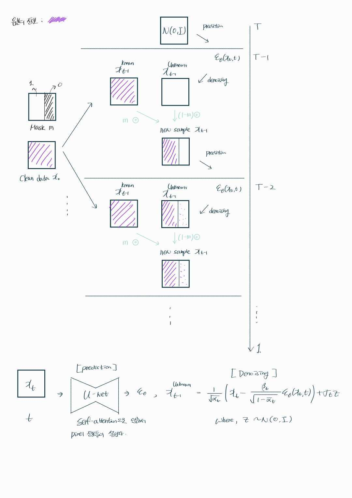
Resample 을 고려한 경우: 

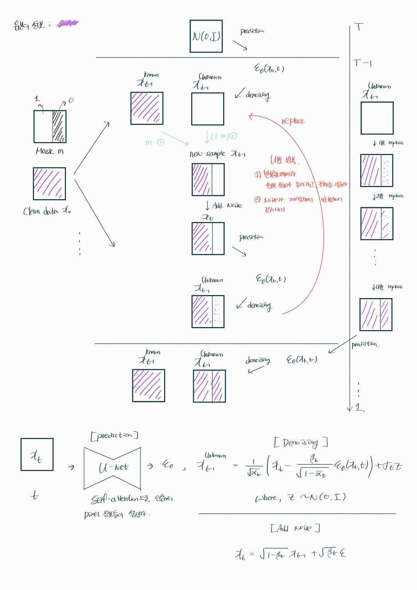

## 4. 실험

Setting

- CelebA-HQ & ImageNet dataset
- 256 x 256 resolution
- T = 250, r = 10, j = 10
- r : Re-sampling 을 해당 time-step 에서 몇 번할지
- j : Re-sampling 을 안 하는 구간의 길이 
  
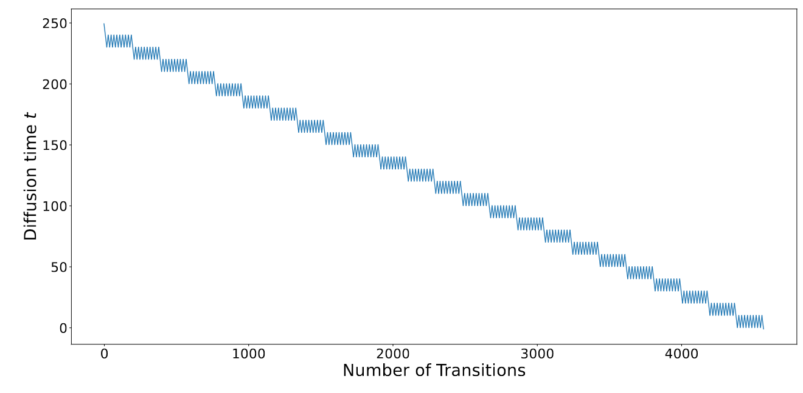

Evaluation 

- 생성된 image 가 사실적인가 (human eval)
- LPIPS : 2개의 이미지 유사도 평가 (VGG network 에 넣어서 중간 layer feature 값들을 비교, the lower is better)

Result

- free-form mask 에 대해서 좋은 성능을 달성한다. 
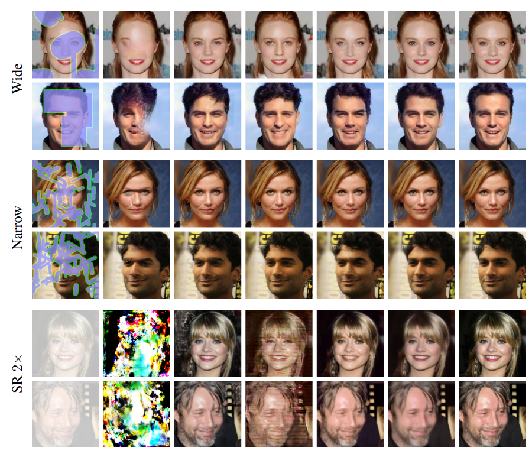
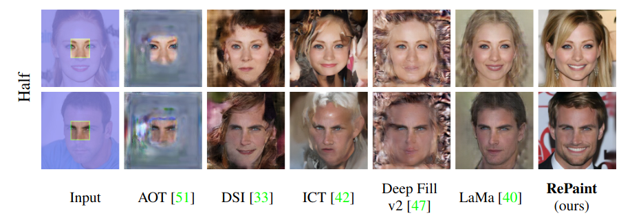
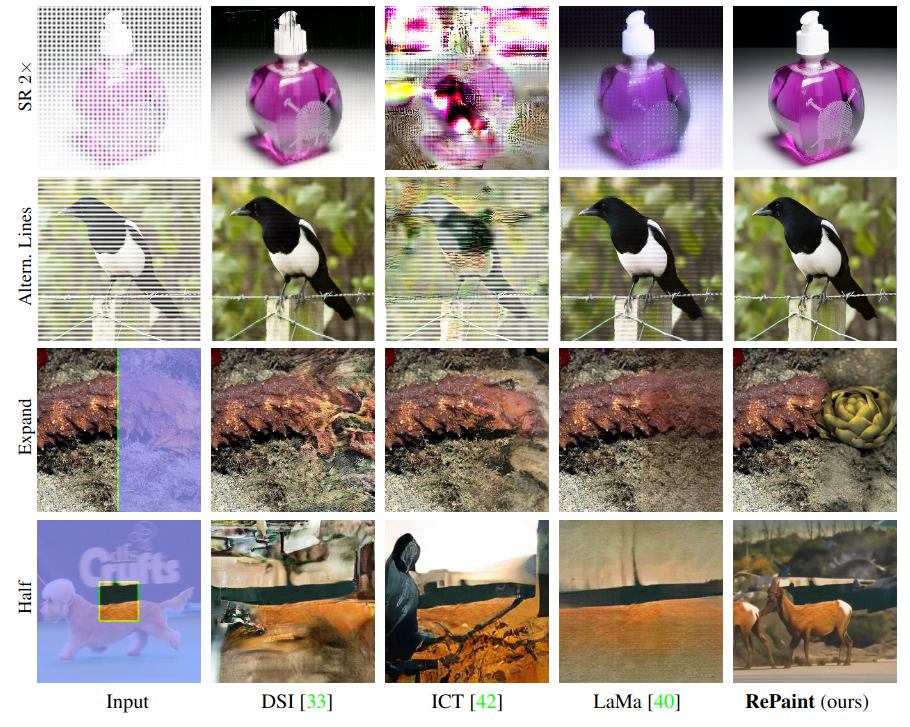

Ablation study

- 대체로 r, j 모두 늘리는 방향이 점수가 높다

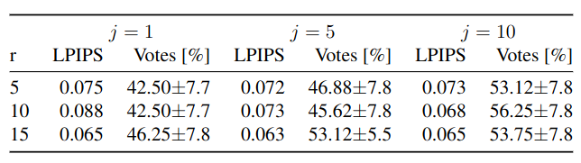

## 5. 정리

- Iterative 하게 Random Gaussian noise 를 sampling 했기 때문에 다양한 output image 를 생성할 수 있다. 
- free-form inpainting 이 가능하다. (masking 모양에 대한 generalization 능력을 갖춤)
- 다른 diffusion-based model 과 마찬가지로 GAN 이나 autoregressive-based model 보다 느리다. 이는 실시간 적용이 힘들다는 얘기와 같다.
- 넓은 mask 를 사용하는 경우, ground truth 와 굉장히 다른 이미지를 생성해낸다. 

## 참고

- [Paper](https://arxiv.org/abs/2201.09865)
