# Structure-aware MRI Translation: Multi-Modal Latent Diffusion Model with Arbitrary Missing Modalities

*MICCAI(2025), 3 citation, China, Review Data: 2026.04.20*

> [!TIP]
> **한 줄 요약** — 임의의 모달리티 조합으로 누락된 MRI 모달리티를 단일 latent diffusion model로 합성하면서, 모달리티 불변 구조 표현(SPM)과 고주파 보상(HFCM)으로 해부학적 구조를 보존한다.

| 흐름 | 내용 |
|:--|:--|
| **문제** | 기존 diffusion 기반 MRI 합성은 고정된 입력-출력 모달리티 쌍에 제한되어 임의의 누락 시나리오를 처리하지 못하고, 해부학적 구조와 미세한 질감을 손상시킨다 |
| **아이디어** | 모달리티를 무작위 마스킹하는 many-to-many LDM + disentanglement로 얻은 모달리티 불변 구조 표현과 Laplacian 기반 고주파 정보를 해부학적 사전정보로 diffusion에 주입 |
| **결과** | BraTS2020/2021에서 평균 PSNR·SSIM 최고, 합성 영상을 넣은 segmentation Dice도 비교 방법(MMGAN, ReMIC, MMT)보다 우수 |

  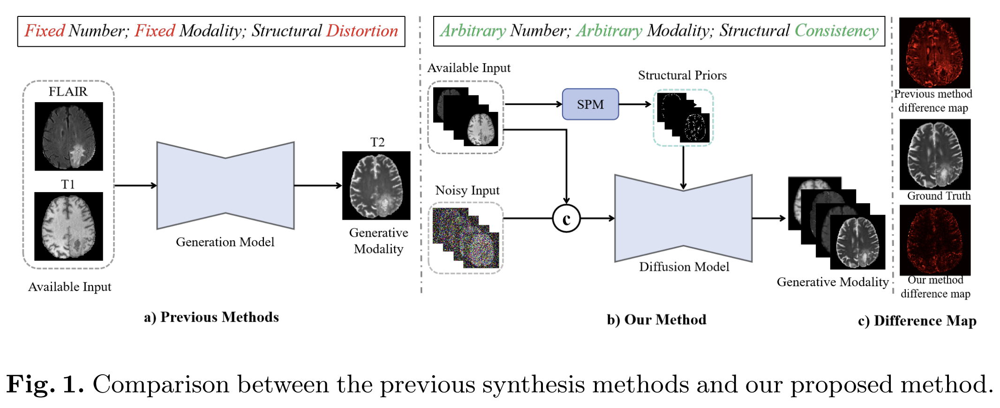 
  <b>Figure 1.</b> 기존 합성 방법(고정 모달리티, 구조 왜곡)과 MISA-LDM(임의 모달리티, 구조 일관성) 비교

---

## 1. 문제 정의 — 왜 이 논문이 필요한가

- Multi-modal Magnetic Resonance Imaging (MRI)은 서로 보완적인 해부학적 및 병리학적 정보를 제공함으로써 임상 진단에서 중요한 역할을 한다.
- 그러나 비용, 촬영시간, 영상 손상과 같은 현실적인 제약으로 인해 일부 모달리티가 누락된 불완전 획득은 여전히 흔하게 발생한다.
- 최근 diffusion model은 의료 영상 간 변환 (image-to-image translation) task에서 큰 가능성을 보여주었다.
    - 하지만 기존의 대부분의 diffusion 기반 합성 모델은 고정된 입력-출력 모달리티 쌍에 제한되어 있어, 임의의 누락 시나리오를 유연하게 처리하지 못한다. 또한 이러한 접근법은 생성 과정에서 해부학적 구조의 일관성을 손상시키고 중요한 질감 세부 정보를 저하시킬 수밖에 없으며, 이는 미세한 병리 패턴의 오진으로 이어질 가능성이 있다.

- 이러한 문제를 해결하기 위해, 우리는 잠재 확산 모델(latent diffusion model)을 기반으로 한 모달리티 불변 구조 인식(modality-invariant structure awareness)을 갖춘 최초의 many-to-many MRI 합성 프레임워크인 MISA-LDM을 제안한다. 본 방법은 사용 가능한 임의의 모달리티 조합을 활용하여, 단일 모델 안에서 누락된 모달리티를 합성할 수 있도록 한다. 동시에 우리는 disentanglement 전략을 이용해 모달리티 불변의 구조 표현을 획득하고, 고주파 정보를 보완적으로 활용하는 구조 보존 모듈(Structure-Preserving Module, SPM) 을 도입한다. SPM이 얻은 해부학적 사전정보(anatomical priors)를 diffusion 과정에 반영함으로써, 해부학적 구조의 완전성을 유지한다.

- BraTS2020 및 BraTS2021 데이터셋에서 수행한 광범위한 실험은 우리 방법의 우수성을 입증한다. 이러한 결과는 다중 모달 MRI 변환에서 생성 일관성을 보존하기 위해 보다 포괄적인 해부학적 사전정보를 도입하는 것이 필요함을 보여준다.

- 자기공명영상(MRI)은 뇌 질환의 진단과 치료에 널리 사용되는 비침습적 영상 기법이다. T1 강조영상(T1w), T2 강조영상(T2w), 조영증강 T1 강조영상(T1CE), 그리고 FLAIR 영상(fluid attenuated inversion recovery) 등을 포함하는 다중 모달 MRI 스캔은 해부학적 구조를 상호보완적으로 보여주며, 각각 서로 다른 연부조직 특성을 강조한다. 이러한 다양한 관점은 효과적인 다중 모달 의료영상 분할 및 검출에 매우 중요하다. 그러나 촬영 시간과 비용의 제약으로 인해, 임상 환경에서 완전한 다중 모달 영상 세트를 확보하는 것은 어려울 수 있다. 이를 해결하기 위해, 사용 가능한 모달리티의 데이터를 활용하여 누락된 모달리티를 합성하는 다중 모달 생성 모델에 대한 관심이 점차 높아지고 있다.

- 즉, MRI에는 T1 ~ FLAIR 처럼 여러 모달리티가 있고, 각각 보여주는 정보가 조금씩 다르다. 따라서 여러 종류를 다 찍으면 진단에 더 유리한데, 촬영 시간이 길고 비용이 들고 환자가 움직이거나 등의 문제로 모든 모달리티를 완벽하게 얻을 수 없다. 따라서 본 논문은 찍을 수 있는 MRI만 먼저 찍고 그걸 바탕으로 빠진 MRI 모달리티를 모델이 합성해서 채우는 방법론이다. 근데 다른 방법론은 고정된 입력으로 유연하게 입력 처리를 하지 못하는데, 본 방법론은 임의의 모달리티 조합을 활용하여 단일 모델이 합성하도록 한다.

- 초기의 다중 모달 MRI 변환 연구는 주로 생성적 적대 신경망(GAN)에 의존했다. GAN 기반 모델은 사용 가능한 모달리티를 누락된 모달리티로 직접 매핑하는 생성자-판별자 구조를 학습하도록 설계되었다. 그러나 이러한 방법들은 조기 수렴, 모드 붕괴(mode collapse), 그리고 고품질이면서 구조적으로 일관된 영상을 생성하지 못하는 한계를 가진다.

- 최근에는 안정적인 학습 과정과 더 우수한 생성 품질이라는 장점을 바탕으로 diffusion model이 생성 과제의 주류 방법으로 GAN을 점차 대체하고 있다. diffusion model의 유연성과 안정적인 학습 특성은 의료영상 합성에 더욱 적합하다. 예를 들어, Ozbey 등은 비지도 의료영상 변환을 위한 적대적 diffusion model을 처음 제안했다. Xing 등은 타깃 모달리티의 분포를 조건으로 생성 과정을 제어하는 cross-conditioned diffusion model을 제안했다. 그러나 Fig. 1에서 보이듯이, 기존 diffusion 기반 생성 방법들은 필연적으로 미세한 세부 정보와 해부학적 구조의 손상을 초래하며, 이는 질병 진단 정확도에 부정적인 영향을 미친다. 이러한 문제는 diffusion model의 반복적인 잡음 추가 및 제거 과정, 특히 denoising의 초기 또는 후기 단계에서 발생한다. 또한 다중 모달 데이터를 다룰 때는 서로 다른 모달리티 간 상관관계를 모델링하는 것이 더 복잡하기 때문에 문제가 더욱 심화된다. 현재까지 diffusion model 기반의 many-to-many MRI 변환에 대한 연구는 아직 이루어지지 않았다.

- 이러한 다중 모달 MRI 합성의 문제를 해결하기 위해, 우리는 Fig. 2에 제시된 바와 같이 Latent Diffusion Model(LDM)기반의 새로운 모달리티 불변 구조 인식 MRI 합성 모델인 MISA-LDM을 제안한다. 기존 모델과 달리, MISA-LDM은 임의의 입력-출력 모달리티 조합을 처리할 수 있도록 설계된 many-to-many 합성 모델로, 일부 모달리티가 누락될 수 있는 상황에서도 높은 유연성을 제공한다.

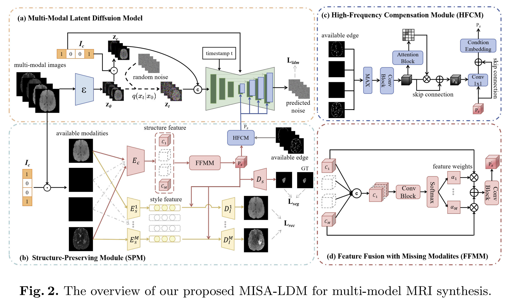

- MRI 합성 과정에서 구조 손실을 완화하기 위해, MISA-LDM은 해부학적 구조 보존을 강화하여 고품질 MRI 합성 능력을 높이는 전용 구조 보존 모듈(Structure-Preserving Module, SPM) 을 포함한다. 구체적으로 SPM은 disentanglement 전략을 사용하여 모달리티 불변 구조 표현을 추출하고, 이를 해부학적 사전정보(anatomical priors)로 활용하여 생성 과정을 유도함으로써 핵심 구조적 특징이 유지되도록 한다.

- 한편, SPM은 상위 수준의 해부학적 구조 보존에는 효과적이지만, 정확한 영상 합성에 필요한 미세한 질감 세부 정보까지 완전히 포착하지는 못할 수 있다. 이를 해결하기 위해 우리는 diffusion 과정에 고주파 정보를 통합하는 고주파 보상 모듈(High-Frequency Compensation Module, HFCM) 을 제안한다. 이 모듈은 SPM을 강력하게 보완하며, 경계의 선명도와 질감 패턴을 향상시킨다. 이 두 모듈의 결합을 통해, 모델은 전체적인 해부학적 일관성을 유지할 뿐만 아니라 미세하고 현실적인 질감까지 생성할 수 있다.

## 2. 방법

- 본 논문의 contribution을 먼저 정리해보자면 다음과 같다.
    - Diffusion model에 사용 가능한 modalities의 위치를 제공함으로써 유연한 입력을 가진다.
    - SPM module을 통해서 상위 수준의 해부학적 구조 보존 + 미세한 질감 세부 정보를 diffusion model에 제공한다.
        - 구체적으로 FFMM module의 output인 $P_s'$은 모달리티 불변성을 가지는 근본적인 해부학적 특징으로 가정한다. 이를 위해 $L_{seg}$를 수행
        - 또한 $P_s'$을 각 style feature와 결합하여 decoding하여 reconstruction한다. 원래 우리가 기대하는 style feature가 모든 정보를 들고 있는 것이 아닌, 각 MRI 모달리티가 가지는 고유한 시각적 특징을 가지고 있게끔 유도하는 것이다.
            - 즉, $P_s'$은 모달리티 불변성의 해부학적 특징, style feature $s_i$는 특정 모달리티의 시각적 특징을 가지리라 기대하고 합쳐서 decoding 하는 것이다.
        - 이후, 미세한 디테일을 위해 HFCM을 도입하여 고주파에 대한 정보를 추가적으로 제공한다.

- Overview: MISA-LDM은 두 가지 핵심 구성 요소로 이루어진다.
    - (a) 임의의 모달리티 조합 변환을 위해 설계된 다중 모달 잠재 확산 모델(multimodal latent diffusion model)
    - (b) 구조적 일관성을 보존하기 위한 구조 보존 모듈(Structure-Preserving Module, SPM) 이다.
    - VAE의 encoder, decoder를 학습하여, 서로 다른 모달리티 전반에 걸친 통합 잠재 공간을 구축한다.
    - Encoder를 통과한 latent representation은 concat되어 통합 표현 $z_0$를 형성한다.
    - 임의의 누락 시나리오를 처리할 수 있도록, 임의 개수의 모달리티를 무작위로 마스킹하고 (단, 최소 한 개는 항상 사용가능하도록 유지) 이를 조건 변수 $z_c$로 사용한다.
    - 또한, 누락된 목표 모달리티의 생성을 명시적으로 유도하기 위해, 이진 지시 벡터 (binary indicator vector) $I_c$를 cross-attention 매커니즘을 통해 diffusion model에 포함한다. (마찬가지로 $z_c$ 에 같이 사용됨)
    - $P_s$: 해부학적 사전정보 (anatomical priors)

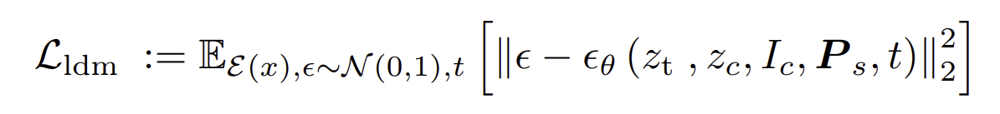

### Structure-Preserving Module

- Disentanglement for coarse modality-invariant structural representation (거친 모달리티 불변 구조 표현을 위한 분리 표현)
    - Overview (b)에 나타난 바와 같이, 합성된 영상에서 해부학적 일관성을 보존하기 위해 생성 과정을 유도할 수 있도록 사용 가능한 모달리티들로부터 모달리티 불변 구조 표현(modality-invariant structural representation) 을 추출하는 분리 표현 전략(disentanglement strategy) 을 제안한다.
    - 구체적으로, 모달리티별 스타일 인코더(modality-specific style encoders) 와 공유 구조 인코더(shared structure encoder) 로 구성된 이중 인코더 프레임워크(dual-encoder framework) 를 제안한다. 각 모달리티 $i$에 대해, 전용 스타일 인코더 $E_s^i$는 해당 모달리티의 고유한 스타일 벡터 $s_i$를 추출하고 (style feature), 공유 구조 인코더 $E_c$는 모달리티에 독립적인 고수준 구조 표현 $C_i$를 (structure feature) 추출한다.
    - 유용한 정보를 효과적으로 활용하기 위해, 우리는 누락 모달리티를 고려한 특징 융합 모듈(Feature Fusion with Missing Modalities, FFMM) 을 제안한다. 이 모듈은 (d)에 나타난 것처럼 sigmoid gating 매커니즘을 통해 특징 가중치를 동적으로 조정한다. 모든 구조 특징들은(누락된 값은 0으로 채움) FFMM을 통해 통합되어, 다음과 같은 거친 구조 표현 $P_s'$를 형성한다. 즉, 독립적인 고수준 구조 표현 $C_i$의 중요도를 기준으로 weighted sum한 게 feature $P_s'$
    - 여기서의 $M$은 전체 모달리티 수이다.

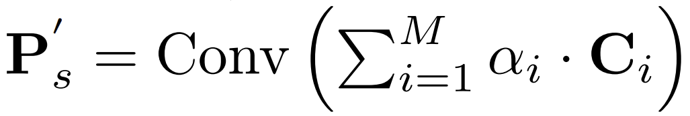

- 성공적인 분리 표현을 유도하기 위해, 두 가지 서로 다른 디코더 구조를 사용한다.
    - 모달리티별 디코더 $D_I^i$: $P_s'$와 $s_i$로부터 사용 가능한 모달리티를 복원한다.
    - 분할 디코더 $D_s$: $P_s'$로부터 직접 뇌종양 마스크를 예측한다.
    - 여기서의 $\bar M$은 사용 가능한 모달리티 수이다.

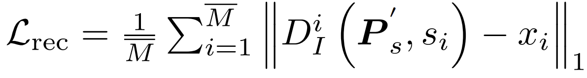

- 한편, 해부학적 구조 추출을 유도하기 위해 Dice 기반의 segmentation loss $L_{seg}$ 도 함께 사용한다.
    - 최종적으로 제안한 방법의 전체 손실 함수는 다음과 같다.

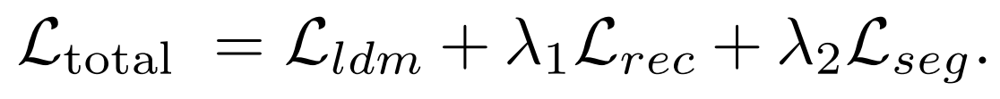

### Supplementing with high-frequency information

- 거친 모달리티 불변 구조 표현은 합성된 모달리티에서 해부학적 일관성을 보존하는 데 효과적이지만, 고수준 의미 정보에 초점을 두기 때문에 미세한 저수준 디테일이 손상될 수 있다. 이러한 한계를 해결하기 위해, 우리는 (c)와 같이 경계 패턴을 명시적으로 보존하고 강화하는 고주파 보상 모듈 (High-Frequency Compensation Module, HFCM)을 설계한다.

- 구체적으로, 우리는 Laplacian 연산자를 사용하여 사용 가능한 모달리티들로부터 에지(edge) 정보를 추출한 뒤, max-pooling 연산을 통해 가장 정보량이 많은 고주파 특징만 유지한다. 이후 self-attention 메커니즘 을 구성하여 병변 경계와 같은 중요한 영역에 집중하도록 하고, 세부 특징들에 대한 동적 가중치 할당을 수행한다.
    - $e_i$는 $i$번째 사용 가능한 모달리티에서 추출된 edge map을 의미한다. 누락된 값은 $0$으로 채운다.

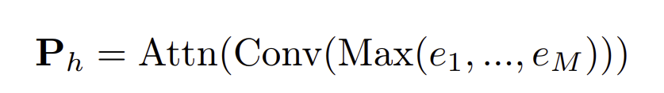

- 이렇게 최적화된 고주파 표현 $P_h$는 거친 구조 표현 $P_s'$와 결합되어, 향상된 해부학적 사전정보 $P_s$를 생성한다.
    - 이 $P_s$는 다중 스케일 prior 정보로써 학습 가능한 조건 임베딩 layer (learnable conditional embedding layer)를 통해 diffusion model의 denoising 과정에 주입되며, 이를 통해 더 나은 해부학적 타당성과 세부 묘사 충실도를 동시에 달성한다.

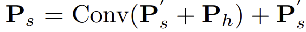

## 3. 실험

### Datasets and Implementation

- BraTS2020 데이터셋은 총 369개의 다중 모달 3D 뇌 MRI volume으로 구성되어 있다.
- BraTS2021 데이터셋은 1251개의 다중 모달 3D 뇌 MRI 볼륨을 포함한다. 두 데이터셋 모두 각 케이스는 T1, T2, T1CE, FLAIR의 네 가지 구조적 MRI 스캔으로 이루어져 있다.

- 전처리 단계에서는 3D 볼륨을 $z$ 축 방향으로 2D 이미지들의 집합으로 슬라이싱하며, 이때 segmentation label도 함께 포함한다. 이후 각 이미지는 $256 \times 256$ 으로 resize된다.

### Comparison with State of the Art Methods

- 이 절에서는 제안한 MISA-LDM을 여러 다중 모달 MRI 합성 방법들과 비교한다. 비교 대상에는 MMGAN, ReMIC, MMT가 포함된다.

- Table 1은 BraTS2020 및 BraTS2021 데이터셋에서 비교 합성 방법들의 결과를 보여준다. 우리 방법은 두 데이터셋 모두에서 평균 PSNR(Peak Signal-to-Noise Ratio) 과 SSIM(Structural Similarity Index) 점수에서 가장 높은 성능을 달성하였다. 이러한 결과는 제안한 접근법의 효과를 정량적으로 입증한다.
    - 특히, 사용 가능한 모달리티 수가 증가할수록 영상 합성 품질이 점진적으로 향상되는 경향이 관찰되었는데, 이는 우리 모델이 서로 다른 모달리티 간의 상보적 정보(complementary information) 를 효과적으로 활용할 수 있음을 보여준다.

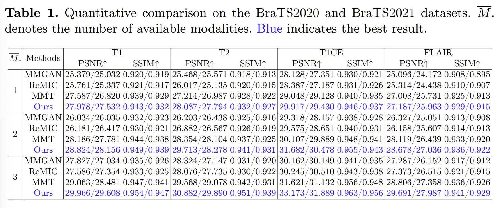

- 또한 우리 방법이 구조적 일관성(structural consistency) 을 잘 보장한다는 점을 추가로 보여주기 위해, 학습된 segmentation model을 이용하여 합성 영상에서 해부학적 구조 보존 정도를 평가하였다.
    - 구체적으로, 우리는 T1, T2, T1CE, FLAIR 영상을 입력으로 받아 테스트 세트에서 종양 마스크를 생성하는 다중 모달 분할 모델을 학습하였다. 그 결과는 Table 2의 첫 번째 행에 제시되어 있다.
    - 이후, 단일 모달리티가 누락된 상황을 가정하고, 서로 다른 방법으로 해당 누락 모달리티를 합성하였다. 그리고 테스트 세트의 이렇게 보완된 다중 모달 영상 시퀀스를 동일하게 학습된 segmentation model에 입력하여 종양 마스크를 생성하였다.
    - 분할 결과는 다음 세 가지 항목의 Dice score로 평가하였다.
        - WT (Whole Tumor): 전체 종양
        - TC (Tumor Core): 종양 핵심부
        - ET (Enhancing Tumor): 조영 증강 종양
    - Table 2에서 보이듯이, 우리 MISA-LDM은 Dice score 기준에서 다른 방법들보다 더 우수한 성능을 보였으며, 이는 합성 과정에서 해부학적 구조를 잘 보존하는 능력이 뛰어남을 의미한다.
    - 또한 이러한 결과는 영상 합성 과정에서 구조적 일관성을 보존하는 것이 영상 품질 향상에 매우 중요하다는 점을 시사한다.

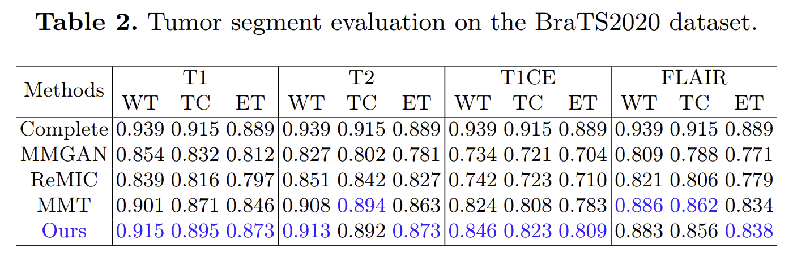

- 정성적 분석(Qualitative Analysis).
    - Fig. 3에는 BraTS2020 데이터셋에서 우리 MISA-LDM과 여러 비교 방법들이 생성한 합성 MRI 영상의 정성적 결과가 제시되어 있다. 우리는 서로 다른 합성 모델들을 이용하여, 세 개의 사용 가능한 모달리티로부터 하나의 누락된 모달리티를 생성하고 그에 따른 시각적 결과를 얻었다. 확대된 빨간 박스 안의 관심 영역(ROI)에서 볼 수 있듯이, 우리 방법은 다른 접근법들에 비해 더 정확한 뇌종양 영역과 더 현실적인 조직 질감을 생성한다. 이러한 시각적 관찰은 MISA-LDM이 다양한 임상 시나리오에서 강건한 cross-modality 합성에 뛰어날 뿐 아니라, 구조적 일관성 보존 측면에서도 다른 방법들보다 우수함을 입증한다.

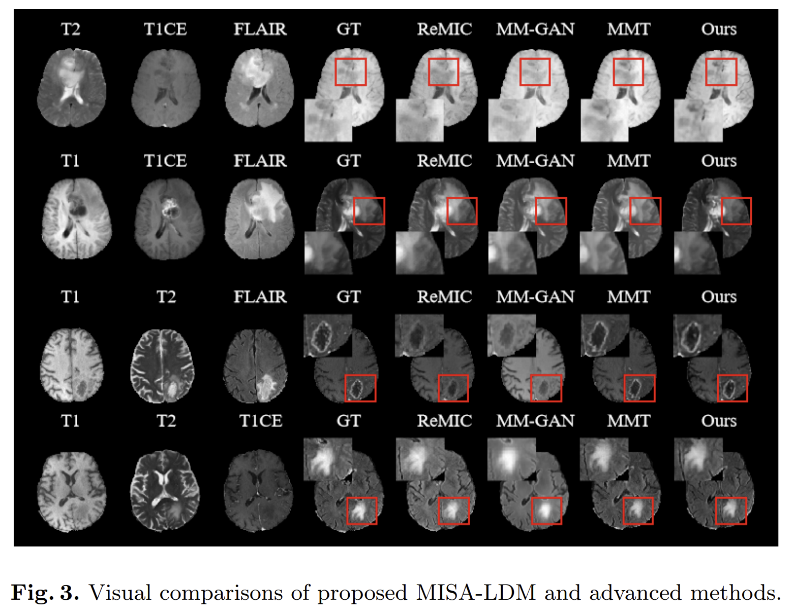

- Fig. 4는 사용 가능한 모달리티 조건이 서로 다른 상황에서 MISA-LDM이 합성한 MRI 영상을 보여준다. 이 결과로부터, 합성 시 사용할 수 있는 모달리티가 많을수록 더 높은 품질의 타깃 모달리티 영상이 생성된다는 것을 확인할 수 있다. 또한 이 결과는 MISA-LDM이 다중 모달 영상 내의 상보적 정보를 효율적으로 활용함을 보여준다.

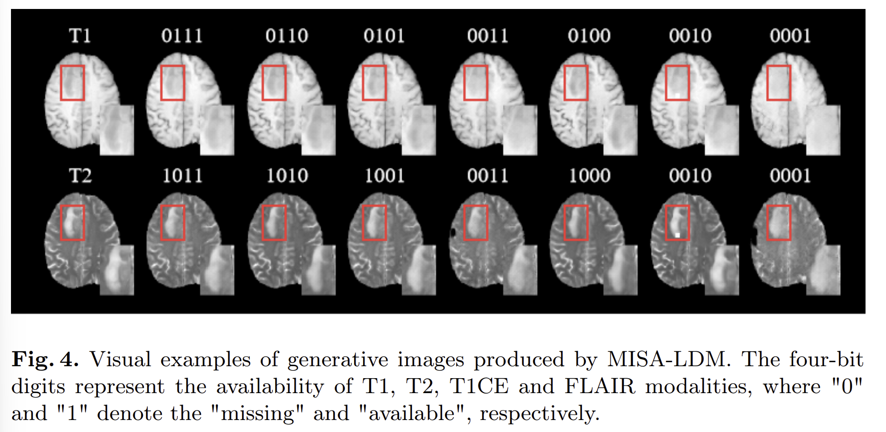

### Ablation Study

- 이 절에서는 핵심 기술 요소들의 개별 기여도를 엄밀히 평가하기 위해 BraTS2020 데이터셋에서 ablation study를 수행하였다. 점진적 ablation 프로토콜에 따라, 우리는 다음의 세 가지 핵심 요소를 체계적으로 분석하였다.
    - 구조 보존 모듈(Structure-Preserving Module, SPM)
    - 고주파 보상 모듈(High-Frequency Compensation Module, HFCM)
    - SPM 내부의 disentanglement 전략을 통해 얻어지는 거친 모달리티 불변 구조 표현(coarse modality-invariant Structural Representation, SR)

- 우리는 한 번에 하나의 타깃 모달리티를 마스킹하고, 나머지 세 개의 사용 가능한 모달리티를 이용해 이를 보완(imputation)하였다. 정량적 결과는 Table 3에 요약되어 있다. 영상의 충실도와 지각적 품질을 평가하기 위해 PSNR과 SSIM을 사용하였고, 전체 종양(Whole Tumor, WT)의 Dice score는 정답 영상과의 구조적 일관성을 반영한다. 결과는 각 모듈이 모두 성능 향상에 기여함을 보여주며, 특히 완전한 SPM이 전반적으로 가장 우수한 결과를 달성하였다. 이는 해당 모듈이 합성 품질 향상과 해부학적 구조 보존 모두에 효과적임을 나타낸다.

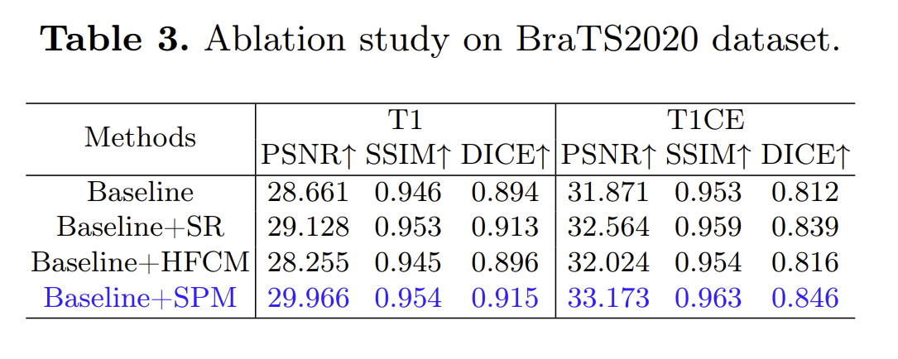

## 4. 정리

- 본 연구에서는 임의의 누락 모달리티 조합을 처리할 수 있는 유연한 다중 모달 MRI 합성을 위한 새로운 잠재 확산 프레임워크 MISA-LDM을 제시하였다. 모달리티 불변 구조 특징 분리(modality-invariant structural feature disentanglement)와 적응적 고주파 보상을 포함하는 구조 보존 모듈을 통합함으로써, 제안한 방법은 cross-modal 생성 과정에서 전역적인 해부학적 구조와 미세한 병리학적 세부 정보를 모두 효과적으로 보존한다. BraTS2020 및 BraTS2021 데이터셋에서 수행한 종합적인 실험은 제안한 MISA-LDM의 우수성을 입증하였다. 또한 각 모듈의 효과를 검증하기 위해 ablation study도 함께 수행하였다.

## 참고

- [Paper](https://papers.miccai.org/miccai-2025/paper/0110_paper.pdf)
