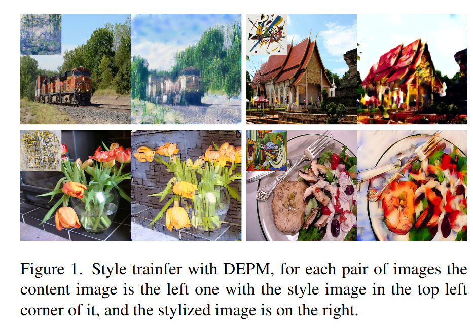
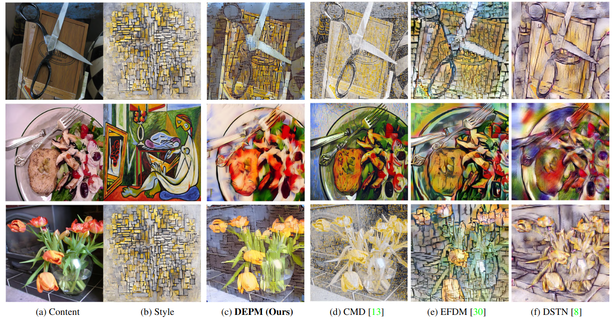

# Diffusion-Enhanced PatchMatch: A Framework for Arbitrary Style Transfer with Diffusion Models

*CVPRW(2023)*

> [!TIP]
> **한 줄 요약** — Stable Diffusion의 latent space에서 patch 기반 기법과 whitening and coloring transform(WCT)을 사용해, fine-tuning이나 pre-training 없이 inference 시에 임의의 스타일을 전송한다 (DEPM).
>
> *Core Idea: "Style Transfer using Diffusion Model without Any Training"*

| 흐름 | 내용 |
|:--|:--|
| **문제** | 단어로 style을 표현하는 것은 어렵고, 기존 style transfer는 optimization이나 network training이 필요하다 |
| **아이디어** | Stable Diffusion의 latent space에서 patch-based technique과 whitening and coloring transformation을 활용 |
| **결과** | 학습 없이 arbitrary style transfer가 가능하고, input image의 content detail을 보존하면서 color transformation 관점에서 우수한 성능을 보인다 |

   
  <b>Figure 1.</b> DEPM 개요

---

## 1. 문제 정의 — 왜 이 논문이 필요한가

- Diffusion model 은 text-to-image synthesis 부터 image restoration, image enhancement, image compression, image inpainting 등 다양한 task 를 수행할 수 있다.
- 하지만, 단어로 style 을 표현하는 것은 어려운 과제이다.
- 본 논문에서는 Stable Diffusion 을 활용하여 어떤 finetuning 이나 pre-training 없이 style transfer 를 하는 Diffusion-Enhanced PatchMatch(*DEPM*) 를 제안한다.
- 즉, inference 시에 임의의 스타일을 전송할 수 있다.

## 2. 사전 지식

- Style transfer technique 은 3 가지 type 으로 분류할 수 있다.
    - Optimization-based
        - A neural algorithm of artistic style(2015)
        - Arbitrary style transfer in real-time with adaptive instance normalization(2017)
    - Neural network training-based
        - Perceptual losses for real-time style transfer and super-resolution(2016)
        - A style-aware content loss for real-time hd style transfer(2018)
    - Arbitrary image style transfer
        - Fast patch-based style transfer of arbitrary style(2016)
        - Universal style transfer via feature transforms(2017)

- DEPM 은 훈련이 필요하지 않고 임의의 스타일을 전송하는 더 유연하고 효율적인 해결책을 제공하려는 $3$ 번째 범주에 속한다. (Arbitrary image style transfer)

## 3. 방법

- Whitening and Coloring Transform(WCT)

## 4. 실험

  

## 5. 정리

- Utilize Patch-based techniques with whitening and coloring transformations in latent space
- Input image 의 content detail 을 보존하면서 color transformation 관점에서 우수한 성능을 보여준다.
- 어떤 학습 없이 arbitrary style transfer 가 가능하다.

## 참고

- [Paper](https://openaccess.thecvf.com/content/CVPR2023W/GCV/papers/Hamazaspyan_Diffusion-Enhanced_PatchMatch_A_Framework_for_Arbitrary_Style_Transfer_With_Diffusion_CVPRW_2023_paper.pdf) · 관련 리뷰: [Image Style Transfer](../image-style-transfer/README.md)
