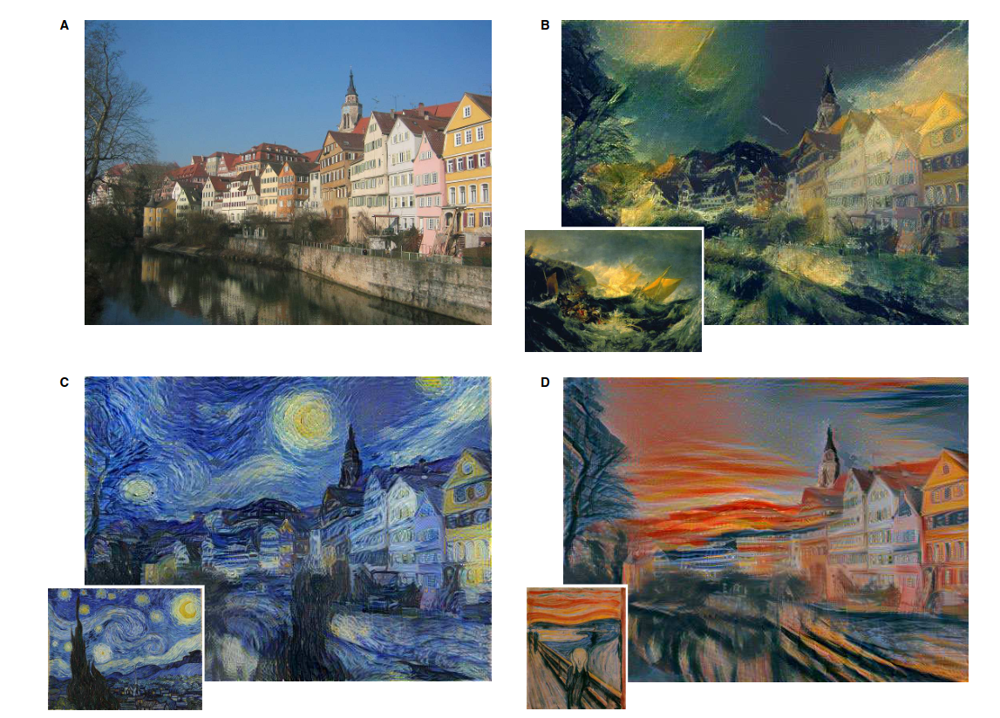
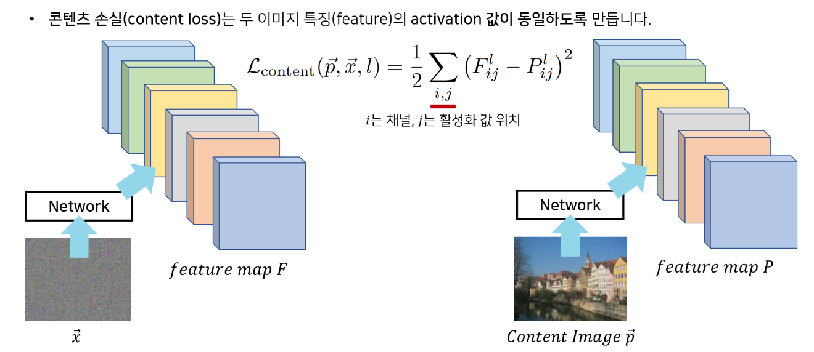
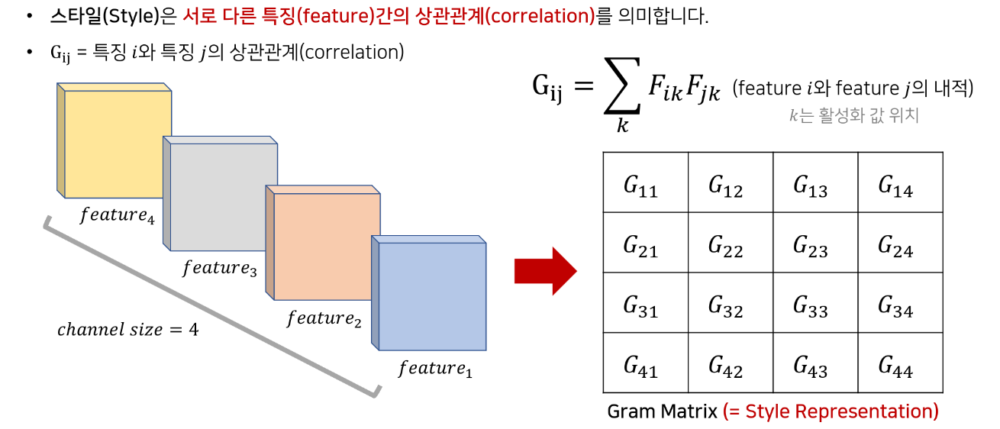
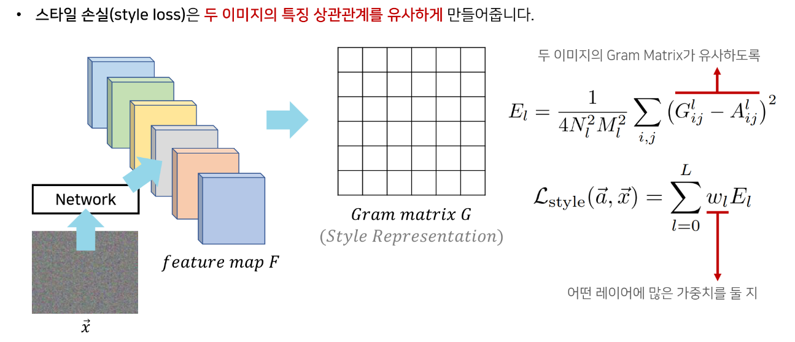
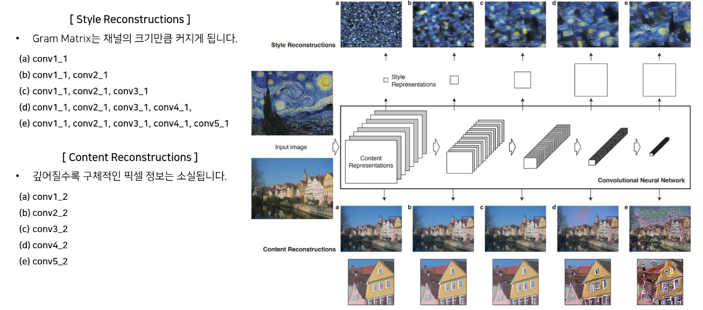
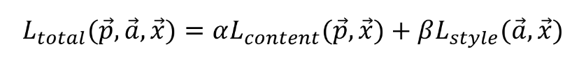
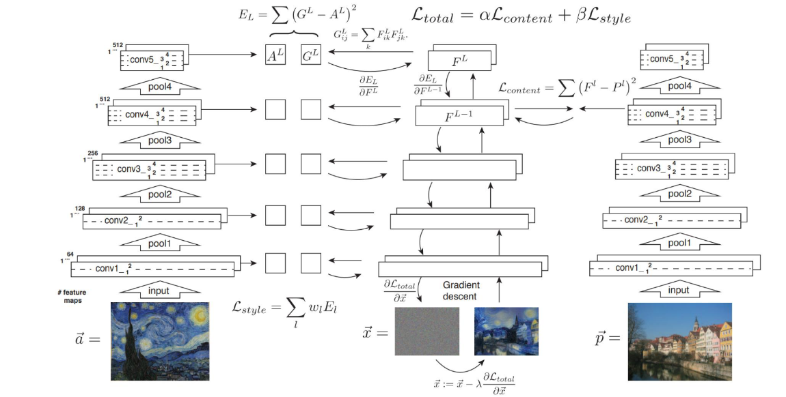
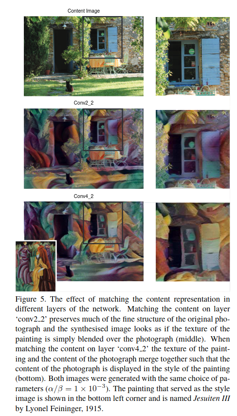

# Image Style Transfer using Convolutional Neural Networks

*CVPR(2016), 5556 citation*

> [!TIP]
> **한 줄 요약** — CNN feature로 content representation을, feature의 Gram matrix로 style representation을 명시적으로 정의해 둘을 분리하고, 한 이미지의 content와 다른 이미지의 style을 결합한 이미지를 합성한다.
>
> *Core Idea: "Style Transfer using CNN with Explicit Definitions(Gram Matrix-Content and Style Disentanglement)"*

| 흐름 | 내용 |
|:--|:--|
| **문제** | 이미지를 다른 스타일로 변환시키고 싶지만, style과 content의 분리를 가능하게 하는 representation이 부족했다 |
| **아이디어** | CNN으로 추출한 feature representation으로 content를, feature 간 Gram matrix로 style을 표현하고 이를 맞추도록 이미지를 합성 |
| **결과** | 임의의 사진의 content를 유지하면서 유명한 예술 작품의 style을 입힌 이미지를 생성한다 |

   
  <b>Figure 1.</b> Image Style Transfer 개요

---

## 1. 문제 정의 — 왜 이 논문이 필요한가

- 이미지를 다른 스타일로 변환시키는 것은 어려운 과제이다. 지금까지는 style 과 content 를 분리를 가능하게 하는 representation 이 부족했다.
- 이 분리를 CNN 으로 해보겠다는 접근. CNN 으로 추출한 feature representation 으로 texture 를 합성하도록 하겠다.

## 2. 방법

- CNN 의 filter 는 서로 다른 feature 값을 추출하도록 학습된다.
- Content representation

  

- Style representation

  

  

  

  

  

## 3. 실험

  

## 참고

- [Paper](https://www.cv-foundation.org/openaccess/content_cvpr_2016/papers/Gatys_Image_Style_Transfer_CVPR_2016_paper.pdf) · 관련 리뷰: [Inversion-based Style Transfer](../inversion-based-style-transfer/README.md)
