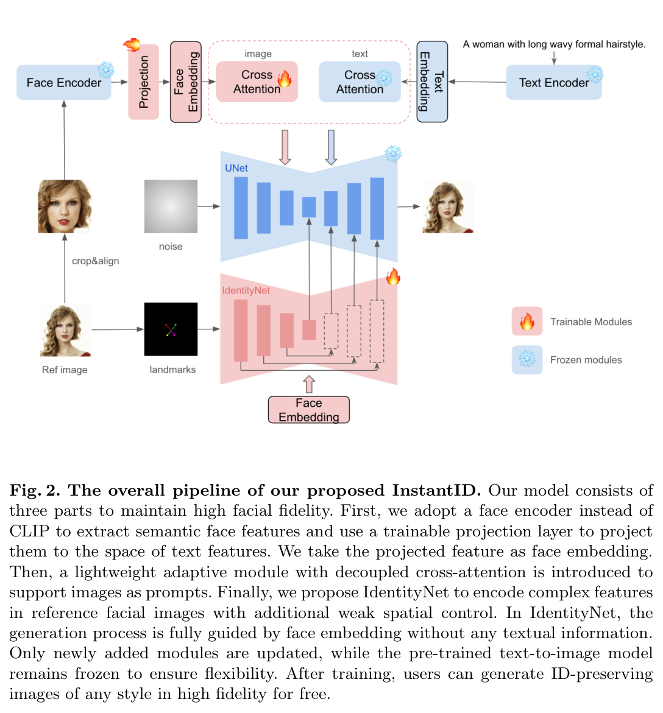

# InstantID: Zero-shot Identity-Preserving Generation in Seconds

*arXiv(2024)*

> [!TIP]
> **한 줄 요약** — 얼굴 이미지 한 장만으로, 추가 fine-tuning 없이 plug-and-play module인 IdentityNet을 통해 pre-trained text-to-image diffusion model이 identity를 보존한 이미지를 생성하게 한다.

| 흐름 | 내용 |
|:--|:--|
| **문제** | Textual Inversion, DreamBooth, LoRA 같은 개인화 방법은 저장 공간·긴 fine-tuning·여러 장의 reference image가 필요하고, ID embedding 기반 방법은 대규모 fine-tuning이 필요하거나 기존 community model과 호환되지 않거나 face fidelity가 낮다 |
| **아이디어** | Face image의 identity 정보를 강한 semantic condition과 약한 spatial condition으로 함께 주는 IdentityNet을 설계해, text prompt와 함께 생성을 guide |
| **결과** | 얼굴 이미지 한 장으로 높은 fidelity의 identity 보존 개인화가 가능하고, SD1.5·SDXL 같은 pre-trained model에 plug-and-play로 붙일 수 있다 |

   
  <b>Figure 1.</b> InstantID 개요

---

## 참고

- [Paper](https://arxiv.org/pdf/2401.07519.pdf) · 관련 리뷰: [IP-Adapter](../ip-adapter/README.md)
