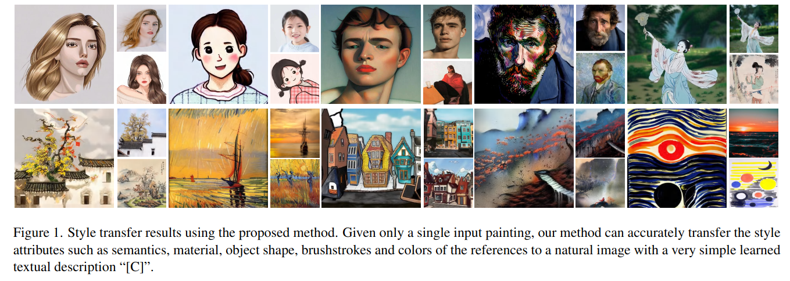
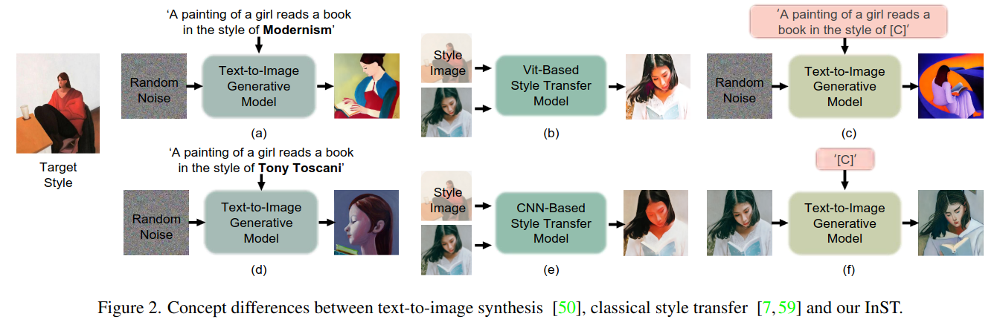
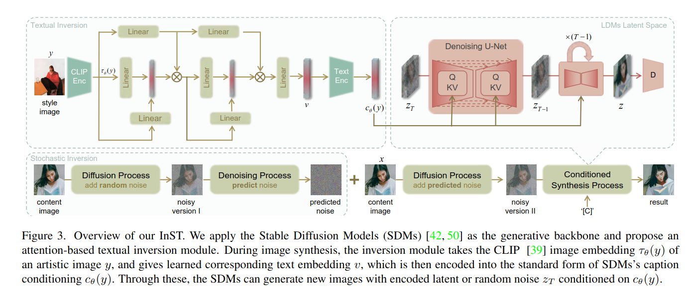
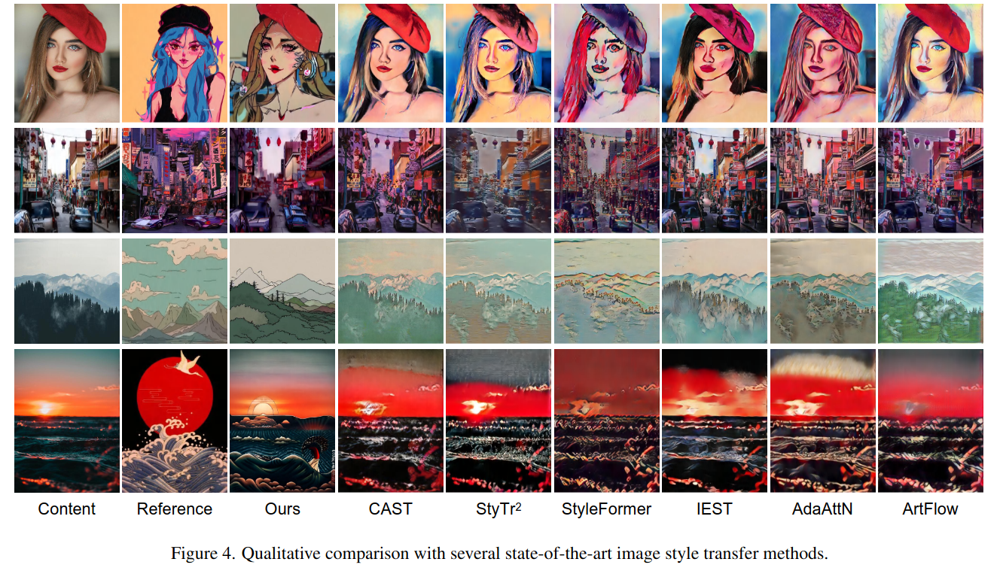
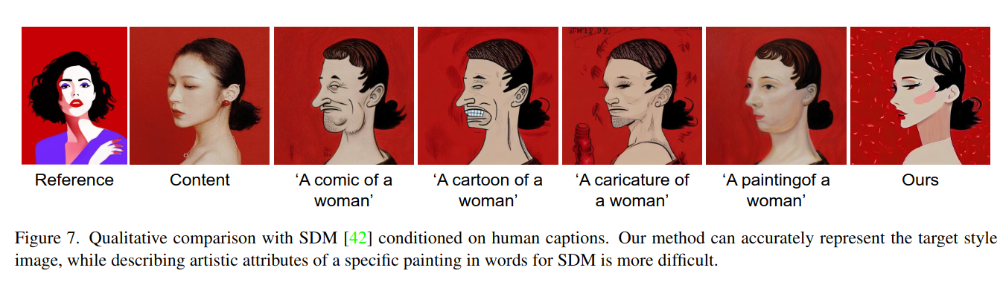

# Inversion-based Style Transfer with Diffusion Models

*CVPR(2023), 29 citation*

> [!TIP]
> **한 줄 요약** — 한 장의 그림에서 artistic style을 textual description $[C]$로 학습(inversion)하고, 이를 content image의 inversion과 함께 써서 복잡한 텍스트 설명 없이 그 style로 이미지를 합성한다 (INST).

| 흐름 | 내용 |
|:--|:--|
| **문제** | 예술 작품의 독특한 style은 일반 언어로 충분히 설명할 수 없다 |
| **아이디어** | Inversion-based style transfer method(INST): single painting의 artistic style을 textual description $[C]$로 학습하고, inference 시 $[C]$와 content image의 inversion으로 생성 |
| **결과** | 복잡한 텍스트 설명을 제공하지 않고도 single painting에서 학습한 artistic style로 이미지를 합성한다 |

   
  <b>Figure 1.</b> INST 개요

---

## 1. 문제 정의 — 왜 이 논문이 필요한가

- Art work(예술 작품) 의 독특함은 일반 언어로 충분히 설명할 수 없다.
- 본 논문의 핵심 아이디어는 artistic style 을 single painting 에서 학습하고 복잡한 텍스트 설명을 제공하지 않고도 합성하는 것이다.
- 구체적으로는 그림의 artistic style 을 학습하는 *inversion-based style transfer method(INST)* 를 제안한다.

## 2. 사전 지식

-  text guided stylization:
    -  StyleGAN-NADA: CLIP-guided domain adaptation of image generators
    -  Language-driven artistic style transfer
    -  StyleCLIP: Text-driven manipulation of stylegan imagery
    -  CLIPstyler: Image style transfer with a single text condition
-  style transfer
    -  ArtFlow: Unbiased image style transfer via reversible neural flows
    -  Arbitrary style transfer via multi-adaptation network
    -  Image style transfer using convolutional neural networks
    -  AdaAttN: Revisit attention mechanism in arbitrary neural style transfer
    -  Style-Former: Real-time arbitrary style transfer via parametric style composition
    -  Domain enhanced arbitrary image style transfer via contrastive learning
-  Diffusion-based method
    -  Diffusion models beat GANs on image synthesis
    -  Draw your art dream: Diverse digital art synthesis with multimodal guided diffusion
    -  DiffStyler: Controllable dual diffusion for text-driven image stylization
    -  Imagic: Text-based real image editing with diffusion models
    -  GLIDE: Towards photorealistic image generation and editing with text-guided diffusion model

## 3. 방법

  

  

- Textual description $[C]$ 학습
- Inference 시에, $[C]$ 와 content image 의 inversion 을 통해 생성

## 4. 실험

  

  

## 참고

- [Paper](https://openaccess.thecvf.com/content/CVPR2023/papers/Zhang_Inversion-Based_Style_Transfer_With_Diffusion_Models_CVPR_2023_paper.pdf) · 관련 리뷰: [Image Style Transfer](../image-style-transfer/README.md) · [Textual Inversion](../textual-inversion/README.md)
