# IP-Adapter: Text Compatible Image Prompt Adapter for Text-to-Image Diffusion Models

*arXiv(2023), 30 citation*

> [!TIP]
> **한 줄 요약** — Text feature와 image feature의 cross-attention을 분리한 가벼운 adapter만 학습해, 기존 text-to-image diffusion model을 고정한 채로 image prompt를 쓸 수 있게 하고 text prompt·custom model·controllable tool과도 호환되게 한다.
>
> *Core Idea: "All existing SD frameworks are frozen, learning only cross-attention to image embedding"*

| 흐름 | 내용 |
|:--|:--|
| **문제** | Text prompt만으로 원하는 이미지를 얻으려면 복잡한 prompt engineering이 필요하고, image-condition으로 직접 fine-tuning하는 기존 방법은 text 생성 능력을 잃고 재사용이 어려우며 ControlNet 같은 controllable method와 호환되지 않는다 |
| **아이디어** | CLIP global image embedding을 작은 projection network로 feature sequence로 만들고, 각 cross-attention layer에 image feature 전용 $W_k', W_v'$ 를 추가한 decoupled cross-attention의 output을 text cross-attention output에 더함 (약 $2200$만 parameter만 학습) |
| **결과** | Pre-trained diffusion model을 고정하므로 같은 base model에서 fine-tuning된 custom model, 기존 controllable tool과 호환되며 text prompt와 image prompt를 함께 쓸 수 있다 |

  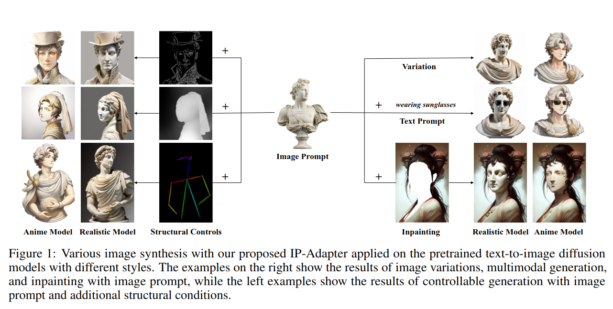 
  <b>Figure 1.</b> IP-Adapter 개요

---

## 1. 문제 정의 — 왜 이 논문이 필요한가

- Text-to-Image diffusion model 은 안정적인 생성 능력으로 고화질 이미지를 생성할 수 있다는 것이 입증됐다.
    - 하지만, text prompt 만 사용하여 원하는 이미지를 생성하는 것은 까다롭다. 복잡한 prompt engineering 을 포함하기 때문이다.
    - "그림 한 장이 천 개의 말보다 가치가 있다" 라는 속담처럼 image prompt 를 사용한다.
    - 기존의 사전 훈련된 모델에서 직접 미세 조정하는 기존 방법은 효과적이지만, text prompt 및 구조적 제어가 제어가 되지 않는다.

- Original diffusion-based T2I model 을 수정하지 않고 image prompt 를 사용하고 싶다!
    - Pre-trained diffusion model 을 고정시키기 때문에, 제안된 IP-Adapter 는 동일한 기본 모델에서 fine-tuning 된 다른 custom model 뿐만 아니라, 기존의 controllable tools 을 사용한 controllable generation 과도 호환이 된다.

> An image is worth a thousand words

## 2. 사전 지식

- SD Image Variations & Stable unCLIP: text-condition 대신 image-condition 으로 변경
    - 1. Text 를 사용한 이미지 생성 능력을 없앤다. 또한, large computing resource 가 필요하다.
    - 2. fine-tuned model 은 일반적으로 재사용이 불가능하다.
    - 3. Controllable method 와 같이 쓸 수 없다.
        - E.g., ControlNet 과 호환되지 않는다.

## 3. 방법

  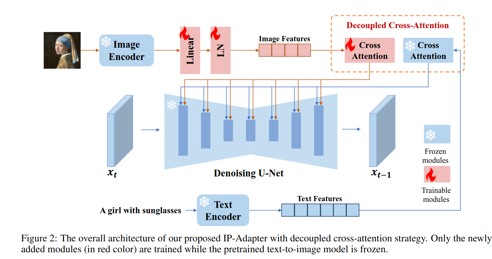

- Pre-trained diffusion model 에서 cross-attention layer 의 key 와 value projection weight 는 text feature 에 맞게 학습됐다. 결과적으로, image feature 와 text feature 를 cross-attention layer 에 병합하면 image feature 를 text feature 에 정렬하는 것만 달성되며 이로 인해 잠재적으로 일부 이미지 관련 정보가 누락되어 결국 reference image 를 사용한 제어 가능한 대략적인 생성만 가능하게 된다.
    - 따라서 본 논문에서는 text feature 와 image feature 에 대해 decoupled cross-attention 을 제안한다.
    - U-Net diffusion model 의 모든 cross-attention layer 중에서 image feature 에 대한 cross-attention layer 를 학습한다.
    - 결과적으로 $2200$ 만 개의 parameter 만을 가진다.

- Image Encoder
    - CLIP image encoder 의 global image embedding 을 사용한다.
    - Global image embedding 을 효과적으로 분해하기 위해, small trainable projection network 를 사용한다. (image embedding 을 $N=4$ 길이의 feature sequence 로 projection)
    - 최종 image feature dimension 은 text embedding 과 같다. (maybe $768$ in SD1.5)

- Decoupled cross-attention
    - 원본 U-Net 의 각 cross-attention layer 에 대해 새로운 cross-attention layer 를 추가하여 image feature 를 삽입하면 된다.
    - 각 cross-attention layer 에 두 개의 행렬 (weight) $W_k$', $W_v$' 만 추가하면 된다.
    - 논문에서는 수렴 속도를 높이기 위해 $W_k, W_v$ 의 값들로 초기화된다.
    - 이후에는 image cross-attention output 을 text cross-attention output 에 더해주면 된다.

- 기존의 text cross-attention 수식

  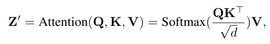

- 새롭게 추가된 image cross-attention 수식

  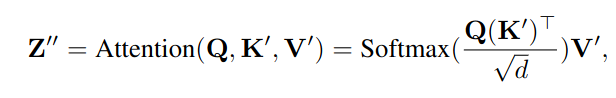

- 최종

  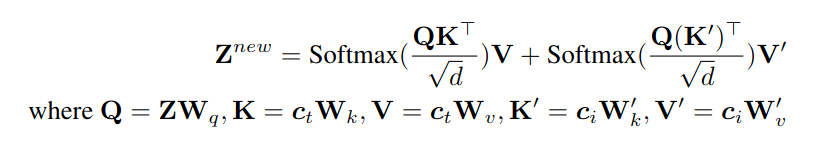

- Training and Inference
    - Classifier-free guidance 를 사용하기 위해, CLIP image embedding 을 zero 로 한다.

  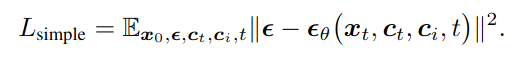

## 4. 실험

### Dataset

- $10$ million text-image pairs from two open source datasets (LAION-$2$B, COYO-$700$M)

### Implementation Details

- SD v1.5
- OpenCLIP ViT-H/14
- DeepSpeed ZeRO-2
- $1$ M steps
- AdamW optimizer with a fixed learning rate $0.0001$ and weight decay of $0.01$
- Resize the shortest side of the image to $512$ and then center crop the image with $512 \times 512$ resolution
- To enable classifier-free guidance:
    - $0.05$ drop probability for text
    - $0.05$ drop probability for image
    - $0.05$ drop probability for text and image
    - Guidance scale: $7.5$

  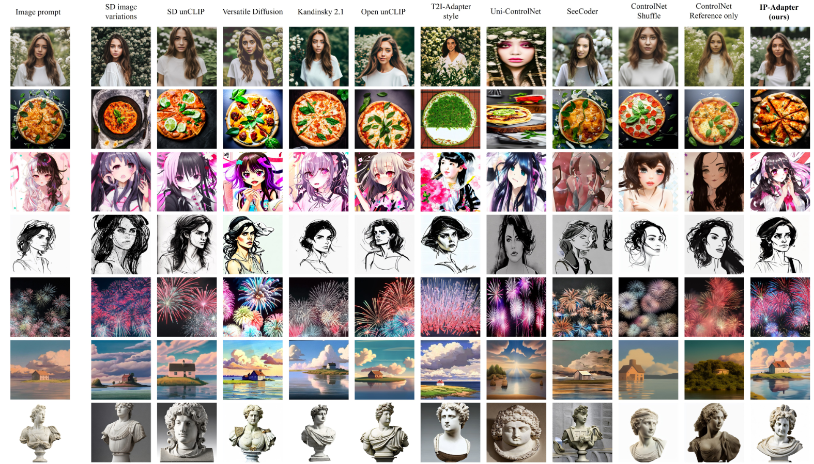

  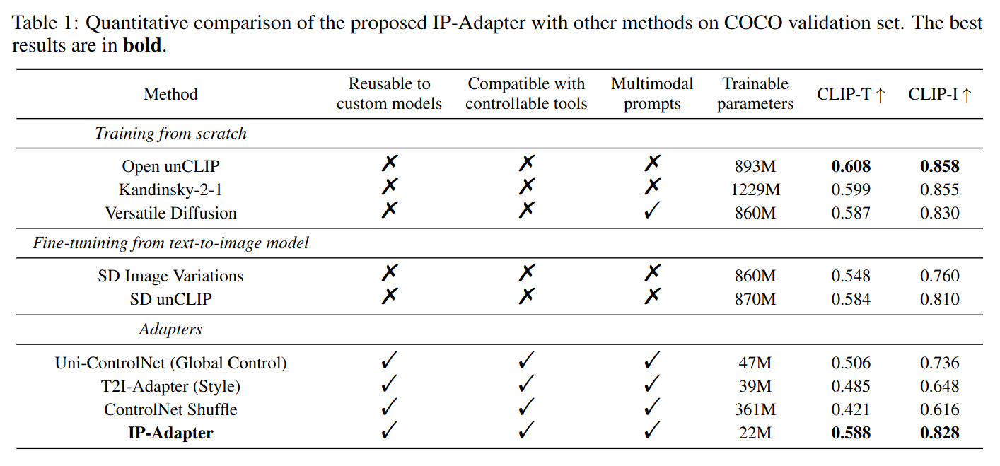

  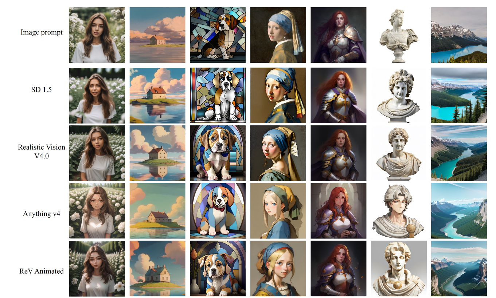

  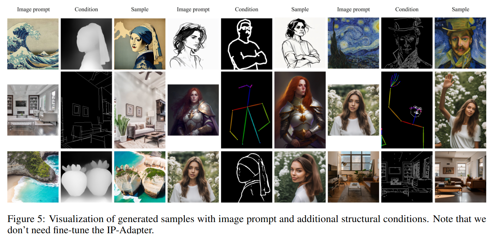

  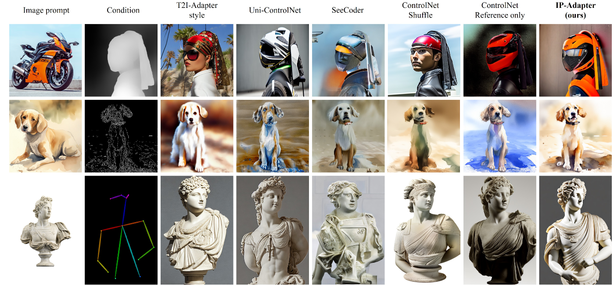

## 5. 정리

### Limitation

- Textual Inversion 이나 Dreambooth 처럼 일관된 이미지를 생성할 순 없다.

## 참고

- [Paper](https://arxiv.org/pdf/2308.06721.pdf) · 관련 리뷰: [ControlNet](../../image-editing/controlnet/README.md) · [DreamBooth](../dreambooth/README.md) · [Textual Inversion](../textual-inversion/README.md)
