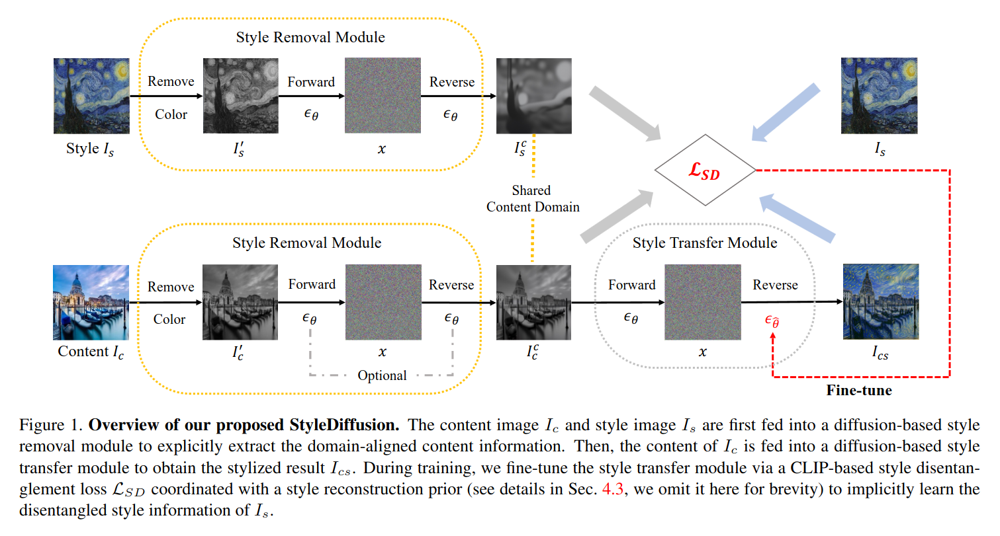
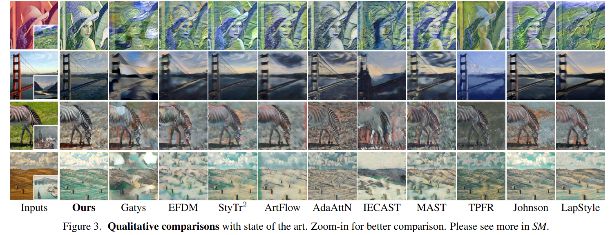

# StyleDiffusion: Controllable Disentangled Style Transfer via Diffusion Models

*ICCV(2023)*

> [!TIP]
> **한 줄 요약** — Content information은 명시적으로 추출하고 style information은 diffusion model로 implicit하게 학습해, 해석 가능하고 제어 가능한 content-style(C-S) disentanglement 기반 style transfer를 만든다.

| 흐름 | 내용 |
|:--|:--|
| **문제** | C-S disentanglement는 style transfer의 근본적인 문제인데, 기존 방법(Gram matrix 같은 explicit definition, GAN 같은 implicit learning)은 해석 가능하지 않고 제어하기 어렵다 |
| **아이디어** | Content를 명시적으로 추출하고 style은 implicit하게 학습하며, CLIP image space에서 C-S를 풀기 위해 CLIP-based style disentanglement loss와 style reconstruction prior를 도입 |
| **결과** | 해석 가능하고 제어 가능한 C-S disentanglement와 style transfer |

   
  <b>Figure 1.</b> StyleDiffusion 개요

---

## 1. 문제 정의 — 왜 이 논문이 필요한가

- Content and style(C-S) disentanglement 는 style transfer 의 근본적인 문제이고 중요한 과제이다.
    - Existing approaches 들은 해석 가능하지 않고 제어하기 어렵다
        - Explicit definitions: Gram matrix
        - Implicit learning: GAN
- 본 논문에서는 이러한 방법들을 사용하지 않고 style transfer 를 위한 새로운 C-S disentanglement framework 를 제안한다.

## 2. 실험

  

## 3. 정리

- 명시적으로 content information 을 추출하고 implicitly, style information 을 학습할 수 있다.
- 즉, 해석가능하고 제어가능한 C-S disentanglement and style transfer 를 제안했다.
- CLIP image space 에서 C-S 를 해결하기 위해 CLIP-based style disentanglement loss 와 style reconstruction prior 를 도입했다.

## 참고

- [Paper](https://openaccess.thecvf.com/content/ICCV2023/papers/Wang_StyleDiffusion_Controllable_Disentangled_Style_Transfer_via_Diffusion_Models_ICCV_2023_paper.pdf) · 관련 리뷰: [Image Style Transfer](../image-style-transfer/README.md)
