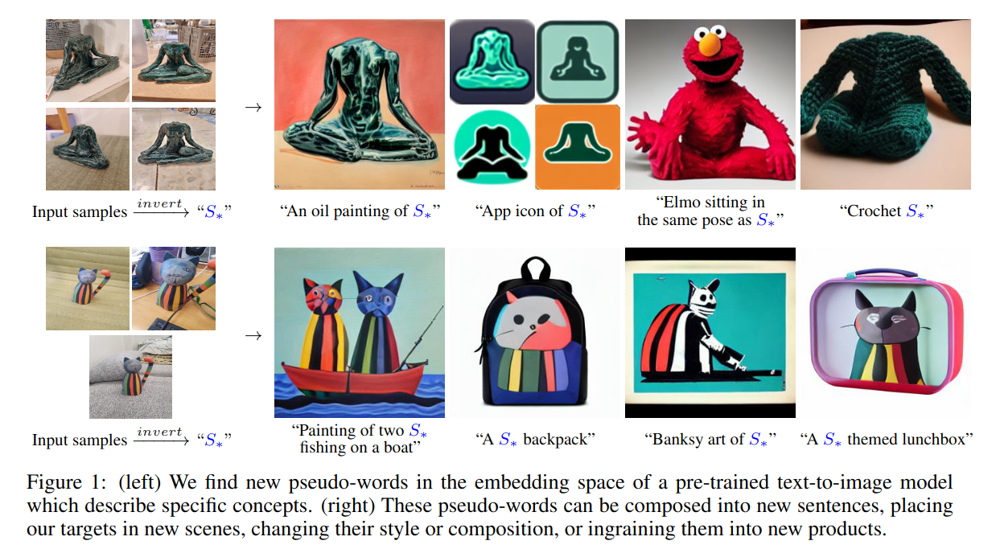
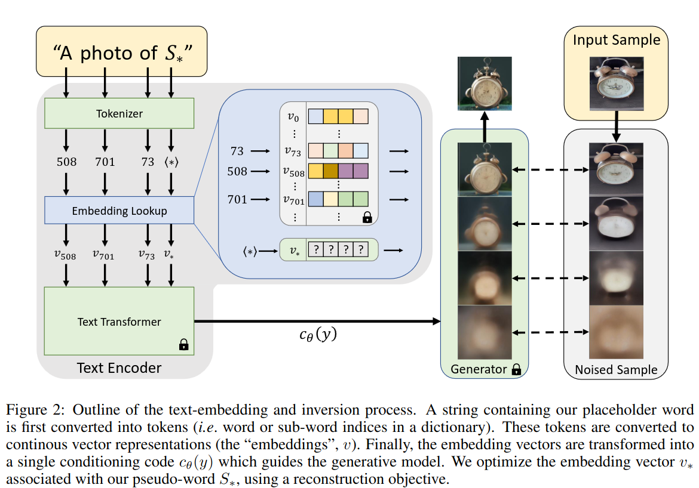
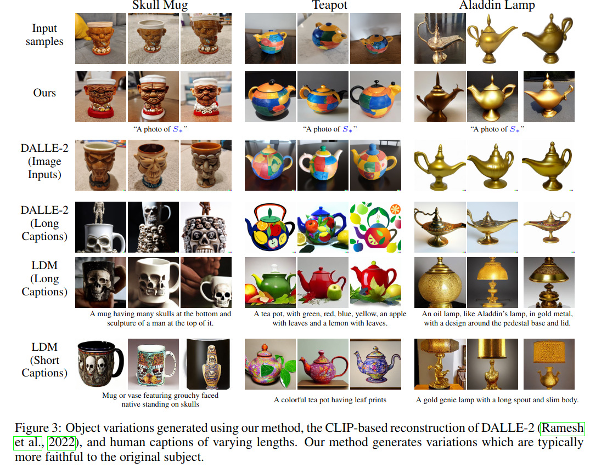
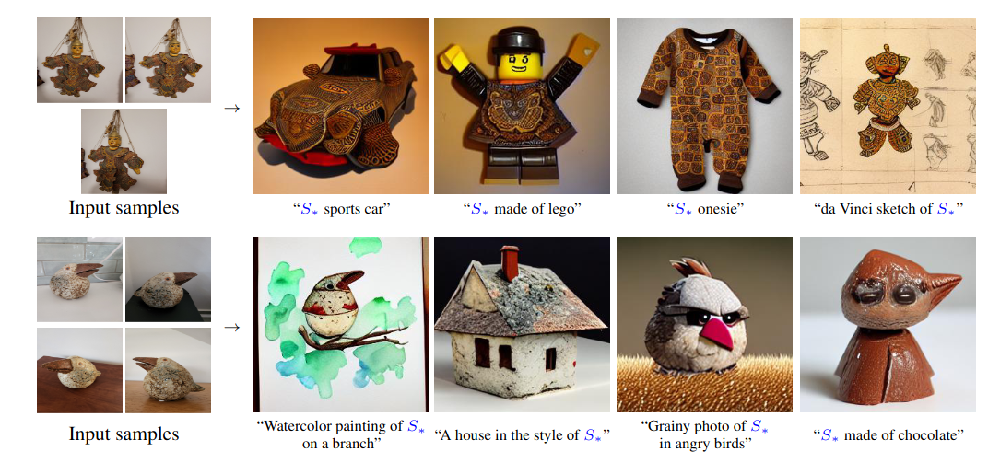
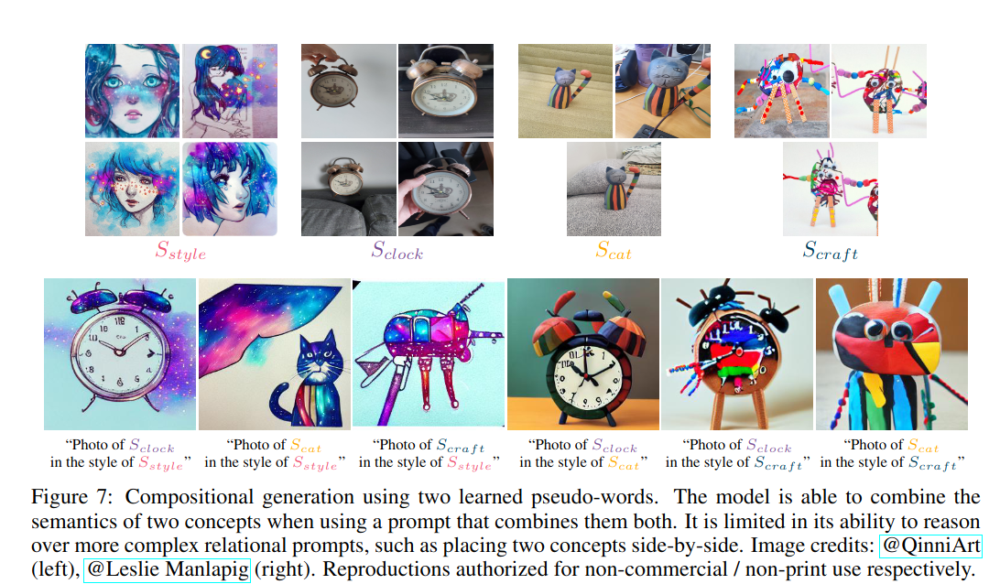

# An Image is Worth One Word: Personalizing Text-to-Image Generation using Textual Inversion

*ICLR(2023), 437 citation*

> [!TIP]
> **한 줄 요약** — $3-5$장의 이미지로 frozen text-to-image model에서 새로운 token의 word embedding 하나만 학습해, 사용자 고유의 concept을 단어처럼 prompt에 넣어 생성할 수 있게 한다.
>
> *Core Idea: "Capture Unique and Varied Concepts via Single Word Embedding"*

| 흐름 | 내용 |
|:--|:--|
| **문제** | Text-to-image model로 사용자 고유의 특정 concept을 생성하고 싶지만, 자연어 설명만으로는 그 concept을 표현하기 어렵다 |
| **아이디어** | 학습시키고자 하는 token의 embedding만 학습시키고 나머지는 freeze |
| **결과** | $3-5$장의 이미지로 text-to-image generation을 개인화할 수 있고, 학습한 concept 여러 개를 함께 쓸 수도 있다 (Multi Concept) |

   
  <b>Figure 1.</b> Textual Inversion 개요

---

## 1. 문제 정의 — 왜 이 논문이 필요한가

- Text-to-Image generation 을 개인화시키는 방법을 제시
- $3-5$ 장의 이미지로도 학습이 가능

## 2. 사전 지식

- Text-guided synthesis
- GAN inversion
- Diffusion-based inversion
- Personalization

## 3. 방법

- 학습시키고자 하는 token 의 embedding 만 학습시킨다.
- 나머지는 freeze

  

## 4. 실험

  

  

- Multi Concept

  

## 참고

- [Paper](https://arxiv.org/pdf/2208.01618.pdf) · 관련 리뷰: [DreamBooth](../dreambooth/README.md)
