# Code as Policies: Language Model Programs for Embodied Control

*ICRA(2023), 1980 citation, Robotics at Google, Review Data: 2026.07.01*

> [!TIP]
> **한 줄 요약** — 코드 작성 LLM에 few-shot prompting으로 자연어 명령을 실행 가능한 Python policy code(LMP)로 바꾸게 해서, 별도 학습 없이 로봇을 제어한다.
>
> "로봇에게 자연어 명령을 주면, GPT-4o 같은 VLM/LLM이 그 명령을 실행 가능한 Python 코드로 바꿔서 로봇을 움직이게 하는 구조"

| 흐름 | 내용 |
|:--|:--|
| **문제** | 자연어 명령을 로봇 policy로 옮기려면 공간적·기하학적 추론, 새로운 명령으로의 일반화, "더 빠르게" 같은 모호한 표현의 해석이 필요하다 |
| **아이디어** | Hint(import 문, API)와 few-shot example로 prompting하여, LLM이 perception/control API와 NumPy·Shapely 같은 라이브러리를 조합한 policy code를 직접 생성 |
| **결과** | Hierarchical code-generation이 RoboCodeGen에서 더 많은 문제를 해결하고, 모델 크기가 커질수록 성능이 향상되며, 서로 다른 로봇 시스템에 적용 가능 |

  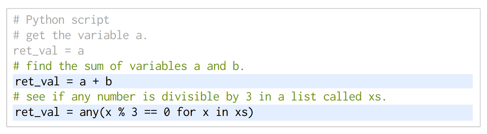 
  <b>Figure 1.</b> Language Model Program 예시

---

## 1. 문제 정의 — 왜 이 논문이 필요한가

- Code completion을 학습한 LLM은 간단한 python program을 합성할 수 있음이 입증됐다. 본 논문은 이러한 코드 작성 LLM이 자연어 명령이 주어졌을 때 로봇 policy code를 작성하는 용도로 재활용될 수 있음을 확인했다. 

- Few-shot prompting을 사용하면, LLM은 새로운 명령을 입력받아 API 호출을 자율적으로 재조합하고, 그에 맞는 새로운 policy code를 생성할 수 있다. 

- 이러한 방식으로 사용되는 LLM은 고전적인 논리 구조를 연결하고, NumPy나 Shapely와 같은 외부 라이브러리를 참조하여 산술 연산을 수행함으로써 다음과 같은 로봇 policy를 작성할 수 있다.
    1. 공간적·기하학적 추론을 수행할 수 있다.
    2. 새로운 명령으로 일반화할 수 있다.
    3. “더 빠르게”와 같은 모호한 설명에 대해서도 문맥에 따라 속도와 같은 정확한 값을 지정할 수 있다.

## 2. 방법

### Prompting Language Model Programs (LMP)

- LMP를 생성하기 위한 prompt는 두 가지 요소를 포함한다. 
    1. Hint 
        - 어떤 API를 사용할 수 있는지 LLM에게 알려주는 import 문이나, 해당 API를 어떻게 사용해야 하는지에 대한 type hint가 포함된다. 
        - `import numpy as np`
    2. Examples
        - 자연어 명령이 주어지면, 어떻게 코드로 변환해야 하는지를 보여주는 few-shot examples이다. 

### Example Language Model Programs (Low-Level)

- 모든 예시와 실험은 OpenAI Codex `code-davinci-002` 를 사용하며, temperature는 0으로 설정한다. 즉, 결정론적인 greedy token decoding을 사용한다. 
    - Python을 작성하고 있음을 나타내는 hint로 시작한다. 
    - 이어서 return value의 형식을 지정하기 위한 example을 하나 제공한다. 
    - 입력 명령은 초록색으로 표시되며, 생성된 출력은 강조 표시되어 있다. 
    - 이렇게 예시로 통해 이해하는 것이 쉽다고 한다.

- Third-party libraries
    - LLM은 많은 라이브러리에 대한 지식도 저장하고 있는데, LMP는 이러한 라이브러리를 사용하도록 prompting 될 수 있으며, 이를 통해 모든 코드를 직접 작성하지 않고도 복잡한 명령을 수행할 수 있다.
    - 예를 들어, NumPy를 사용하면 좌표를 이용한 spatial reasoning을 유도할 수 있다. 
    - Hint에는 import 문이 포함되며, example에는 기본 방향을 정의했다. 변수명도 중요하다고 한다. 

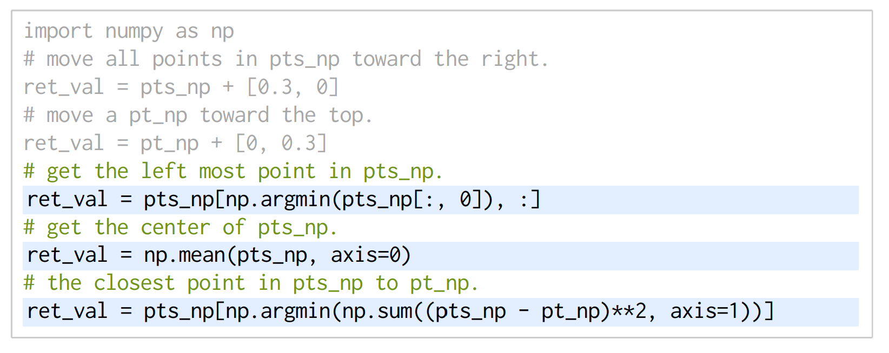

- First-party libraries 
    - LMP는 학습 데이터에 존재하지 않는 perception API나 control primitive API도 사용할 수 있다. 단, 이러한 함수들이 의미 있는 이름을 가지고 있고, Hint나 Example을 통해 제공되어야 한다. 

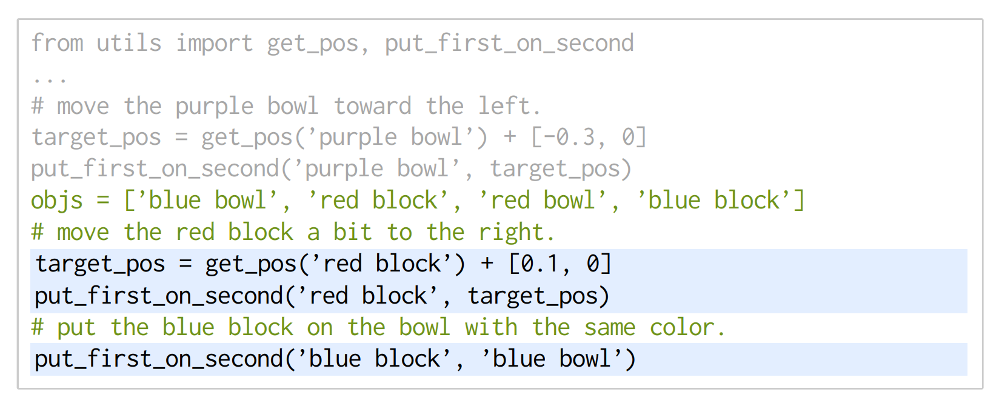

### Example Language Model Programs (High-Level)

- While 문

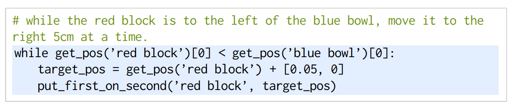

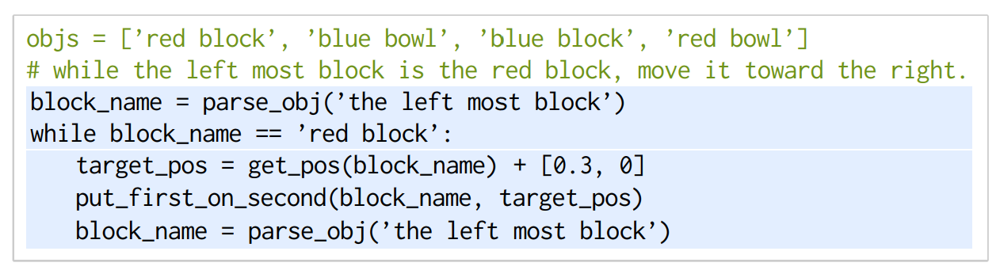

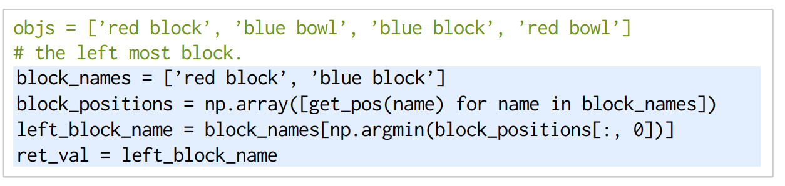

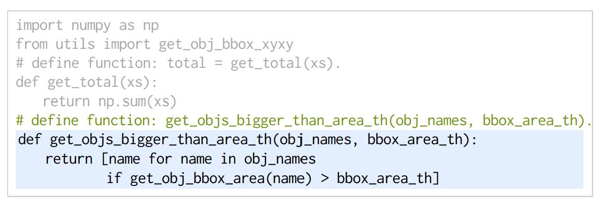

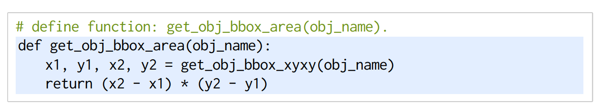

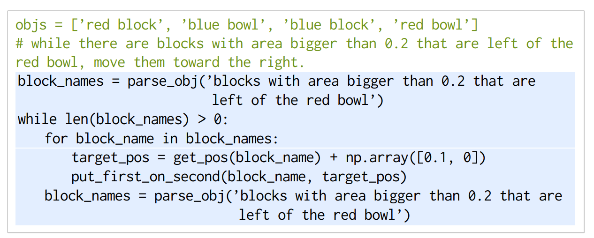

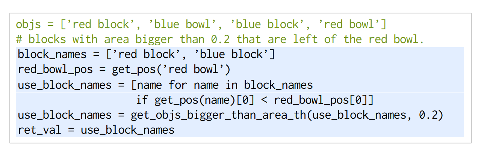

## 3. 실험

- Hierarchical vs flat
    - flat은 전체 코드를 한 번에 생성
    - Hierarchical은 큰 문제를 작은 함수로 나눠서 생성

- 본 실험의 목표
    1. 서로 다른 언어 모델에서 code generation을 사용할 때의 영향을 평가하고, 일반화의 양상을 분석한다.
    2. 시뮬레이션된 language-instructed manipulation task에서 Code as Policies (CaP)를 baseline들과 비교한다.
    3. CaP를 서로 다른 로봇 시스템에 적용하여 유연성과 사용 편의성을 보여준다.

- Hierarchical code-generation은 RoboCodeGen에서 더 많은 문제를 해결하며, 모델 파라미터 수가 증가함에 따라 scaling law에 따라 성능이 향상된다. 아래 값은 pass rate, 즉 통과율을 %로 나타낸 것이다.

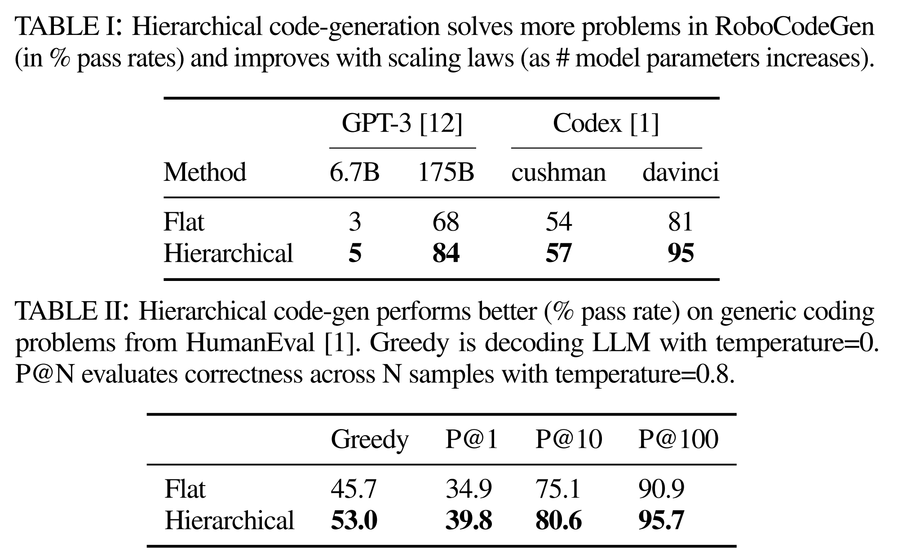

## 참고

- [Paper](https://arxiv.org/pdf/2209.07753)
