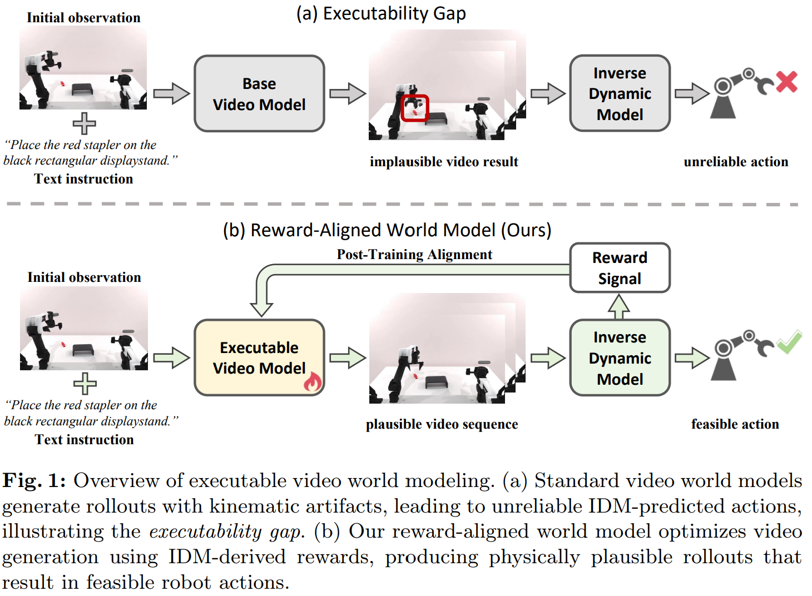
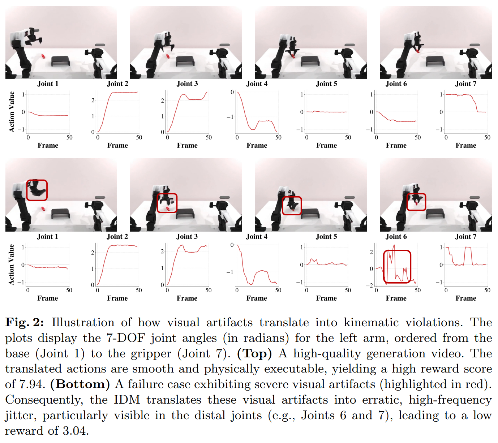
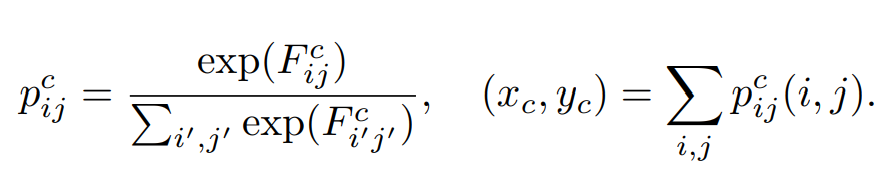
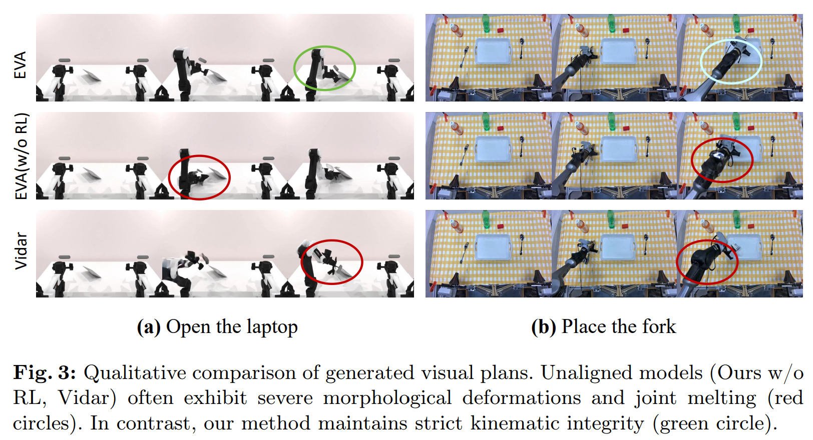
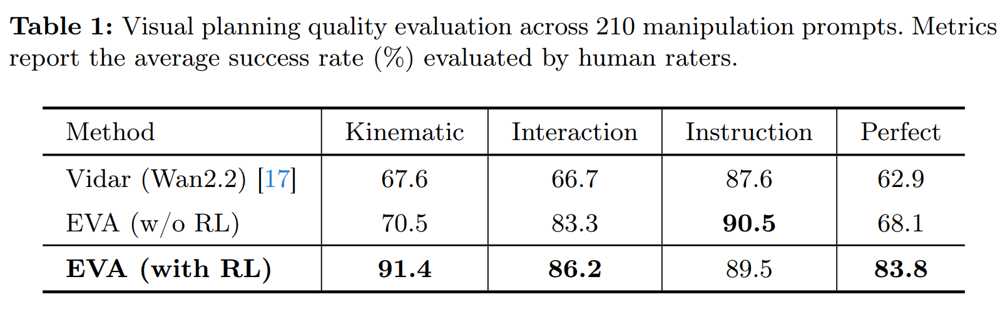

## Aligning Video Models with Executable Robot Actions via Inverse Dynamics Rewards
*arXiv(2026), 3 citation, Chinese University of Hong Kong, Review Data:*

[Intro](#intro) 
[Related Work](#related-work) 
[Method](#method) 
[Experiment](#experiment) 
[Conclusion](#conclusion) 

> Core Idea

<strong>"시각적으로 일관되기만 한 비디오 생성으로 인해 물리학적으로 실행할 수 없는 비디오 생성인 Executability gap을 해결하기 위해 이미 학습된 IDM을 Reward Model로 활용하여 물리학적으로도 일관된 비디오를 생성하는 것이다."</strong> 

***

### <strong>Intro</strong>

- Video generation model은 robotics의 world model로 사용된다. 
    - 이는 observation과 task instruction을 condition으로, 미래의 시각적 rollout을 생성한다. 

- 그리고, IDM (Inverse dynamic model)은 생성된 frame들을 실행가능한 robot action으로 변환한다. 

- 하지만, 최근 video world model은 명시적인 실행 제어 조건이 부족하여 시각적으로 일관된 rollout 일지라도, 강체 (rigid-body) 및 운동학적 일관성을 위반할 수 있다. (e.g., 관절의 꺾임)
    - 이로 인해, IDM을 통해 디코딩 할 때 불안정하거나 실행불가능한 제어 명령이 생성될 수 있다. 
    - 시각적 frame 생성을 통해 실행 가능한 제어로 가지 못하는 mismatch를 본 논문에서는 `executability gap` 이라고 한다. 

- 물론, 이 gap이 추론 시에 *rejection sampling* 과 같은 방법론을 적용하면 그 gap이 완화될 수 있다. 
    - 하지만, video generation의 높은 cost로 인해 비효율적이다. 

- 본 논문에서는 이 gap을 학습 signal로 활용하고 reinforcement-learning post training framework인 **EVA** (Executable Video Alignment) 제안한다. 

- EVA는 실제 로봇 궤적을 기반으로 IDM(Inverse Dynamics Model)을 학습시키고, 이를 생성된 영상이 유도하는 동작 시퀀스를 평가하는 보상 모델로 재구성한다.
    - 이를 통해 속도, 가속도, 저크(jerk)로 측정되는 부드러운 동작을 장려하는 동시에, 구현 제약 조건을 위반하는 동작에는 페널티를 부여할 수 있다.
    - 중요한 점은 생성된 영상에 심각한 시각적 아티팩트가 포함된 경우에도 보상이 유용한 정보를 제공한다. 

- 즉 Executability gap을 해결하기 위해 이미 학습된 IDM을 Reward Model로 활용하여 물리학적으로도 일관된 비디오를 생성하는 것이다.

- 관절 각도 데이터(7-DOF): 로봇 팔의 7개 자유도(Joint 1~7)에 해당하는 관절 각도 변화를 그래프로 나타냅니다.
    - 상단(고품질 생성): 시각적으로 우수한 비디오는 로봇의 움직임을 예측할 때 관절 각도가 부드러운 곡선을 그리며 변화합니다.
    - 하단(실패 사례): 영상 자체에 미세한 시각적 오류(Artifacts)가 포함되면, 이를 Inverse Dynamics Model(IDM)이 해석할 때 급격한 관절 이동(Jumps)이나 고주파 떨림(High-frequency jitter)이 발생합니다.

***

### <strong>Related Work</strong>

- Video World Models for Robotics

- Embodied Visuomotor Policies
    - 결합형(End-to-End VLA): 시각적 관찰을 로봇의 저수준 모터 명령으로 직접 매핑합니다. (예: Diffusion Policy, π0)
    - 분리형(Decoupled Paradigm): 비디오 모델이 시각적 계획(Visual Planner)을 세우고, Inverse Dynamics Model (IDM)이 이를 실행 가능한 행동으로 추출합니다. 이는 일반화 능력이 뛰어나다는 장점이 있습니다.
    - 분리형 접근 방식의 가장 큰 문제는 비디오 모델이 시각적으로는 그럴듯하지만, 물리적으로는 불가능한 비디오(팔의 기형적 변형, 시간적 불연속성 등)를 생성할 수 있다는 점입니다.
    - IDM은 단순히 입력된 비디오를 해석하는 '수동적 디코더'로 작동하므로, 이러한 시각적 오류를 걸러내지 못하고 불안정한 로봇 제어 명령을 생성하여 실패로 이어집니다.

- Alignment and Post-Training in Generative Models 

***

### <strong>Method</strong>

$\textbf{Preliminaries}$

- Flow-Matching-Based Video Generation 
    - Wan 2.1과 같은 large scale video generation model들은 flow-matching을 사용
    - Video sequence $V = \{I_1, \cdots, I_{T} \}$ 가 주어지면 3D VAE로 latent space로 보낸다. $x_1$
- Group Relative Policy Optimization
    - 강화학습 기법이다. 
    - GRPO는 여러 개의 샘플을 동시에 생성한 뒤, 그 그룹 내에서의 상대적인 점수를 계산하여 학습한다. 
    - 이를 통해 value function을 학습시키는 복잡한 과정을 생략할 수 있다. 

$\textbf{IDM (Inverse Dynamics Model)}$

- IDM은 이 생성된 미래 프레임들을 보고 "이 비디오대로 움직이려면 현재 로봇이 어떤 동작을 해야 하는가?"를 계산하여 로봇을 움직인다. 
    - 따라서 video generation model이 생성한 frame들 (미래를 예측한 frame 포함)을 보고 이렇게 되려면 어떤 행동을 해야하는가 예측하는 거다
    - Convolutional Backbone (특징 추출): 비디오 프레임에서 로봇 팔의 위치, 물체의 형태 등 제어에 필요한 핵심 정보(특징)를 뽑아냅니다.
    - Spatial Softmax (2D 좌표 변환): 단순히 이미지를 뭉뚱그려 처리하는 대신, 로봇의 관절이나 손끝(Gripper)이 이미지 상에서 어디에 위치하는지 좌표값 $(x_c, y_c)$ 으로 정밀하게 찾아냅니다.
    - MLP (행동 예측): 추출된 좌표값들을 종합하여 "이 좌표로 이동하려면 각 관절 모터를 얼만큼 움직여야 하는가?"라는 질문에 대한 답(Action)을 계산합니다.
    - 이러한 키포인트 형태의 표현은 생성된 rollout으로부터 동작을 디코딩할 때 global pooling보다 더 안정적이다다

- Spatial Softmax 수식
    - 각 채널에서 모든 feature 값들을 더한 게 분모, 분자는 특정 위치에서의 값
    - 그리고, 모든 채널의 값을 더한다.

$\textbf{IDM-based Executability Reward}$

- Inverse Dynamics Model(IDM)을 사용하여 보상(Reward)을 산출하는 과정
    - 생성된 비디오를 IDM에 입력으로 주면 행동 시퀀스가 나온다.
    - 여기서 속도, 가속도, 저크를 유한 차분법(finite difference)으로 계산하여 행동의 부드러움을 측정
    - 페널티 함수(Huber Penalty): 급격한 동작 변화를 방지하기 위해 가속도와 저크에 대해 Huber 함수를 적용합니다.

***

### <strong>Experiment</strong>

***

### <strong>Conclusion</strong>

***

### <strong>Question</strong>

<a href="">link</a>

> 인용구
