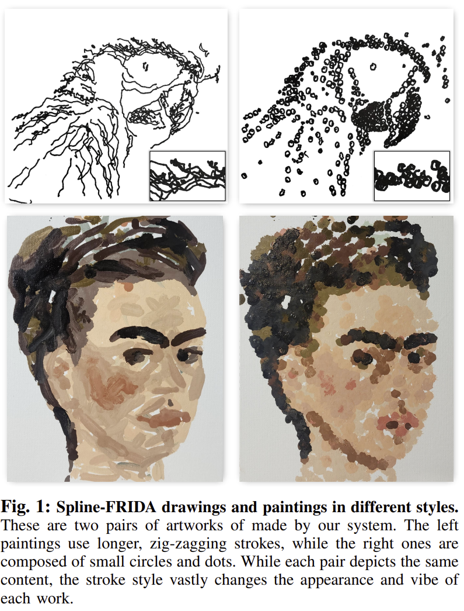
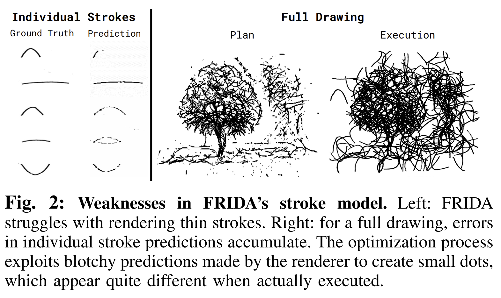
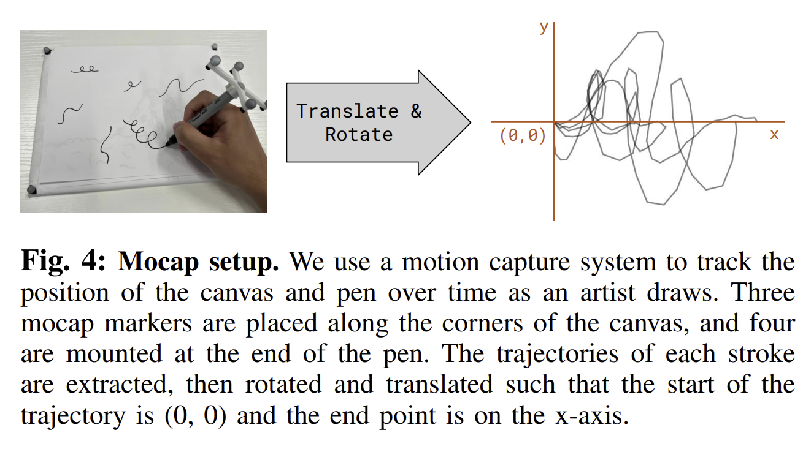
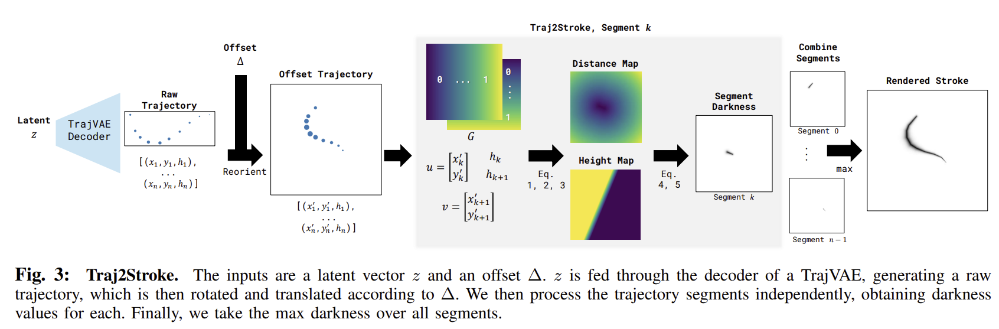

# Spline-FRIDA: Towards Diverse, Humanlike Robot Painting Styles with a Sample-Efficient, Differentiable Brush Stroke Model

*RA-L(2025), 4 citation, Jean Oh (CMU), Review Data: 2026.04.22*

> [!TIP]
> **한 줄 요약** — 모션 캡처로 기록한 사람의 붓질 궤적을 TrajVAE로 모델링하고, 가변 두께 폴리라인을 미분 가능하게 렌더링하는 Traj2Stroke를 FRIDA에 도입하여, 로봇이 다양하고 사람다운 붓질 스타일로 그림을 그리게 한다.

| 흐름 | 내용 |
|:--|:--|
| **문제** | FRIDA 등 기존 로봇 페인팅은 2차 베지어 곡선 같은 단순한 붓질 표현과 CNN 렌더러를 써서, 길고 가는 Sharpie 선이나 복잡하고 다양한 인간 붓질 스타일(intra-stroke style)을 포착하지 못한다 |
| **아이디어** | 모션 캡처 궤적을 $n=32$개 제어점 폴리라인으로 정규화 → 소수의 궤적으로 미세조정하는 TrajVAE로 스타일 모델링 → Traj2Stroke로 렌더링하고 feature-space loss를 경사하강법으로 최적화해 계획 |
| **결과** | FRIDA의 기존 동역학 모델 대비 시뮬레이션과 실제 Sharpie 붓질 사이의 Sim2Real gap이 훨씬 작아지고, 유연한 붓질 궤적이 의미적 계획을 향상시켜 더 인간다운 그림을 만든다는 근거 제시 |

   
  <b>Figure 1.</b> 긴 붓질(왼쪽)과 작고 원형에 가까운 붓질(오른쪽): 붓질의 형태가 그림의 스타일을 정의한다

---

## 1. 문제 정의 — 왜 이 논문이 필요한가

- 작품은 벽에 걸린 그림 그 이상이다. Painting은 많은 의도적인 붓질로 이루어진 과정이며, 그 붓질의 형태는 작품의 전체적인 스타일과 메세지를 구성하는 중요한 요소이다.

- 그림과 드로잉은 감정, 문화적 가치, 그리고 공동의 경험에 대한 메세지를 전달하는 데 사용된다. 이러한 요소들은 그림 속 사물이나 대상 자체에서도 전달될 수 있지만, 스타일 역시 그러한 메세지를 표현하는 데 그에 못지않게 중요하다.
    - 특히, 한 작품 안에 포함된 개별 붓질의 형태 패턴은 작품 전체의 스타일과 미적 감각을 형성하는 데 기여할 수 있다.
    - 아래 그림에서 보듯이, 왼쪽 그림은 긴 붓질을 사용하고, 오른쪽 그림은 작고 원형에 가까운 붓질을 사용한다. 두 경우 모두, 붓질의 형태는 그림의 스타일을 정의하는 데 핵심적이며, 작가가 전달하고자 하는 메세지의 표현에서도 중요한 역할을 한다.

- 또한 로봇이 인간의 예술 창작을 지원하려면, 사용자가 선택이나 시연을 통해 지정할 수 있는 유연한 붓질 스타일을 로봇이 갖추는 것이 중요하다. 많은 예술가들은 예술적 과정을 자동화하는 것을 원하지 않지만, 일부는 협업적 창작 보조자(co-creative assistant) 에게는 열려 있다. 본 연구는, 로봇과 함께 창작하는 사용자가 이미지 스타일에 대해 더 많은 창의적 통제권을 가질수록, 그 작품에 대해 더 큰 주인의식(ownership) 을 느끼게 된다는 가정 위에서 진행된다.

- 기존 연구는 주로 베지어 곡선(Bezier curve)과 같은 기본적인 붓질 표현을 사용해 그림을 계획하는 데 초점을 맞추었고, 전체 이미지의 스타일에만 주로 주목해왔다. 반면 본 논문에서는 하나의 붓질 내부(intra-stroke)의 스타일 제어를 어떻게 구현할 수 있는지에 초점을 둔다.

- 본 연구에서는 실제 붓과 마커를 사용하여 종이 위에 사람이 그리는 과정을 모션 캡처로 기록한다. 그리고 이렇게 기록된 궤적을 **TrajVAE**라는 오토인코더로 모델링한다. 또한, 주어진 궤적으로부터 붓질의 2차원 외곽선(outline) 을 예측하는 새로운 붓질 동역학 모델 **Traj2Stroke**도 제안한다.

- 정리하면, 본 논문의 주요 기여는 다음과 같다.

> [!NOTE]
> **Contributions**
> 1. 변분 오토인코더(variational autoencoder) 를 사용하여 인간의 붓질 궤적 스타일을 성공적으로 모델링하는 방법을 제시한다.
> 2. 가변적인 두께를 가지는 폴리라인을 미분 가능하게 렌더링하는 방법인 Traj2Stroke를 제안한다. FRIDA의 기존 동역학 모델과 비교했을 때, Traj2Stroke는 시뮬레이션과 실제 샤피(Sharpie) 붓질 사이의 Sim2Real gap을 훨씬 더 작게 만든다.
> 3. 더 유연한 붓질 궤적이 로봇의 의미적 계획(semantic planning) 을 향상시키고, 더 인간다운 그림을 만들어낼 수 있음을 시사하는 근거를 제시한다.

- 기존의 붓질 궤적 모델링 연구는 real-world robotics에서 작동하지 않거나 human-made brush stroke를 포착하기엔 충분히 유연하지 못했다.

- 본 연구에서는 Spline-FRIDA를 도입하여 복잡한 사람의 붓질 궤적을 모델링할 수 있도록 한다.
    - Motion capture를 사용하여 작가가 그리는 과정을 기록하였고, 추출된 궤적을 autoencoder로 모델링하며, 기존의 로봇 페인팅 플랫폼 FRIDA에 새로운 붓질 동역학 모델을 도입했다.

## 2. 방법

### Background

- 본 연구는 FRIDA를 기반으로 한다. FRIDA는 사용자가 텍스트 프롬프트, 이미지, 또는 오디오 녹음으로 설명한 내용을 상호작용적이고 협업적인 방식으로 그림으로 그려주는 로봇 시스템이다. FRIDA는 합성곱 신경망(CNN) 을 사용하여 붓질(stroke)을 렌더링한다. 이 CNN은 붓으로 만든 짧고 단순한 붓질에는 잘 작동하지만, 그림에 나타난 것처럼 더 길고 가는 Sharpie 마커 선을 사용할 경우에는 수렴에 어려움을 겪는다.

- 우리는 이 문제가, 가는 정답 선(thin ground truth strokes)은 렌더러가 더 높은 수준의 정밀도를 달성해야 하므로 작업이 더 복잡해지기 때문이라고 본다. 그 결과, CNN은 종종 얼룩지거나(blotchy) 불완전한 예측을 만들어낸다. 이는 계획(planning) 단계에서 이러한 오류가 누적되기 때문에 문제가 된다(Figure의 오른쪽 참조).

- 또한 FRIDA의 붓질 표현 방식에는 한계가 있다. FRIDA는 다른 많은 컴퓨터 페인팅 연구와 마찬가지로, 길이(length), 캔버스 위 높이(height above the canvas), 굽힘 정도(bend) 의 세 가지 파라미터로 정의되는 2차 베지어 곡선(quadratic Bezier curve) 을 사용해 붓질을 표현한다. 이러한 단순한 방식은 편리하다는 장점이 있지만, 인간 드로잉에 내재된 복잡성과 다양성을 포착하기에는 부족하다. 이러한 배경에서, 우리는 다양한 스타일을 가능하게 하는 길고 복잡한 궤적을 모델링할 수 있도록, 새로운 붓질 표현 방식과 새로운 렌더러를 제안한다.

- Overview
    - 스트로크 모델링 및 렌더링 접근법은 다음 네 단계로 구성된다.
        - 모션 캡처 기술을 사용하여 사람의 시연 데이터를 수집하고 처리한다.
        - Autoencoder인 TrajVAE를 학습시켜 이러한 궤적을 모델링한다.
        - Real2Sim2Real 방법론을 사용해 새로운 렌더링 접근법인 Traj2Stroke를 fine-tuning한다.
        - 주어진 이미지와 예측된 그림 사이의 feature-space loss를 줄이기 위해, 동역학 모델을 통해 브러시 스트로크 파라미터 집합을 경사하강법으로 최적화하며 계획을 수행한다.

### Motion Capture Drawing Recording and Processing

- OptiTrack 카메라와 Motive 소프트웨어로 구성된 모션 캡쳐 시스템을 사용하여 사람의 붓질 궤적을 수집한다.
- 예술가가 스케치를 하는 동안, 우리는 캔버스와 펜의 위치 및 자세를 지속적으로 추적한다.
- 펜 길이를 수동으로 측정한 값을 이용해 펜 끝의 위치를 계산할 수 있으며, 이를 통해 펜 끝과 캔버스 사이의 거리를 구한다. 이 값이 특정 임계값보다 작으면, 펜이 종이에 닿아 있다고 판단한다. 이러한 조건을 만족하는 연속된 위치들은 하나의 궤적으로 합쳐진다.

- 궤적의 시작점이 $(0, 0)$ 이 되고 끝점이 $x$축 위에 위치하도록 회전 및 평행이동시킨다. 이는 그림에 나타난 것처럼, 샘플 효율적인 모델링을 위해 변동성을 줄이기 위한 것이다. 다만 이 정규화에는 한 가지 절충점이 있다. 즉, 캔버스 위의 위치나 회전에 따라 궤적의 스타일이 달라지지 않는다고 가정한다는 점이다. 또한 각 궤적은 정확히 $n$개의 점을 갖도록 다시 샘플링하며, 실제로는 $n = 32$를 사용한다.

따라서 각 사람의 붓질 궤적은 n개의 제어점(control point) 을 지나는 폴리라인(polyline, 구간별 선형 경로) 으로 모델링된다. 이 폴리라인은 n × 3 텐서로 인코딩된다. 각 제어점의 좌표 (x, y, h) 에서, x와 y는 캔버스 평면 내의 수평 변위를 의미하고, h는 브러시가 캔버스 위에서 얼마나 떠 있는지를 나타내는 수직 변위(높이)이다.

### TrajVAE

- 모션 캡처 데이터를 수집하고 처리한 뒤, 우리는 이러한 스트로크 궤적을 모델링하기 위해 변분 오토인코더(VAE) 를 학습시킨다. 우리는 이를 TrajVAE라고 부른다. 학습 과정에서 TrajVAE는 하나의 궤적을 입력으로 받아, 이를 MLP 인코더에 통과시켜 크기 $64$의 잠재 벡터(latent vector)로 압축한 뒤, 다시 MLP 디코더를 통해 궤적으로 복원한다. 우리는 입력 궤적과 출력 궤적 사이의 평균제곱오차(MSE) 를 최소화하도록 학습한다.

- 우리는 보통 한 번의 드로잉에 대해 사람이 그린 궤적을 $20$개에서 $200$개 정도 기록하지만, 이 정도 데이터만으로는 TrajVAE를 처음부터 안정적으로 학습시키기에 충분하지 않다는 것을 확인했다. 그래서 각 TrajVAE를 여러 기록 세션에서 모은 궤적들로 먼저 사전학습(pretraining)한 뒤, 특정한 스타일을 반영하기 위해 하나의 세션 데이터로 미세조정(fine-tuning)한다. 각 모델은 매우 빠르게 수렴하며(1분 미만), 미세조정 데이터셋에서도 소수의 궤적(20개 미만)만 필요하다.

- 계획 단계에서는 VAE 디코더만 사용된다. 전체 파이프라인은 모듈식으로 설계되어 있어, 서로 다른 VAE를 교체해 끼울 수 있다. 이를 통해 추가 학습 없이도 스트로크 스타일을 바꿀 수 있다.

- 한편, 우리의 모션 캡처 장치는 드로잉 도구 끝의 수직 위치를 충분한 정밀도로 측정하는 데 어려움을 겪는다. 이는 아주 작은 높이 차이도 스트로크의 두께에 큰 영향을 줄 수 있기 때문이다. 따라서 실제 구현에서는 높이 정보를 TrajVAE로 직접 모델링하지 않고, 계획 과정에서 별도의 스트로크 파라미터로 최적화한다.

## 참고

- [Paper](https://arxiv.org/pdf/2412.00597)
