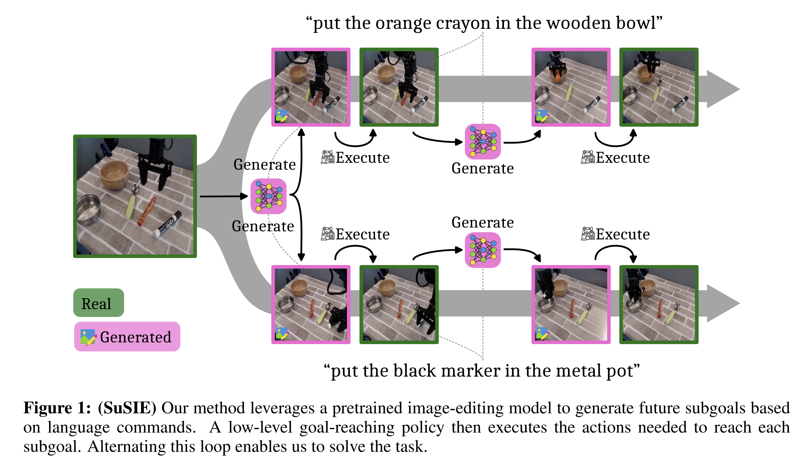
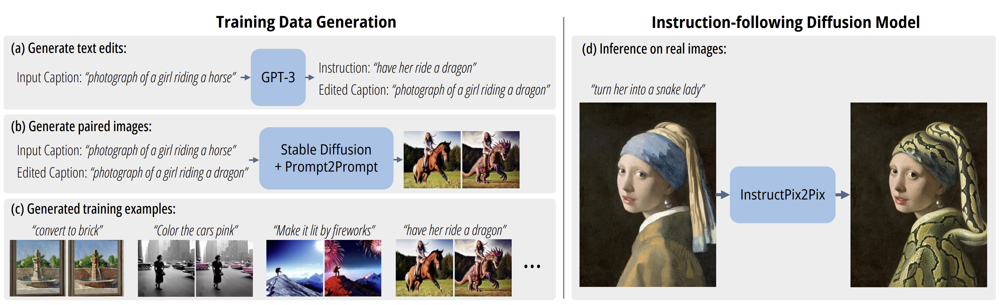
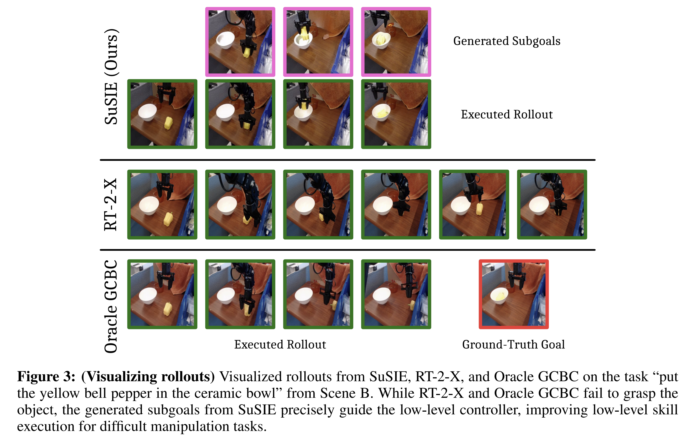
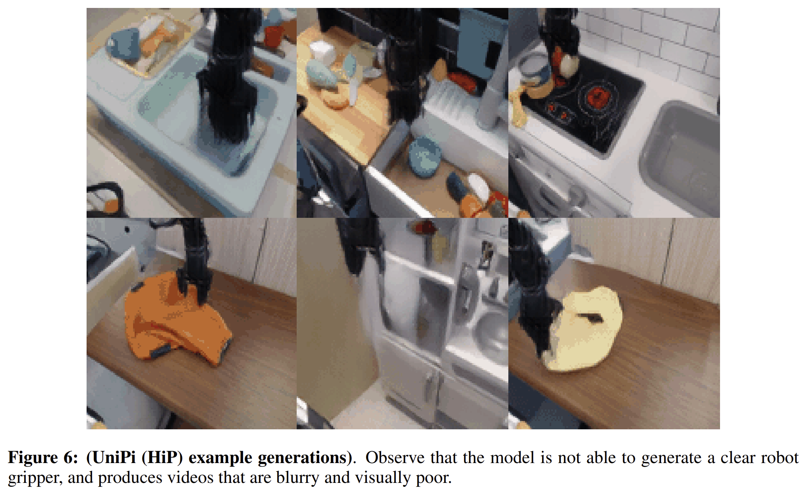
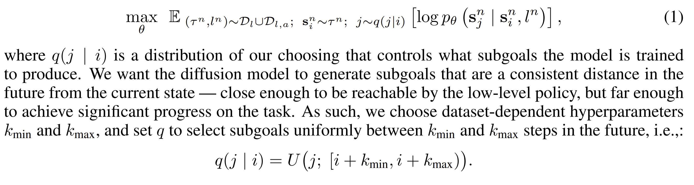
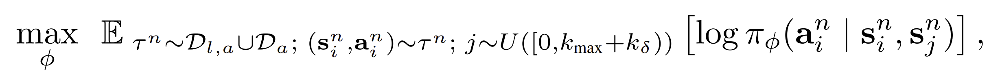
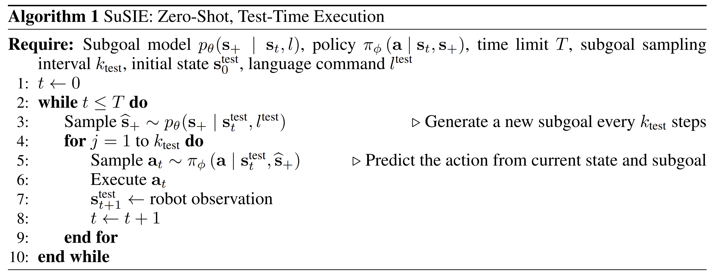
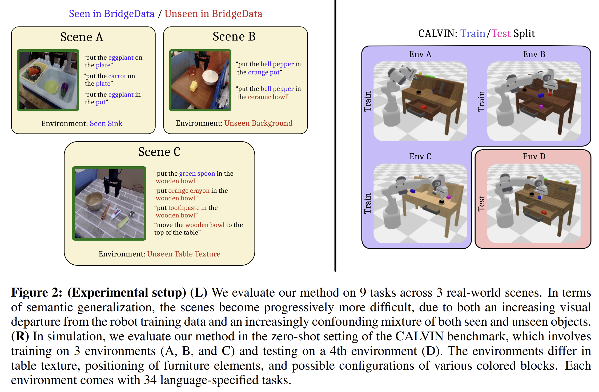
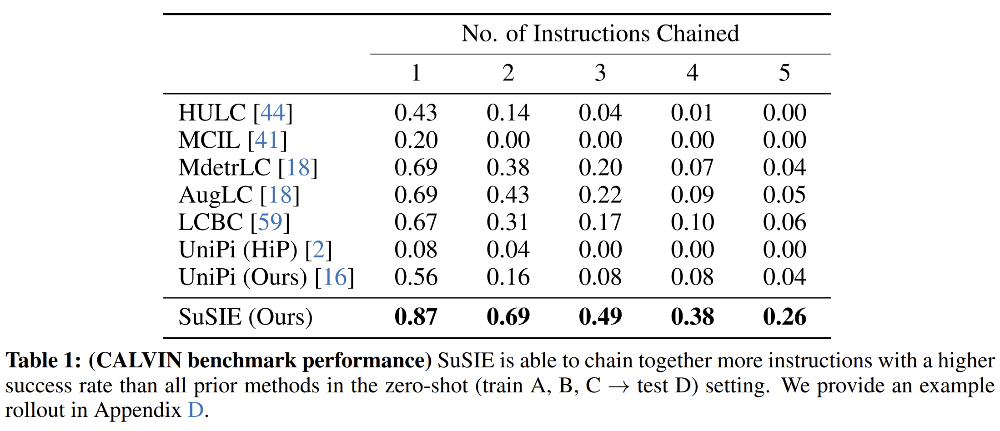
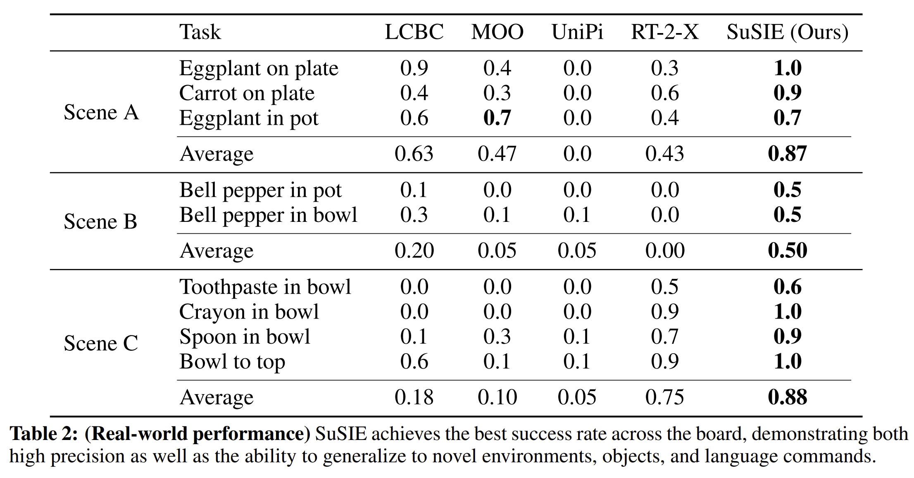

## ZERO-SHOT ROBOTIC MANIPULATION WITH PRETRAINED IMAGE-EDITING DIFFUSION MODELS
*ICLR(2024), 308 citation, Google Deepmind, Review Data: 2026.06.09*

[Intro](#intro) 
[Related Work](#related-work) 
[Method](#method) 
[Experiment](#experiment) 
[Conclusion](#conclusion) 

> Core Idea

<strong>"초기 state 및 goal이 주어지고 그 goal을 달성하기 위해 sub state들을 이미지로 생성, sub goal을 수행하기 위한 action을 예측 및 수행하여 최종적인 goal로 도달"</strong> 

***

### <strong>Intro</strong>

- Generalist (범용) 로봇이 unstructured environment (비정형 환경)에서도 동작하려면, 로봇은 새로운 물체와 상황을 인식하고 추론할 수 있어야 한다. 
- 이미지 편집 확산 모델인 SuSIE를 제안하여, 고수준 플래너처럼 동작하게 하며, 저수준 제어기가 수행할 수 있는 중간 하위 목표를 제안한다. 

- 구체적으로, 사람의 비디오와 로봇 실행 데이터로 구성된 비디오 데이터를 이용해 InstructPix2Pix를 파인튜닝한다. 이를 통해 로봇의 현재 관찰 이미지와 언어 명령이 주어졌을 때, 가상의 미래 “하위 목표” 관찰 이미지를 출력하도록 한다. 또한 로봇 데이터를 사용하여 앞서 언급한 저수준 제어기 역할을 수행하는 목표 조건부 저수준 정책을 학습한다.

- 고수준 하위 목표 예측이 인터넷 규모의 사전학습과 시각적 이해 능력을 활용하여 저수준 목표 조건부 정책을 안내할 수 있음을 확인했다. 그 결과, 기존의 언어 조건부 정책보다 훨씬 뛰어난 일반화 성능과 정밀도를 달성했다. 

- CALVIN 벤치마크에서 최신 최고 성능을 달성했으며, 실제 로봇 조작 작업에서도 강건한 일반화 성능을 보였다. 특히 특권 정보를 사용하는 강력한 베이스라인이나, 훨씬 더 많은 연산량과 학습 데이터를 사용하는 베이스라인보다도 우수한 성능을 보였다. 

- Overview of InstructPix2Pix

- 유용한 범용 로봇은 사람처럼, 이전에 한 번도 접하지 못한 새로운 물체와 상황을 인식하고 추론할 수 있어야 한다. 예를 들어 사용자가 로봇에게 “저 큰 주황색 크레용을 건네줘”라고 지시했을 때, 로봇이 이전에 큰 주황색 크레용을 다뤄본 적이 없더라도 이를 수행할 수 있어야 한다. 다시 말해, 로봇은 해당 형태와 크기의 물체를 조작할 수 있는 물리적 능력뿐만 아니라, 학습 분포 밖에 있는 물체에 대해 추론할 수 있는 의미론적 이해 능력도 갖추어야 한다.

- 최근 몇 년 동안 로봇 조작 데이터셋이 크게 성장했지만, 가능한 모든 물체와 환경의 사례를 포함하기는 어렵다. 이는 사람의 경험이 세상에 존재하는 모든 종류의 물체와의 물리적 상호작용을 포함할 수 없는 것과 마찬가지이다. 이러한 데이터셋에는 길고 원통형인 물체를 조작하는 예시는 충분히 포함되어 있을 수 있다. 그러나 로봇이 일상적인 작동 중 마주하게 될 특정 물체들을 의미적으로 이해하고 연결하기 위한 폭넓은 의미 지식은 부족하다.

- 그렇다면 이러한 의미 지식을 언어 기반 로봇 제어에 어떻게 부여할 수 있을까? 한 가지 방법은 비전과 언어로 사전학습된 모델을 활용하여 로봇 학습 파이프라인의 여러 구성 요소를 초기화하는 것이다. 예를 들어 최근 연구들은 로봇 정책을 사전학습된 비전-언어 인코더로 초기화하거나, 사전학습 모델을 의미론적 장면 증강에 적용한다. 이러한 방법들은 로봇 학습에 의미 지식을 도입하지만, 이 접근법들이 로봇 정책 실행의 모든 수준에서 인터넷 기반 사전학습의 잠재력을 충분히 활용하는지는 아직 명확하지 않다. 또는 단순히 정책의 고수준 시각적 일반화 능력만 향상시키는 것일 수도 있다.

- 우리는 일반화 가능한 로봇 조작을 가능하게 하기 위해 사전학습된 이미지 편집 모델을 활용하는 접근법을 제안한다. 우리는 이미지 편집 모델을 비디오 데이터로 파인튜닝하여, 현재 프레임과 현재 작업에 대한 언어 설명이 주어졌을 때 가상의 미래 프레임을 생성하도록 한다.

- 테스트 시점에는 로봇 데이터로 학습된 저수준 목표 도달 정책을 사용하여 이 가상의 미래 프레임에 도달하도록 한다. 이 저수준 정책은 올바른 동작을 결정하기 위해 시각-운동 관계만 추론하면 되며, 상위 수준의 의미론을 이해할 필요는 없다. 또한 이러한 하위 목표는 물체를 잡는 자세와 같이 중간 단계에서 로봇 팔이 취해야 할 가능성 높은 자세를 추론함으로써 작업을 단순화할 수 있다.

- 실제로 실험에서 우리는 기존 접근법들이 과제를 해결할 만큼 충분한 의미 이해 능력을 가지고 있더라도, 장애물과 물체의 위치를 정밀하게 파악하지 못해 실패하는 경우가 많다는 점을 관찰했다. 반면 우리의 방법은 생성된 하위 목표를 따라감으로써 이러한 상황에서도 우수한 성능을 보였다.

***

### <strong>Related Work</strong>

- Incorporating semantic information from pretrained vision-language models
    - 사전학습된 vision-language model(VLM)의 의미 정보를 로봇 학습에 통합하는 기존 연구들은 두 가지 범주로 분류할 수 있다.
        - 첫 번째 범주는 VLM의 정보를 활용하여 로봇 policy의 시각적 장면 이해 능력을 향상
            - 예를 들어 GenAug, ROSIE, DALL-E-Bot, CACTI는 text-to-image 생성 모델을 사용하여 새로운 객체와 배치를 포함한 주어진 장면의 semantic augmentation을 생성하고, 증강된 데이터로 로봇 policy를 학습시켜 유사한 장면에서 잘 수행되도록 합니다. 
            - MOO는 사전학습된 object detector를 사용하여 bounding box를 추출하고, policy가 target object를 향하도록 유도합니다.
            - 이러한 접근법들이 사전학습 모델을 활용하기는 하지만, 본 실험에서는 VLM을 이용한 pretraining이 low-level policy execution을 반드시 향상시키지는 않는다는 것을 확인했다. 학습된 policy가 종종 객체를 부정확하게 localization하거나 gripper를 정밀하게 움직이지 못하기 때문이다(Figure 3 참조). 
            - 반면, 본 방법은 low-level goal-reaching policy의 움직임을 신중하게 유도하는 subgoal을 합성함으로써, pretraining의 이점을 low-level control에 통합하고 정밀도를 향상시킬 수 있다.
            - 본 방법은 비정형 open-world setting에 직접 적용될 수 있지만, 이전 연구의 방법들을 적용하려면 object bounding box나 3D mesh와 같은 추가적인 사전 정보가 필요하다. 이는 이러한 추가 정보가 없는 시나리오에서 적용 가능성을 크게 제한한다. 
            - 예를 들어, 새로운 target object에 대한 3D object mesh가 제공되지 않았기 때문에 GenAug는 본 실험에 적용할 수 없다. 생성 모델을 활용하는 본 접근법과 달리, 다른 연구들은 control을 위한 vision-language pretraining의 representation learning objective를 설계한다. 
            - 그러나 이러한 방법들도 policy를 학습하기 위해 target task의 제한된 데이터를 여전히 필요로 한다. 반면, 본 방법은 task-specific data 없이 zero-shot으로 target task를 해결한다.
        - 두 번째 범주의 접근법은 사전학습 모델의 의미 정보를 low-level controller에 제공하는 데 활용한다. 일반적으로 이러한 기존 방법들은 사전학습 모델을 사용하여 visual plan 또는 textual plan 을 상상하게 하고, 이를 low-level robot control policy에 제공한다. 이 중 text-conditioned low-level policy를 학습하는 방법들은 grounding problem을 겪는데, 본 방법은 low-level policy가 이미지만 보기 때문에 이 문제를 완전히 우회한다.
            - 이 두 번째 범주에서 저희 방법과 가장 관련이 깊은 방법은 UniPi와 HiP입니다. 이들은 target task를 달성하는 frame sequence를 생성하도록 video model을 학습하고, inverse dynamics model을 학습하여 robot action을 추출한다. 
            - 본 방법은 전체 video, 즉 rollout의 모든 frame을 생성하려 하지 않고, commanded task를 해결하기 위해 low-level policy가 달성해야 하는 다음 waypoint만 생성한다. 이 차이는 작아 보일 수 있지만 중요한 함의를 가진다. 
            - 전체 video를 modeling하는 것은 generative model에 매우 큰 부담을 주며, frame들이 엄격한 물리적 일관성을 따라야 한다. 그러나 본 방법은 open-source video model이 종종 시간적으로 일관되지 않은 frame을 생성하여 low-level controller를 혼란스럽게 만든다는 것을 확인했다(Appendix C 참조). 
            - 본 방법은 low-level controller가 더 긴 시간 구간에서 task의 물리적 측면을 처리할 수 있도록 더 많은 자유도를 제공하면서, diffusion model이 물리적 plausibility를 유지할 수 있는 수준에서 이를 유도한다. 

- Figure 3

- Appendix C

- Classical model-based RL and planning with no pretraining
    - Action-conditioned dynamics model을 학습하고, 해당 model 안에서 RL을 수행
    - 하지만 본 model은 action input에 conditioned되지 않는다.
    - 이러한 model-based RL 방법들은 새로운 task에 대한 zero-shot generalization 능력을 보이지 않는데, 이는 본 방법이 가지는 중요한 능력

- 즉, 본 방법은 robot manipulation을 위해 Ground-Truth goal만 제공하는 것이 아니라 subgoal을 image (next waypoint)로 제공하여 task의 난이도를 낮춘다. 
    - No training 
    - Zero-shot

***

### <strong>Method</strong>

$\textbf{Preliminaries and Problem Statement}$

- language-conditioned robotic control 문제 설정을 고려
    - 구체적으로 새로운 language command로 설명된 task를 수행하는 것이다. 
    - 데이터의 출처는 3가지 범주로 나눈다. 
        - 로봇 action을 포함하지 않는 language-labeled video clip $D_l$
        - Language label과 robot action을 모두 포함하는 language-labeled robot data $D_{l,a}$
        - Action만 포함하는 unlabled robot data $D_a$
    - $D_{l,a} = \{ (\tau^1, l^1), (\tau^2, l^2), \dots, (\tau^N, l^N)  \}$
        - Trajectory $\tau^n$는 이미지 또는 상태의 sequence $s_i^n \in S$ 과 이 데이터를 수집하는 동안 실행된 action $a_i^n \in A$ 으로 구성된다. 
        - 즉, 표준 Markov decision process의 가정을 따라 $\tau^n = (s_0^n,a_0^n, s_1^n, a_1^n,\cdots)$ 이다. 
        - $l^n$은 해당 trajectory에서 수행된 task를 설명하는 자연어 명령이다. 
    - Test time에는 새로운 장면 $s_0^{test}$와 새로운 task의 자연어 설명 $l^{test}$가 주어졌을 때, 해당 task를 $s_0^{test}$에서 시작하여 성공적으로 수행하는 success rate를 기준으로 방법을 평가한다.
    - 즉, language-labeled robot data $D_{l,a}$는 action, state, goal $(s_0^n,a_0^n, s_1^n, a_1^n,\cdots, l^n)$ 로 이루어져있다. 
    - Test때는 초기 state 및 goal이 주어지고 그 goal을 달성하기 위해 sub state들을 이미지로 생성, sub goal을 수행하기 위한 action을 수행하여 최종적인 goal로 도달
        - Immediate state는 phase 1에서 생성하고 그 state로 가기 위한 action을 phase 2에서 진행
    - $D_l, D_a$는 각각 action $a_i^n$, langauge annotation $l^n$이 누락되어 있는 버전이다.

- SUSIE의 목표는 인터넷 데이터로 학습된 모델의 의미 이해 능력을 로봇 제어에 활용하는 것이다. 
    - 하지만 단순한 "컵을 잡아라" 등의 명령의 의미는 잘 이해하지만, 직접적으로 로봇에서 왼쪽으로 3cm 이동하라같은 low-level action을 알려주지는 못한다. 
    - 따라서 문제를 두 단계로 나눈다. 
    - Phase 1: subgoal 생성
        - "컵을 잡아라" $\rightarrow$ "컵 가까이에 로봇 손이 위치한 이미지", "컵을 잡기 직전의 이미지", "컵을 잡은 상태의 이미지"같은 중간 목표 상태의 이미지를 만든다. 
        - 이때 사용되는 건 text-guided image-editing model이다. 즉, 현재 장면 이미지와 language를 입력으로 받아 다음 장면을 생성하는 것이다. 
            - $D_l, D_{l,a}$로 학습
    - Phase 2: low level control policy 학습 
        - 다음은 로봇이 phase 1에서 생성된 subgoal image에 도달하도록 low-level control policy를 학습한다. 
        - 현재 이미지에서 목표 이미지에 도달하려면 어떤 action을 해야 하는가를 학습한다. 
        - $D_{l,a}, D_a$로 학습한다. 

$\textbf{Phase 1}$

- State와 Goal (language)를 입력으로 다음에 도달해야 할 중간 목표 이미지를 생성한다. 
    - 즉, 현재 이미지 및 "컵을 잡아라"가 주어지면 "컵 가까이에 로봇 손이 위치한 이미지", "컵을 잡기 직전의 이미지", "컵을 잡은 상태의 이미지"같은 중간 목표 상태의 이미지가 생성된다.
    - 이를 일종의 image editing으로 보고 Instruct Pix2Pix를 사용하여 생성한다. 
    - 이때 action이 꼭 필요하지 않아서 $D_l, D_{l,a}$를 가지고 이미지를 생성한다.

- 현재 시점이 $i$ 일때, 미래 시점 $j$를 $i+ k_{min}$부터 $i +k_{max}$사이에서 균등하게 선택한다.
    - 즉, 너무 가까운 frame도 피하면서 너무 먼 frame도 피하는 방식이다.

$\textbf{Phase 2}$

- Phase 1에서 만든 subgoal image를 실제 로봇이 어떻게 따라가도록 하는지이다.
- Phase 1에서는 이미지 편집 모델 $p_{\theta}$가 현재 장면과 goal을 보고 미래 목표 이미지를 생성했다. 이후 실제 로봇이 그 subgoal image에 도달하도록 실제 action을 출력하는 low-level controller를 학습한다. 
- Controller는 language-agnostic하므로 $D_{l,a}, D_{a}$를 사용한다. 
- $k_{\delta}$: phase 1의 image-editing model은 완벽하지 않다. 실제 test time에서는 조금 더 먼 target state를 생성할 수도 있으니 policy를 학습할 때 $k_{max}$보다 약간 더 넓은 범위를 산정한다. 

$\textbf{Test-time control}$

- 초기 input은 initial state $s_0^{test}$와 target goal $l^{test}$가 주어지면, 
    - 새로운 sub state를 예측하고, 그 state에 도달하기 위해 $k_{test}$만큼 반복한다. 현재 state는 계속 업데이트 
        - $k_{test}$ 는 $k_{max}$와 비슷하게 설정한다. 이는 하나의 subgoal을 달성하기 위해 poilcy를 몇 step 동안 실행할지 결정하는 값이다.
    - 이후, 현재 state를 다시 image-editing model에 넣어서 새로운 target sub state를 생성하고 반복

***

### <strong>Experiment</strong>

$\textbf{Implementation Details}$

- Phase 1: Instruct Pix2Pix $256 \times 256$
    - Classifier-free guidance 

- Phase 2: Diffusion policy 

$\textbf{Evaluation}$

- Zero-shot task 수행이 가능한가
- Subgoal을 설정하지 않는 다른 방법들보다 SUSIE가 더 정밀하고 능숙한 조작을 하는가
- 인터넷 기반 pretrianing과 non-robot video data를 함께 학습하는 것이 zero-shot generalization에 얼마나 중요한다.

$\textbf{Experimental Scenarios and Comparisons}$

- Real-world 실험 환경
    - Windowx250 robot platform에서 수행
    - BridgeData v2 데이터셋 
        - 60k 이상의 trajectory (그 중 45k는 언어 라벨 존재)
        - 나머지 15k는 언어 라벨 없이 action만 있는 데이터 
    - 평가로는 Scene A/B/C가 있다. 
        - Scene A: 학습 데이터인 BridgeData와 비슷
        - Scene B: 비슷하지만 배경과 distrctor는 새로움
        - Scene C: 가장 어려움 (새로운 배경, 물체 등)

- Non-robot video data
    - 로봇이 아닌 일반 비디오 데이터로는 Something-Something dataset을 사용 
    - 사람이 다양한 물체를 조작하는 짧은 비디오 

- 시뮬레이션 실험 
    - CALVIN benchmark
    - A, B, C, D 네 개의 simulated environment가 있다. 각 환경에는 사람이 수집한 play trajectory가 있다. 
    - A, B, C에서 학습하고 D에서 테스트

- 시뮬레이션 결과
    - success rate로 측정

- Real-World 결과
    - 중요한 것은 SUSIE가 RT-2-X보다도 좋은 성능을 보인다. 
    - RT-2-X는 55B parmas와 더 많은 data로 학습

***

### <strong>Conclusion</strong>

***

### <strong>Question</strong>

<a href="">link</a>

> 인용구
