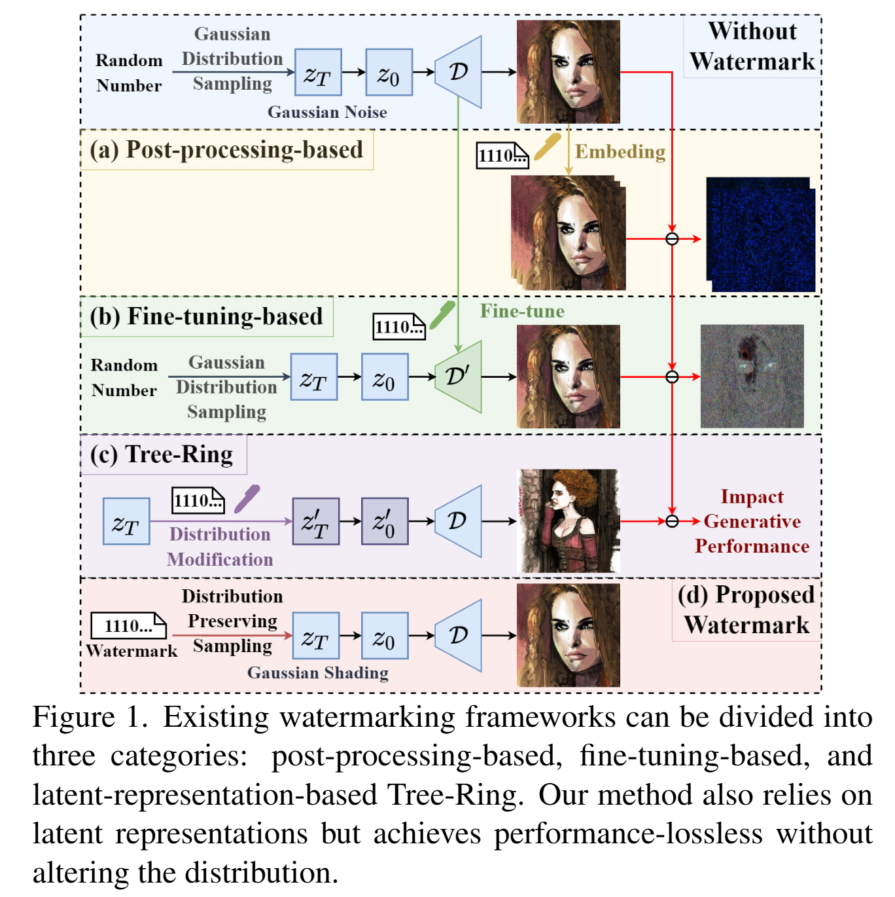
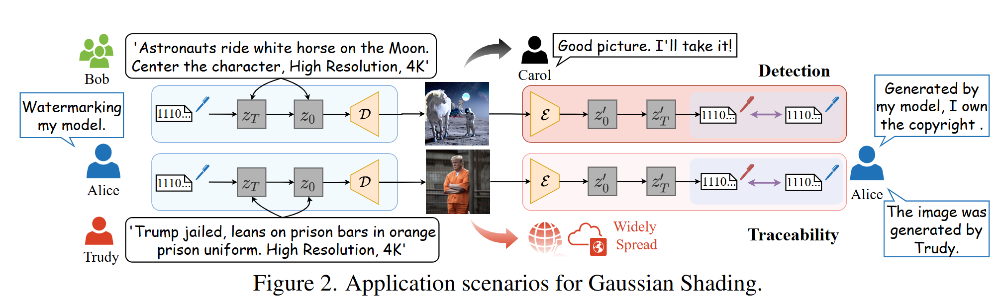
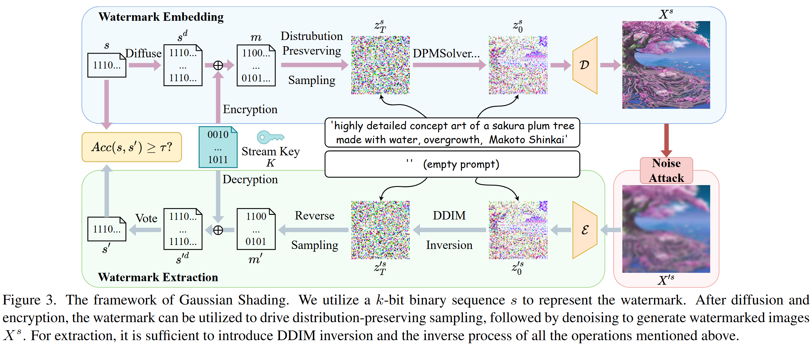

# Gaussian Shading: Provable Performance-Lossless Image Watermarking for Diffusion Models 

*CVPR(2024), 373 citation, Anhui Province Key Laboratory of Digital Security, Review Data: 2026.11.18*

<!--
  ↑ 위 두 줄은 형식을 유지하세요. 학회·연도·추가 날짜가 README/사이트에 자동으로 들어갑니다.
  이 회색 주석들은 GitHub와 사이트에 보이지 않으니 지우지 않아도 됩니다.
  쓸 내용이 없는 섹션은 비워두지 말고 통째로 지우세요.
-->

> [!TIP]
> **한 줄 요약** — 이 논문이 무엇을 해냈는지 한 문장으로.

| 흐름 | 내용 |
|:--|:--|
| **문제** | 모델 성능을 저해하지 않고 워터마크를 삽입할 수 없을까? |
| **아이디어** | Diffusion model의 초기 Gaussian noise에 정보를 삽입하면서도 기존 noise의 확률분포를 유지하여 이미지 생성 성능에 영향을 주지 않는다.  |
| **결과** | 별도의 학습이나 모델 파라미터 변경 없이 이미지를 생성하는 과정에서 워터마크를 삽입하고, 생성된 이미지만을 가지고도 워터마크를 역추적할 수 있다. |

   
  <b>Figure 1.</b> Diffusion-based watermarking methods

---

## 1. 문제 정의 — 왜 이 논문이 필요한가

<!-- 처음 읽는 사람도 따라올 수 있게: 분야 → 문제 → 기존 한계 → 이 논문 순서로 -->

**배경.** 

Diffusion model은 image generation에서 상당한 발전을 이루었다. 잘 학습된 모델은 다양한 backgrond에서의 high-quality image를 쉽게 생성한다. 

하지만, 이는 지식재산권과 확산 모델이 도난당하거나 두 번 재판매될 지에 대한 여부에 관한 걱정을 가져온다. 

반면, 현실적인 이미지를 쉽게 생성하는 것은 잘못된 정보를 담은 content가 생성될수 있다는 우려도 있다. 예를 들어, 2023.05.23일 Twitter에 인증받은 사용자, Bloomberg Feed는 “Large explosion near the Pentagon complex in Washington DC – initial report”라는 제목의 트윗과 함께 합성 이미지를 게시했습니다. 이 트윗은 여러 공신력 있는 언론 계정에서 공유되었고, 그 결과 주식시장에 잠시 영향을 주기도 했습니다.

2023년 10월 30일에는 백악관이 AI 보안에 관한 행정명령을 발표하며, AI 기반 사기 및 기만으로부터 미국인을 보호할 필요성을 강조하고, AI 생성 콘텐츠를 탐지하고 공식 콘텐츠의 진위를 인증하기 위한 표준과 모범 사례를 수립하겠다는 방침을 밝혔습니다.

**기존 방법의 한계.** 

기존 방법들은 종종 model 성능을 타협하거나 추가적인 학습을 필요로 한다. 이는 운영자와 사용자에게 바람직하지 않다. 

Diffusion model을 위한 기존 watermarking 방법을 총 3가지로 나눌 수 있다. (Post-processing-based, Fine-tuning-based, Tree-Ring)

Post-processing: 이미지를 직접 변경하므로 품질 저하

Fine-tuning: model parameter를 수정해야하므로 추가적인 계산 비용

Tree-Ring: 은 $z_T$의 푸리에 공간에서 변형을 수행하는데, 이는 distribution modification을 불러 일으킨다.

**이 논문의 접근.** 

Gaussian shading - diffusion dmoel watermarking 논문으로 performance-lossless이고 training-free인 동시에 저작권 보호와 침해 콘텐츠 추적이라는 두 가지 목적을 수행한다. 

Model parameter를 바꾸지 않는다. Watermark를 Gaussian distribution을 따르는 latent representation에 mapping한다. 이는 non-watermarked diffusion model로부터 구해진 latent representation이기에 구별할 수 없다. 

Watermark는 DDIM Inversion에 의해서 추출된다. 

> [!NOTE]
> **Contributions**
> 1. 모델 성능을 해치지 않으면서 watermark 삽입이 가능하다 (training-free)
> 2. 저작권 보호와 침해 콘텐츠 추적이 가능하다.

## 2. 사전 지식

<!-- Method를 이해하는 데 꼭 필요한 개념/선행 연구만. 이미 정리한 리뷰가 있으면 링크 -->

일반적으로 워터마크의 기능은 용량에 따라 달라집니다. 예를 들어 1비트 워터마크는 이미지가 특정 확산 모델로 생성되었는지를 판별할 수 있어 저작권 보호에 쓰이고, 다중 비트 워터마크는 그 이미지를 생성한 사용자가 누구인지까지 판별할 수 있어 추적성(traceability)을 제공합니다. 이미지 워터마킹은 이미지를 운반체로 삼는 방법입니다. 초기의 워터마크 삽입 방법은 주로 공간 영역(spatial domain)에 초점을 맞췄으나, 이후 강건성을 높이기 위해 변환 영역(transform domain) 워터마킹 기법이 개발되었다.

- Scenarios 
  - Alice: model owner
  - Bob: ordinary user
  - Trudy: 침해 콘텐츠 생성 및 유포자 
    - Traceability: Alice는 사용자마다 서로 다른 워터마크를 할당. Trudy 추적 가능
  - Carol: model이 생성한 이미지를 훔쳐 저작권 주장
    - Detection: Alice가 생성된 이미지에 1비트 워터마크를 삽입하여 저작권 보호

   
  <b>Figure 2.</b> Application Scenarios

## 3. 방법

### 3.1 전체 구조

<!-- 그림 한 장 + "입력 → 처리 → 출력" 흐름을 3~5줄로 -->

   
  <b>Figure 3.</b> Overview

### 3.2 핵심 구성 요소

<!-- 구성 요소마다: 무엇을 하는가 → 수식 → 직관(왜 이렇게 하는가) -->

- Watermark Embedding
  - Latent representation $c \times h \times w$
  - 각 원소에 $l$ bit를 넣을 수 있다고 보면 전체 용량은 $l\times c \times h \times w$ bit가 된다. 이게 이론상 최대 용량
  - 하지만, 워터마크를 한 번만 넣으면, 이미지가 조금만 변형되도 정보가 쉽게 망가진다. 따라서 워터마크를 작게 축소한다. $l \times \frac{c}{f_c} \times \frac{h}{f_{hw}} \times \frac{w}{f_hw}$
  - 줄인 워터마크를 $f_c \times f_{hw}^2$ 번 복제한다. 
  - 따라서 실제로 담을 수 있는 정보량은 다음과 같다. $k = \frac{l \times c \times h \times w}{f_c f_{hw}^2}$
  - 논문에서 사용하는 값: $f_c = 1, f_{hw} = 8, f_l = 1$ 즉, $k=256 bits$

- Watermark Randomization
  - 원본 워터마크를 다음과 같다고 가정 [1,1,1,1,1,1,0,0]
  - 이 워터마크는 1이 75%, 0이 25%이다. 만약 다음과 같은 규칙으로 Gaussian noise를 생성한다면? bit 0 > 음수 noise, bit 1 > 양수 noise 
  - 더 이상 표준 정규 분포를 따르지 않게 된다. 
  - 따라서 논문은 **ChaCha20** 암호화를 사용한다. 암호와의 결과로 각각의 비트는 1/2의 확률을 가진다. 
  - 워터마크 값은 샘플링 구간을 결정 (bit 1이면 양수 noise), $u$는 그 구간에서의 구체적인 noise 값을 확률분포에 따라 결정한다. 
  - $u$는 $0~1$ 사이의 균등분포에서 독립적으로 무작위 샘플링한다.

> 왜 bit를 0, 1로만 표현하는가?
>> 한 latent 원소에 8개의 bit 표현이 가능하다고 한다면 Gaussian 구간을 8개로 나눠야한다. 즉, DDIM Inversion 시에 자그마한 perturbation에도 값이 달라진다.

> [!IMPORTANT]
> **핵심 수식**
>
> $$\mathcal{L} = \mathbb{E}\left[\lVert \epsilon - \epsilon_\theta(x_t, t) \rVert^2\right]$$
>
> 각 항이 무엇을 의미하는지 한 줄씩

## 4. 실험

### 4.1 설정

| 항목 | 내용 |
|:--|:--|
| Dataset | |
| Metric | |
| Baseline | |

### 4.2 주요 결과

<!-- 표/그림을 붙이고, 바로 아래에 "그래서 이 결과가 보여주는 것"을 한 줄로 -->

### 4.3 Ablation

<!-- 어떤 구성 요소가 성능에 얼마나 기여하는가 -->

## 5. 정리

- **한계** — 논문이 인정한 한계 / 내가 본 한계
- **배운 점** — 이 논문에서 가져갈 아이디어
- **연구 아이디어** — 내 연구에 적용해 볼 만한 것

## 6. 질문 & 메모

- [ ] 아직 이해 못 한 부분, 확인해 볼 것

## 참고

- [Paper](https://arxiv.org/abs/xxxx.xxxxx) · [Code](https://github.com/...) · 관련 리뷰
