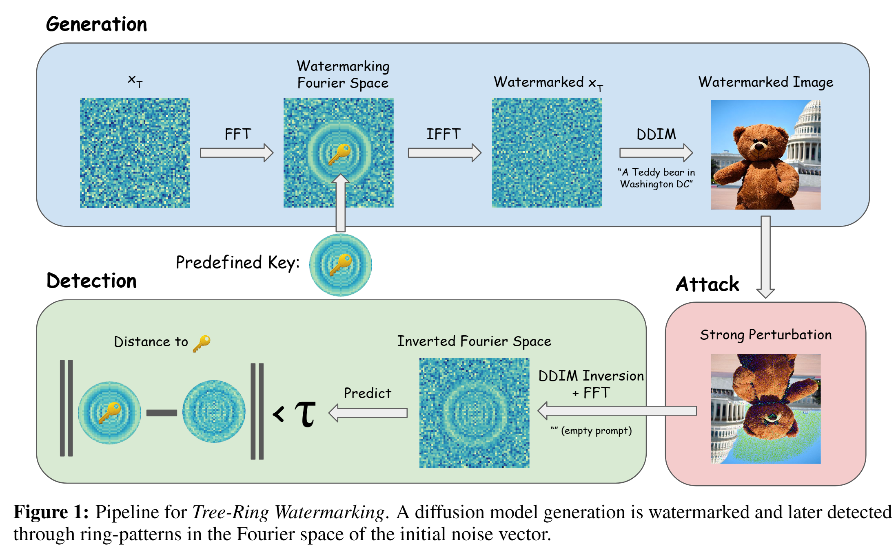
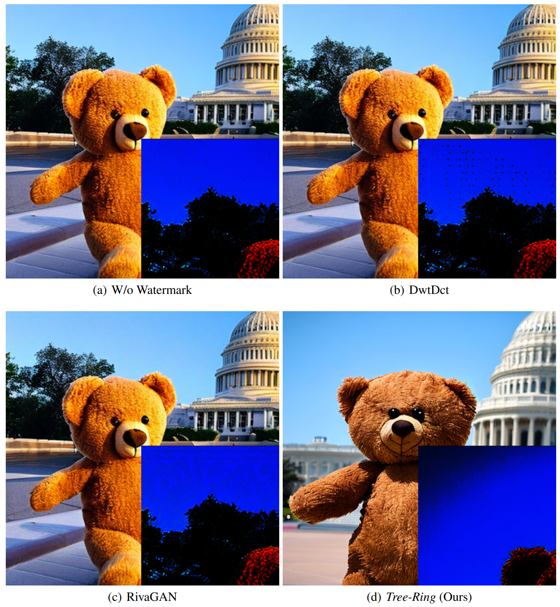

# Tree-Ring Watermarks: Fingerprints for Diffusion Images that are Invisible and Robust

*NeurIPS(2023), 391 citation, University of Maryland, Review Data: 2026.11.18*

> [!TIP]
> **한 줄 요약** — Diffusion sampling에 쓰이는 initial noise vector에 Fourier space에서 구조화된 패턴을 심고, 생성 후 diffusion inversion으로 noise를 복원해 그 패턴을 검출함으로써 보이지 않으면서도 robust한 watermark를 만든다.

| 흐름 | 내용 |
|:--|:--|
| **문제** | 생성 이미지의 출처를 추적하기 위한 watermark는 이미지에 보이지 않아야 하면서도, 편집·변형 공격에 견딜 수 있어야 한다 |
| **아이디어** | Initial noise의 Fourier space에 ring 형태의 key 패턴을 심어 convolution·crop·dilation·flip·rotation에 불변하도록 하고, 검출 시 DDIM inversion으로 복원한 noise에서 패턴을 확인 |
| **결과** | Stable Diffusion 등 임의의 diffusion model에 plug-in으로 적용 가능하고 FID 손실이 거의 없으며, 기존에 배포된 watermark 방식보다 훨씬 robust |

   
  <b>Figure 1.</b> Tree-Ring Watermark 개요

---

## 1. 문제 정의 — 왜 이 논문이 필요한가

<!-- 처음 읽는 사람도 따라올 수 있게: 분야 → 문제 → 기존 한계 → 이 논문 순서로 -->

**배경.**

Watermarked image는 사람에게는 보이지 않지만, machine-generated로써 이미지에 signal이 담겨져 있다. 

Text-to-image model의 악용 가능성 때문에 생성된 출력물에 대한 워터마크 개발이 필요해졌다.

워터마크는 이미지 생성 시스템의 사용기록을 남겨, 소셜 미디어, 언론사, diffusion platform 자체가 이미지의 출처를 식별하고 피해를 완화하거나 법집행 기관과 협력할 수 있도록 한다. 

**기존 방법의 한계.**

Sampling 이후에 post-hoc modification을 수행한다. 예를 들어, Stable Diffusion에 현재 적용된 워터마크는 생성된 이미지의 특정 푸리에 주파수를 수정하는 방식으로 작동한다. 

Watermark encoder - decoder를 adversarial objective로 함께 학습 (전송량과 강건성 극대화). 이러한 접근법들은 여전히 encoder가 주어진 이미지에 사후적으로 신호를 새기는 전통적인 워터마크처럼 작동.

학습된 encoder를 사용해 생성 모델의 학습 데이터에 워터마크를 새긴다. 그 결과 watermark encoder가 모델 안에 내장되어 워터마크가 적용된 데이터를 더 쉽게 생성한다. 

**이 논문의 접근.**

Watermark를 initial noise vector안에 심는다. Fourier space에서 구조화되기에 convolution, crop, dilation, flip, rotation에 불변한다. 

Watermark signal은 생성된 이미지를 inversion하여 embedded signal을 검사한다. 

> [!NOTE]
> **Contributions**
> 1. Post-hoc modification이 아닌 truly invisible한 첫 번째 watermark paper이다. 
> 2. 여러 이미지 변환에 불변하면서 추가 학습이나 미세 조정이 필요하지 않다. 

   
  <b>Figure 2.</b> Zoomed-in view with high contrast. 다른 방법론들은 실제로 보이지 않는다고 주장하지만 여전히 흔적이 눈에 보인다.

## 2. 사전 지식

<!-- Method를 이해하는 데 꼭 필요한 개념/선행 연구만. 이미 정리한 리뷰가 있으면 링크 -->

- **DDIM Inversion**

- 픽셀 공간의 회전은 푸리에 공간의 회전에 대응합니다.

- 픽셀 공간의 이동은 모든 푸리에 계수에 상수 복소수를 곱하는 것에 대응합니다.

- 픽셀 공간의 확대/축소는 푸리에 공간의 축소/확대에 대응합니다.

- 픽셀 공간의 색상 지터(채널의 모든 픽셀에 상수를 더하는 것)는 0 주파수 푸리에 모드의 크기를 바꾸는 것에 대응합니다.

## 3. 방법

### 3-1. Threat Model

Watermarking의 목적은 주어진 이미지가 어떤 모델로부터 생성됐는지 식별할 수 있게하면서 image quality degradation없이 이미지를 생성하는 것이다. 

이 연구에서 고려하는 위협 모델을 간단히 설명한다. 

"Gene"은 diffusion model을 소유자로, 비공개 워터마킹 알고리즘이 포함된 API를 통해 이미지를 생성

"Fiona"는 위조자로, API를 통해 이미지를 생성한 뒤, 강력한 데이터 증강을 적용해 이미지를 변환하여 워터마킹 알고리즘 탐지를 피하고자 한다. 

### 3.2 전체 구조

<!-- 그림 한 장 + "입력 → 처리 → 출력" 흐름을 3~5줄로 -->

Key를 Gausisan array에 직접 새기면 결과 이미지에 눈의 띄는 패턴이 생길 수 있으므로, initial noise vector의 푸리에 변환에 새긴다. 

이진 mask를 선정하여 푸리에 공간 중 key를 새길 sub-space를 지정한다. Mask 안의 주파수 성분에는 key를 넣고 그 외에는 Gaussian. 검출시에도, DDIM Inversion으로 얻은 noise에 푸리에 변환을 거쳐 subspace에서의 $L_1$ distance를 구한다. 

   
  <b>Figure 1.</b> Tree-Ring Watermark 개요

### 3.2 핵심 구성 요소

<!-- 구성 요소마다: 무엇을 하는가 → 수식 → 직관(왜 이렇게 하는가) -->

전체 과정 자체는 단순하지만, 성공 여부를 결정짓는 **Key Pattern** 구성에 성능이 좌우된다.

Tree-Ring Zeros: 이미지 공간에서 회전에 대한 불변성을 유지하기 위해 마스크를 원형 영역으로 정합니다. 키는 0으로 이루어진 배열로 선택하며, 이는 이동, 자르기, 확대/축소에 대한 불변성을 만들어 줍니다. 이 키는 조작에 불변이지만, 가우시안 분포에서 크게 벗어나는 대가가 있습니다. 또한 여러 키를 사용해 모델을 구별하는 것을 불가능하게 합니다.

Tree-Ring Rand: 고정된 키 k를 가우시안 분포에서 뽑습니다. 이 키는 노이즈 배열의 원래 푸리에 모드와 같은 i.i.d. 가우시안 성질을 가지므로, 생성 품질에 가장 적은 영향을 줄 것으로 예상합니다. 이 방법은 모델 소유자가 여러 키를 가질 수 있는 유연성도 제공합니다. 그러나 이미지 조작에 대해서는 불변이 아닙니다.

Tree-Ring Rings: 여러 개의 링으로 이루어진 패턴을 도입하며, 각 링을 따라 값이 일정합니다. 이렇게 하면 워터마크가 회전에 대해 불변이 됩니다. 링의 상수 값은 가우시안 분포에서 뽑습니다. 이는 여러 유형의 이미지 변환에 대한 어느 정도의 불변성을 제공하면서, 전체 분포가 등방성 가우시안에서 최소한으로만 벗어나도록 보장합니다.

세 가지 키 유형을 비교하면서 각각의 장단점을 보여준다. 

## 4. 실험

### 4.1 설정

| 항목 | 내용 |
|:--|:--|
| Metric | 비트 정확도 |
| Baseline | DwtDct, DwtDctSvd (2개는 학습 x), RivaGAN (GAN-based)|
| Model | 두 가지 대표적인 확산 모델 (SD v2, 256 x 256 ImageNet diffusion model) |

50 inference steps, 7.5 CFG, DDIM inversion 시 empty prompt (프롬프트를 알 수 없다는 가정), 워터마크 반지름은 $10$

<!-- ### 4.2 주요 결과

### 4.3 Ablation

어떤 구성 요소가 성능에 얼마나 기여하는가 -->

## 5. 정리

- **한계** — 모델 소유자가 추론 시 DDIM을 사용해야 한다. 만약 DDIM이 인기를 잃는다면, 제안한 워터마크는 다른 sampling 방식에 맞게 수정되어야 한다. 또한 제안한 워터마크는 역변환 과정에 모델 파라미터가 필요하므로, 설계상 모델 소유자만 검증할 수 있다. 
- **배운 점** — 푸리에 공간과 이미지 공간 사이의 변환 불변성
- **연구 아이디어** — 생성형 확산 모델의 출력 분포를 최소한으로 이동시켜 워터마킹하는 새로운 접근법을 제안

## 6. 질문 & 메모

## 참고

- [Paper](https://arxiv.org/pdf/2305.20030) · 관련 리뷰: [Stable Signature](../stable-signature/README.md)
