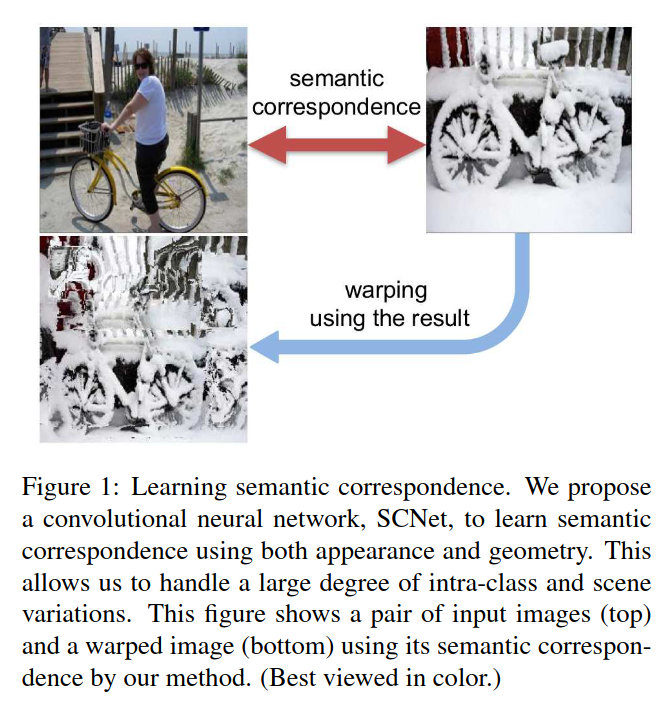
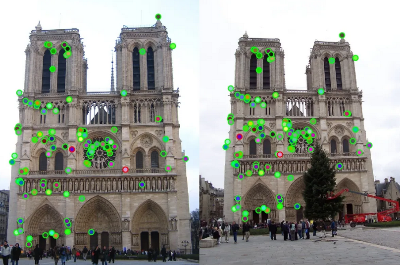
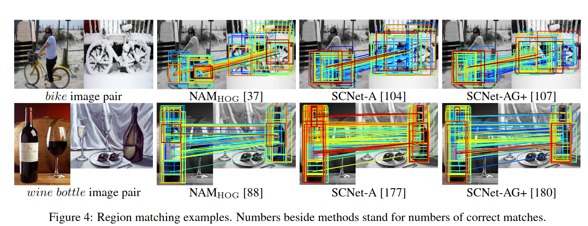

# SCNet: Learning Semantic Correspondence

*ICCV(2017), 160 citation, The University of Hong Kong, Yonsei University, POSTECH, Review Data: 2024.07.05*

> [!TIP]
> **한 줄 요약** — Region proposal을 매칭 단위로 쓰고 기하학적 일관성을 손실 함수에 명시적으로 넣은 CNN(SCNet)으로 semantic correspondence를 학습한다.

| 흐름 | 내용 |
|:--|:--|
| **문제** | 이전 work들은 hand-crafted feature(SIFT, DAISY, HOG)와 spatial regularizer를 결합하거나, appearance만을 위해 correspondence model을 학습했다 |
| **아이디어** | Region proposal을 매칭 기본 요소로 사용하고, 기하학적 일관성을 손실 함수에 통합한 CNN 구조 SCNet을 PASCAL VOC 2007 keypoint dataset 이미지 쌍으로 학습 |
| **결과** | 최근 deep learning architecture와 hand-crafted feature 기반 이전 방법들을 모두 능가 |

   
  <b>Figure 1.</b> SCNet 개요

---

## 1. 문제 정의 — 왜 이 논문이 필요한가

**배경.**

- Semantic correspondence: 한 object나 scene category의 다른 instance를 묘사하는 이미지들 사이의 feature matching
    - Feature matching: 서로 다른 이미지에서 유사한 특징을 찾아내고 대응시키는 과정. 주로 feature descriptor로 특징을 찾고 matching 시킨다.
    - Stereo matching: 두 개의 서로 다른 시점에서 촬영한 이미지 쌍(stereo image)을 이용해 깊이 정보를 추출하는 과정이다. 이 과정은 주로 3D 재구성이나 깊이 맵 (depth map)생성을 위해 사용된다.

**기존 방법의 한계.** 이전의 work들은 hand-crafted features (SIFT, DAISY, or HOG)와 spatial regularizer를 결합하거나, appearance만을 위해 correspondence model을 학습했다.

**이 논문의 접근.**

- 본 논문은 SCNet이라는 CNN 구조의 모델을 제안한다.
    - Semantic correspondence를 위한 기하학적으로 타당한 모델이다.
    - 매칭 기본 요소로 region proposal을 사용하며, 손실 함수에 기하학적 일관성을 명시적으로 통합했다.
    - PASCAL VOC 2007 keypoint dataset의 이미지 쌍을 사용하여 훈련했다.
    - SCNet outperforms both recent deep learning architectures and previous methods based on hand-crafted features.

## 2. 사전 지식

- Semantic correspondence
    - SIFT Flow: 고전적인 optical flow를 확장하여 비슷하지만 서로 다른 장면들간의 correspondence를 확립한다.
    - DAISY
    - HOG
- Deep learning for correspondence
    - 최근에는 CNN model을 사용하여 feature descriptor나 similarity function을 학습하기 위해 optical flow나 stereo matching과 같은 전통적인 dense correspondence problem에 적용하고 있다.

## 3. 실험

## 참고

- [Paper](https://openaccess.thecvf.com/content_ICCV_2017/papers/Han_SCNet_Learning_Semantic_ICCV_2017_paper.pdf)
