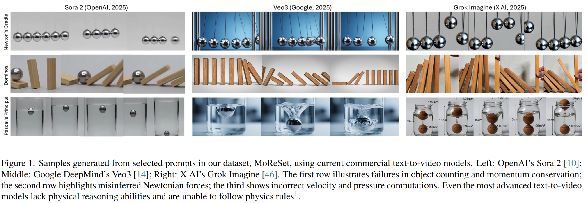
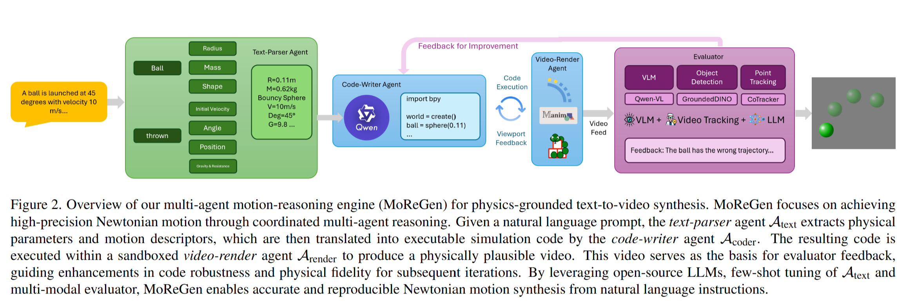

# MoReGen: Multi-Agent Motion-Reasoning Engine for Code-based Text-to-Video Synthesis

*CVPR(2026), 2 citation, Northeastern University, Review Data: 2026.06.24*

> [!TIP]
> **한 줄 요약** — 다중 LLM 에이전트가 자연어 설명을 물리 시뮬레이터 · 렌더링 엔진용 실행 코드로 바꿔, 뉴턴 역학을 따르는 재현 가능한 text-to-video를 생성한다.

| 흐름 | 내용 |
|:--|:--|
| **문제** | 최신 상업용 T2V 모델도 물리학적 rule을 지키지 못하고, FID · FVD 같은 외관 기반 지표나 인간 평가로는 정밀한 물리적 관계를 평가하기 어렵다 |
| **아이디어** | Text parser(자연어 → structured Newtonian specification) · Code-Writer(physics simulation code) · Video-Render(rendering script) 세 LLM agent와, code-writer에게 feedback을 주는 Evaluator로 반복 개선 |
| **결과** | 물리 엔진이 계산한 궤적을 따라가므로 물리적 정밀도와 모션 일관성을 갖춘, 재현 가능한 뉴턴 역학 비디오 생성 |

   
  <b>Figure 1.</b> MoReGen 개요

---

## 1. 문제 정의 — 왜 이 논문이 필요한가

- 최근 나온 상업적 text-to-video generation model을 3개를 써봤다. 가장 발전된 모델임에도 불구하고, 물리학적 추론 능력이 부족했고 물리학적 rule을 지키지 못한다.

- 평가 방법론에서도 병행적인 한계가 발생합니다. 대부분의 기존 T2V 모델은 성능 평가를 위해 Fréchet inception distance(FID) 및 Fréchet video distance(FVD)와 같은 외관 기반 지표에 의존합니다.

- 결과적으로 연구자들은 인간 기반 평가로 눈을 돌렸으나, 인간의 지각적 판단은 본질적으로 정성적이며 정밀한 물리적 관계를 평가하기에는 불충분하여 정량적 정확도가 필수적인 영역에서의 활용도가 제한적입니다

- 본 저자들은 체계적으로 물리학적 정확성과 motion 일관성을 강조하는 Newtonian motion-controlled text-to-video generation을 연구한다.

- 뉴턴 역학 기반 모션 제어의 의미
    - 기존의 T2V 모델들은 주로 시각적인 그럴듯함(Photorealism)에 집중하여, 실제 물리 법칙(관성, 운동량 보존, 가속도 등)을 무시하는 경우가 많습니다.
    - 이 논문은 단순히 픽셀 데이터를 모방하는 방식에서 벗어나, 뉴턴의 운동 법칙을 준수하는 물리적 제약 조건을 영상 생성 과정에 명시적으로 도입하고자 합니다.

- 물리적 정밀도 (Physical Precision)
    - 객체가 움직일 때 계산되는 속도, 가속도, 충돌 지점 등이 수학적·물리적 모델링과 정확히 일치함을 의미합니다.
    - 이를 위해 MoReGen은 LLM이 생성한 코드를 실제 Physics Simulator(예: Pymunk 등)에서 실행하여, 데이터 기반의 추측이 아닌 물리 엔진의 계산 결과값을 영상으로 구현합니다.

- 모션 일관성 (Motion Coherence)
    - 영상의 첫 프레임부터 마지막 프레임까지 객체의 궤적(Trajectory)이 물리 법칙에 따라 매끄럽게 연결되는 것을 의미합니다.
    - 물리 시뮬레이터에서 추출된 객체의 위치(Position), 속도(Velocity), 방향(Orientation) 정보를 렌더링에 사용함으로써, 인공지능이 생성한 영상에서 흔히 발생하는 '갑작스러운 멈춤'이나 '부자연스러운 물리적 튐 현상'을 방지합니다.

- 연구의 차별성:
    - 기존 모델들이 확률적인 Diffusion-based Pipeline에 의존하여 데이터를 암기하는 방식이었다면, MoReGen은 Code-based 접근법을 사용하여 물리 엔진이 계산한 궤적 정보를 강제로 따라가게 만듦으로써 생성된 영상의 재현 가능성(Reproducibility)을 높였습니다.

- MoReGen은 다중 에이전트 LLM, 물리 시뮬레이터, 렌더링 엔진을 통합하여 자연어 설명으로부터 재현 가능하고 물리적으로 정확한 영상을 생성할 수 있다.

- **확률적 노이즈 제거에 의존하는 기존의 확산 기반 파이프라인과 달리, MoReGen은 물리 시뮬레이터 및 렌더링 엔진을 위한 실행 가능한 코드를 직접 생성하며, 코더 LLM 에이전트를 통해 자연어 지시사항으로부터 뉴턴 역학 기반의 움직임을 합성할 수 있게 합니다.**

## 2. 사전 지식

- Transformer-based video generation
    - 방대한 데이터셋과 고비용의 컴퓨팅 인프라에 대한 의존성 때문에 자원이 제한적인 연구자들은 대규모 학습을 수행하기 어렵습니다
    -  더욱 중요한 점은, 이러한 모델들이 물리적 인식을 갖추기보다 외형 중심적이라는 것입니다. 이 모델들은 학습 분포를 암기하기 때문에 운동 역학이나 물리적 인과관계에 대한 이해가 부족합니다

- Physics-aided Generation and Evaluation
    - Bastek 등은 도메인 특화 물리 가이드를 확산 백본(diffusion backbones)에 통합하는 프레임워크를 제안했습니다.
    - Liu 등은 비디오 사전 지식을 바탕으로 운동을 생성하기 위해 시뮬레이터를 사용했으며, Zhang 등은 물리적으로 불가능한 출력을 페널티 처리하기 위해 LLM을 활용했습니다.

## 3. 방법

- MoReGen은 3개의 LLM agent와 하나의 evaluator로 구성된다.
    - LLM은 모두 QWen
    - Text parser: raw description을 structured Newtonian specification으로 변환
    - Code-Writer: 위에서 변환한 것을 실행가능한 physics simulation code로 변환
    - Video-Render: rendering script 생성
    - Evaluator: feedback을 code-writer에게 제공하여 비디오를 반복적으로 개선
    - Text parser에 대한 few-shot training만으로 일관된 뉴턴 역학 비디오 생성 가능

## 참고

- [Paper](https://arxiv.org/pdf/2512.04221)
