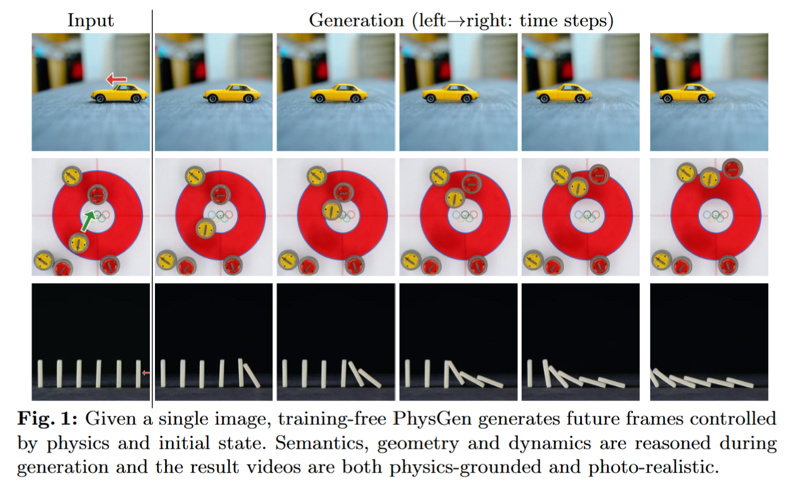
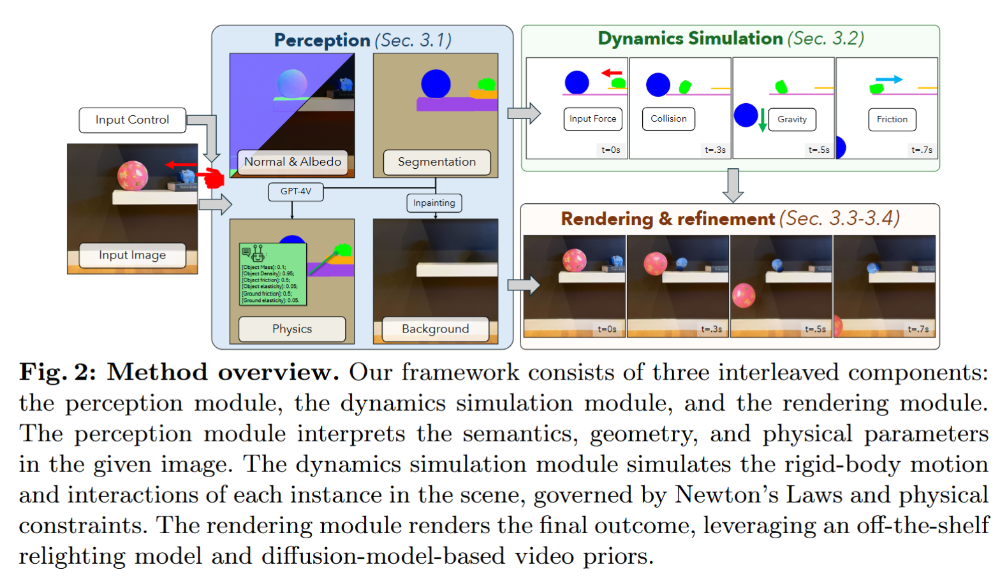

## PhysGen: Rigid-Body Physics-Grounded Image-to-Video Generation
*ECCV(2024), 182 citation, University of Illinois Urbana-Champaign, Review Data: 2026.06.26*

[Intro](#intro) 
[Related Work](#related-work) 
[Method](#method) 
[Experiment](#experiment) 
[Conclusion](#conclusion) 

> Core Idea

<strong>"test1"</strong> 

***

### <strong>Intro</strong>

- 본 논문에서 제안하는 PhysGen은 image-to-video generation model로써, 힘의 방향이 표시된 이미지를 input으로 받으면 현실적이고, 물리학적으로 말이되는 일관성있는 비디오를 생성한다. 
    - 총 3가지의 주요 요소로 구성된다.
    - Image understanding module: 주어진 이미지의 기하학적, 재료, 물리적 파라미터를 이해하는 module 
    - Image-space dynamics simulation model: 강체 물리학 (rigid-body physics)과 추론된 파라미터를 활용하여 사실적인 동작을 시뮬레이션
    - Image-based rendering and refinement module: 생성된 움직임을 특징으로 하는 사실적인 영상 자료를 제작하기 위해 생성형 비디오 확산(generative video diffusion) 모델을 활용하는 이미지 기반 렌더링 및 정교화 모듈

- 우리는 외부 힘이 가해졌을 때, 어떤 일이 일어날 지 직관적으로 알 수 있다. 이러한 실제 경험 없이도 상황을 예측하는 고도의 인지 능력을 부여하고자 한 것이 PhysGen이다. 

- 기존 방식의 한계
    - 전통적인 컴퓨터 그래픽스: 물리 엔진을 사용하여 동작을 제어할 수 있지만, 실제 세상의 이미지를 애니메이션으로 만드는 데 필요한 복잡한 배경과 조명을 재현하기 어렵습니다.
- 기존 데이터 기반 이미지-비디오 생성(I2V)
    - 대규모 데이터를 학습하여 매우 사실적인 영상을 만들지만, 정작 중요한 '물리 법칙'을 배우지 못해 시간이 지날수록 영상이 어색해지거나(시간적 일관성 부족), 사용자가 원하는 물리적 힘(force)과 토크(torque)를 정밀하게 제어할 수 없다는 한계가 있습니다.

> **강체 역학(Rigid-Body Dynamics)** 은 물리학 및 공학에서 매우 중요한 분야로, 외부에서 힘을 받았을 때 **'변형되지 않는 이상적인 물체(강체)'** 가 어떻게 움직이는지를 연구하는 학문

***

### <strong>Related Work</strong>

***

### <strong>Method</strong>

- 프레임워크는 인식 모듈(perception module), 역학 시뮬레이션 모듈(dynamics simulation module), 렌더링 모듈(rendering module)이라는 세 가지 상호 연결된 구성 요소
    - 인식 모듈은 주어진 이미지 내의 의미론적 정보, 기하학적 구조, 그리고 물리적 매개변수를 해석합니다. 
    - 역학 시뮬레이션 모듈은 뉴턴의 법칙(Newton’s Laws)과 물리적 제약 조건에 따라 장면 내 각 개체의 강체 운동과 상호작용을 시뮬레이션합니다. 
    - 렌더링 모듈은 기존의 리라이팅 모델(relighting model)과 확산 모델(diffusion-model-based) 기반의 비디오 사전 지식을 활용하여 최종 결과물을 렌더링

segmentation + Physics with GPT-4V -> Dynamics simulation 

Dynamics simulation + Background -> inpainting -> Rendering

$\textbf{Perception}$

- 정적인 단일 이미지로부터 물리 기반의 시뮬레이션을 수행하기 위해 필요한 핵심 요소들을 추출
- Segmentation
    - GPT-4V를 사용하여 이미지 내의 모든 객체 카테고리를 식별
    - 이를 Grounded-SAM과 결합하여 각 객체의 마스크 생성
- Physical Properties Reasoning
    - GPT-4V에 객체 마스크를 제공하여 질량(mass), 마찰 계수(friction coefficient), 탄성 계수(elasticity)와 같은 물리적 수치를 직접 질문
    - Coulomb friction 모델과 탄성 계수를 활용하여 객체가 물리 시뮬레이션 환경에서 어떻게 반응할지 결정
- Geometry Primitives
    - 생성된 픽셀 기반의 마스크는 물리 시뮬레이터에서 직접 사용하기 어렵기 때문에, 이를 원(circle)이나 다각형(polygon) 같은 벡터 형태의 기하학적 기본 요소로 변환
- 본질 분해 (Intrinsic Decomposition) 및 배경 복원
    - 객체가 움직일 때 발생하는 그림자나 조명 변화를 처리하기 위해, 이미지의 알베도(albedo), 법선(normal), 그리고 조명(lighting)을 추정합니다.
    - 객체가 이동하면서 생기는 빈 배경 영역은 최신 생성형 Inpainting 모델을 사용하여 자연스럽게 채워 넣습니다.

$\textbf{Image space dynamics simulation}$

- 3차원 공간 전체를 완벽하게 재구성하는 대신, 2차원 이미지 평면 내에서 물체의 물리적 움직임을 계산

$\textbf{Rendering}$

$\textbf{Generative refinement with latent diffusion models}$

- 단순히 물리적 시뮬레이션과 리라이팅(Relighting)만으로는 해결하기 어려운 영상의 부자연스러움을 개선하기 위해 **잠재 확산 모델(Latent Diffusion Models, LDM)**을 활용한 정교화(Refinement) 과정
- SDEdit 기반의 노이즈 처리

***

### <strong>Experiment</strong>

***

### <strong>Conclusion</strong>

***

### <strong>Question</strong>

<a href="">link</a>

> 인용구
