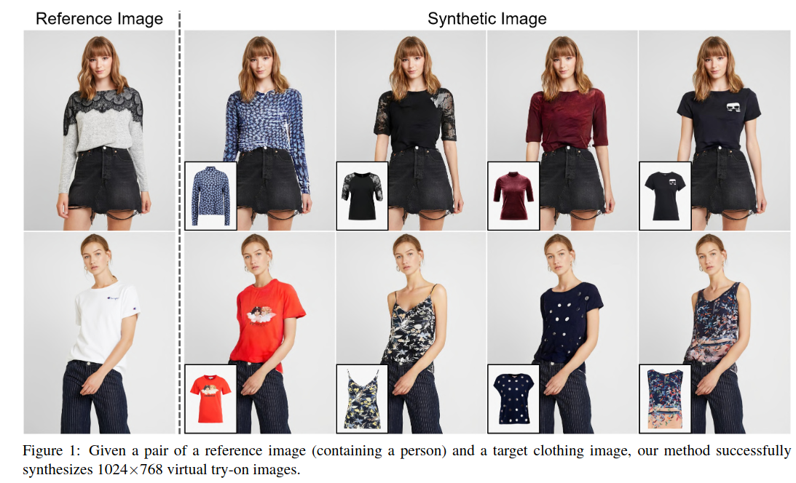
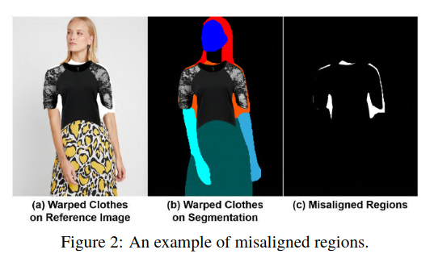
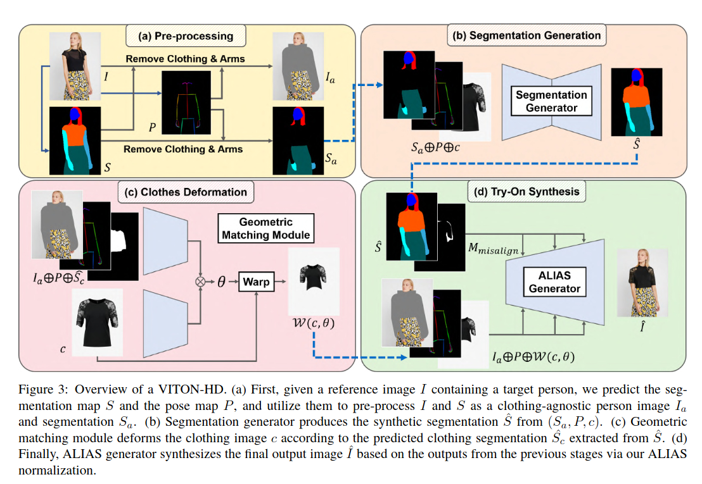
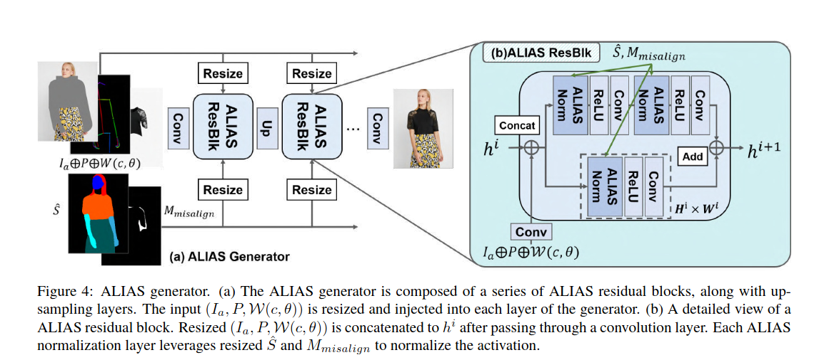
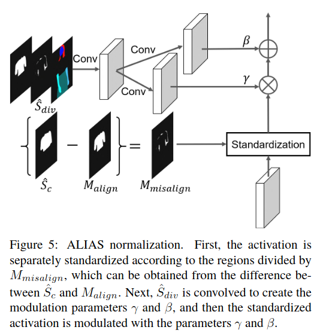
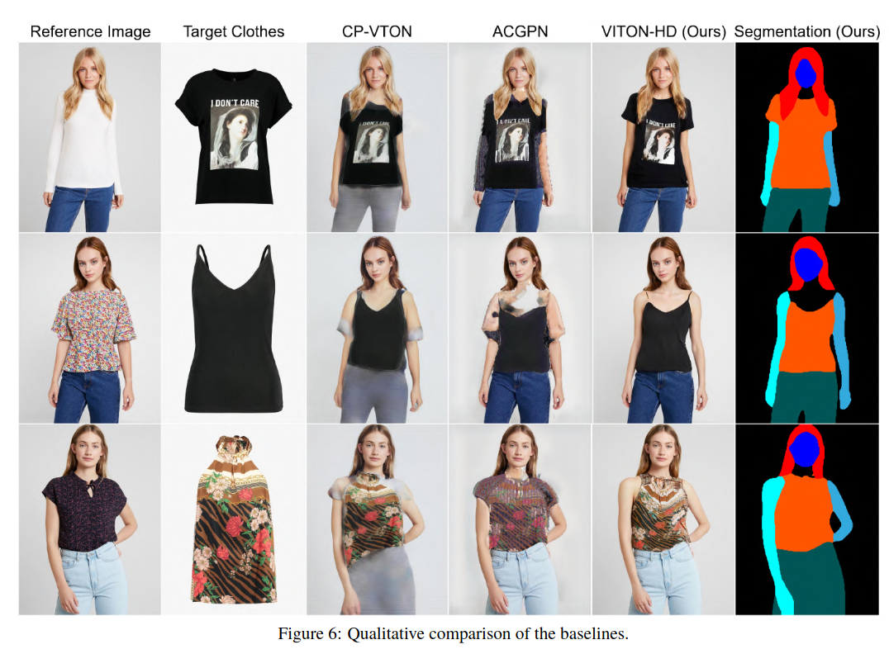
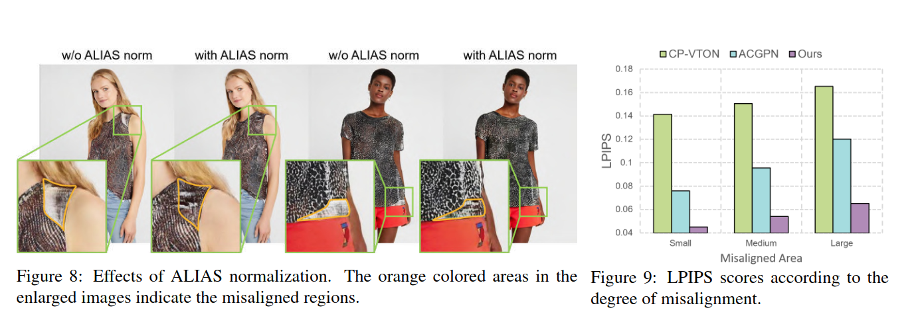

# VITON-HD: High-Resolution Virtual Try-On via Misalignment-Aware Normalization

*CVPR(2021), 121 citation*

> [!TIP]
> **한 줄 요약** — Segmentation 생성 → 옷 warping → ALIAS normalization 기반 generator로 misaligned 영역의 artifact를 처리해 1024×768 고해상도 virtual try-on을 구현한다.
>
> Core Idea: *"High-Resolution Image Synthesis by Solving misalign artifacts"*

| 흐름 | 내용 |
|:--|:--|
| **문제** | 기존 방법은 $256 \times 192$ 저해상도에 머물고, 해상도를 키우면 warped cloth와 clothing region 간 misalignment artifact가 두드러진다 |
| **아이디어** | Segmentation map 예측 → target cloth를 몸에 rough fit → ALIgnment-Aware Segment (ALIAS) normalization과 ALIAS generator로 misaligned 영역과 detail 보존 |
| **결과** | 새로 crawling한 13,679쌍 고해상도 데이터셋에서 최대 $1024 \times 768$ try-on 합성 |

   
  <b>Figure 1.</b> VITON-HD의 1024×768 try-on 결과

---

## 1. 문제 정의 — 왜 이 논문이 필요한가

- 이전의 연구들은 생성된 이미지의 해상도가 $256 \times 192$ 로 여전히 낮아, 온라인 소비자를 만족시키기에는 한계가 있었다.
- 본 연구에서는, resolution 을 증가시키면서 (up to $1024 \times 768$) warped cloth 와 clothing region 간의 misalign 의 artifacts 를 해결하고자 한다.
    - 1. segmentation map 을 준비
    - 2. Roughly fit the target clothing item to a given person's body
    - 3. ALIgnment-Aware Segment (ALIAS) normalization 과 ALIAS generator 를 제안 (misaligned area 와 detail 을 보존하기 위해)

## 2. 방법

- Method
    - (a): Target person $I$ 이 주어지면, segmentation map $S$ & Pose map $P$ 를 예측 $\rightarrow$ 그 정보를 가지고 clothing agnostic person image $I_a$ 와 segmentation $S_a$ 를 pre-process 한다.
    - (b): Segmentation generator 에게 ($S_a, P, c$) 를 input 으로 줘서, synthetic segmentation $\hat{S}$ 를 만든다.
        - $c$: clothing image
    - (c): $I_a, P, \hat{S_c}, c$ 를 이용하여 clothing image $c$ 를 deform (변형) $\rightarrow$ $W(c,\theta)$
        - $\hat{S_c}$: $\hat{S_c}$ 로부터 추출된 clothing segmentation
    - (d): $\hat{S}, M_{misalign}, I_a, P, W(c, \theta)$ 를 입력으로 ALIAS generator 를 통해 output image $\hat{I}$ 를 만든다.

## 3. 실험

### Dataset

- $13,679$ frontal-view woman 과 top clothing image pair 를 online shopping mall website 에서 crawling 했다.
    - Train: $11,647$
    - Test: $2,032$

## 참고

- [Paper](https://openaccess.thecvf.com/content/CVPR2021/papers/Choi_VITON-HD_High-Resolution_Virtual_Try-On_via_Misalignment-Aware_Normalization_CVPR_2021_paper.pdf)
