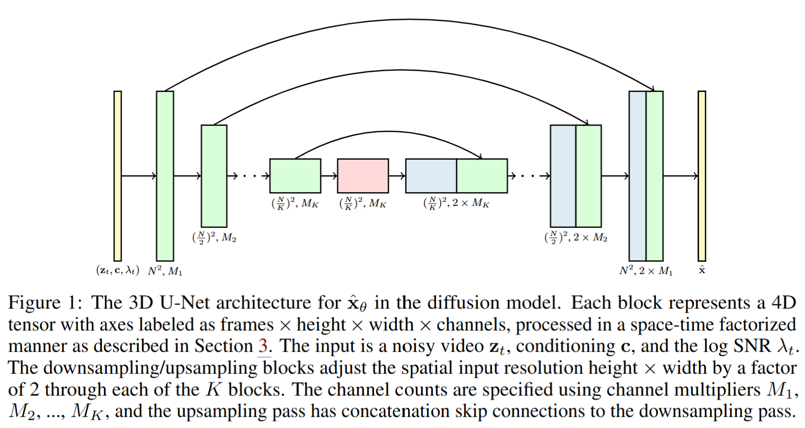
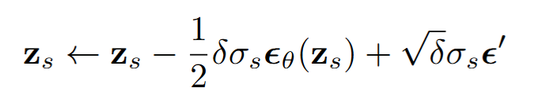
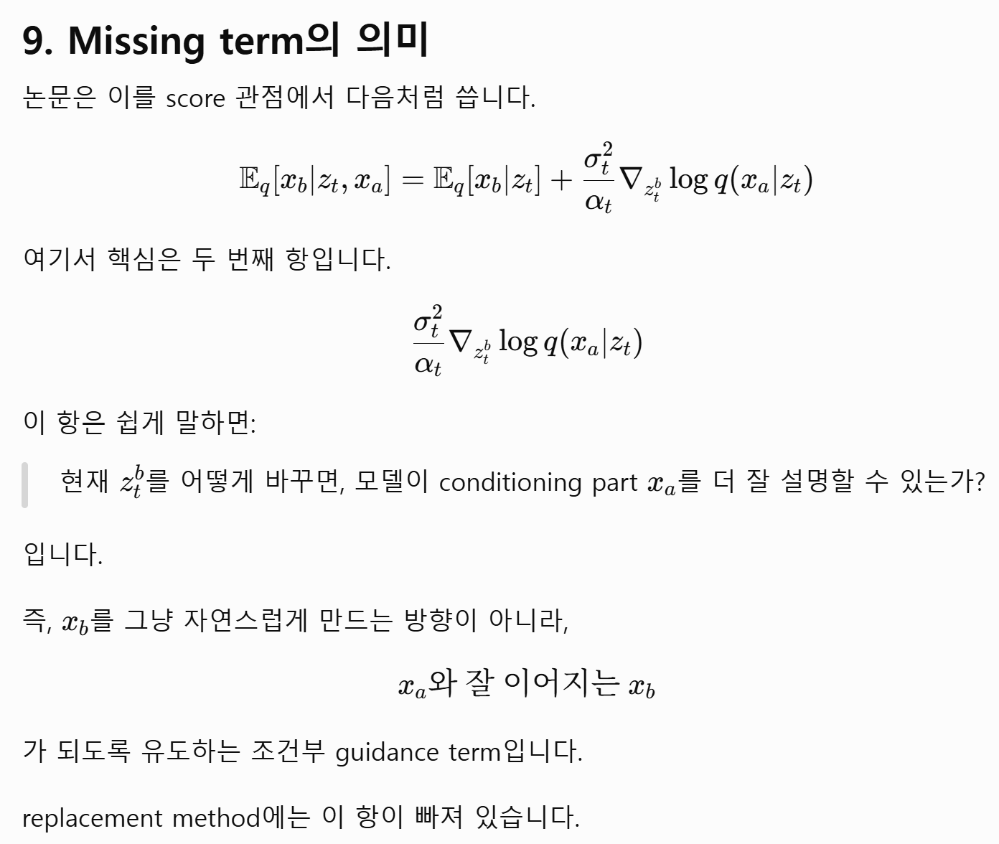
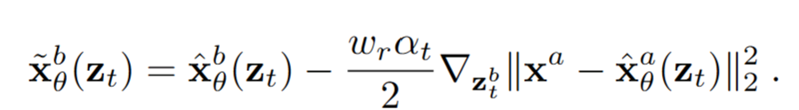

## Video Diffusion Models
*Neurips(2022), 3364 citation, Jonathan Ho, Review Data: 2026.06.26*

[Intro](#intro) 
[Related Work](#related-work) 
[Method](#method) 
[Experiment](#experiment) 
[Conclusion](#conclusion) 

> Core Idea

<strong>"test1"</strong> 

***

### <strong>Intro</strong>

- Image diffusion model architecture의 자연스러운 확장이다. (3D U-Net diffusion model)
    - Image와 video로부터 동시에 학습이 가능하다. (minibatch gradient의 variance를 줄이고, 최적화 속도를 위함)
    - 길고 고해상도 비디오를 생성하기 위해, 공간적이고 시간적인 video extension을 위한 새로운 conditional sampling technique을 제안한다. 

- Sampling 
    - 본 논문은 추론 시에 기존의 predictor-corrector sampler를 사용하다.(Yang Song의 score-based paper에 등장한다)
    - DDPM + Langevin correction step로 보면 된다다. 
    - 또한, conditional generation을 위해 CFG를 사용한다. 

- Predictor-Corrector sampler 
    - Predictor step: Ancestral sampler로 denoising
    - Corrector step: Langevin correction으로 한 번 더
    - 목적: predictor로 예측한 $z_s$가 진짜 diffusion marginal distribution에 더 잘 맞도록 보정한다. 
    - 중요한 건 각각의 step마다 다른 input이 필요하기에 한 번의 sampling시에 2번의 network 호출이 필요하다.

***

### <strong>Related Work</strong>

***

### <strong>Method</strong>

- $t$가 더 noisy level, $s$가 더 clean level 

- 핵심은 다음과 같다.
    - Diffusion 관련 수식은 그대로 사용하고, $\hat x_{\theta}$ 모델 구조만 3D U-Net으로 바꾸는 것이다. 
    - 즉, 이제 $x$가 이미지 한 장이 아니라 여러 프레임으로 이루어진 비디오 block이다. 

- Video $\in \mathbb{R}^{F \times H \times W \times C}$
    - 학습할 때는 항상 정해진 크기의 비디오 block을 본다 
    - 긴 비디오는 짧은 모델을 conditioning으로 이어붙인다 
    - Condition $c$와 noise level $\lambda_t$를 embedding vector로 만들어서 residual block에 더한다.

- Naive 하게는 3D conv를 쓰면 된다. 그러면 conv가 시간, 공간을 동시에 본다. 하지만 본 논문은 같이 보지 않고, space-time factorized 3D U-Net을 사용한다.
    - Factorized라는 말은 공간과 시간을 나눠서 처리한다는 의미이다. 
    - Spatial Conv $\rightarrow$ Spatial attention $\rightarrow$ Temporal attention
    - 따라서 Conv는 $1 \times 3 \times 3$을 사용하여 시간 방향으로는 섞지 않고, 각 프레임 내부의 공간 정보만 처리한다. 즉, 각 프레임을 이미지처럼 처리하는 것이다. 
    - $3\times 3\times3$을 사용하지 않는 이유는 계산량이 커지고, 이미지 모델의 구조를 그대로 가져오기 어렵기 때문이다. 

- Spatial attention 
    - 이전과 마찬가지로 각 frame을 독립적인 이미지처럼 보고 각 frame간의 정보가 섞이지 않게끔 attention을 진행한다. 

- Temporal attention 
    - Spatial attention을 frame 축으로 한다고 보면 된다. 
    - 특정 위치의 feature가 시간에 따라 어떻게 변하는지 학습하는 단계이다. 
    - 시공간을 통합하여 모든 token간 attention을 하면 계산량이 대략 $(FHW)^2$가 된다. 반면 factorization을 하면, $F(HW)^2 + HW(F)^2$가 된다. 

- Relative position embedding
    - Temporal attention에서는 frame 순서를 알아야 한다. 
    - 따라서 temporal attentin에 relative position embedding을 넣는다. 이는 상대적인 위치를 알려준다.

- 또한, temporal attention을 제거하거나 identity처럼 만들면 각 frame이 서로 정보를 주고 받지 않으므로 image data로도 이 3D UNet을 학습시킬 수 있다. 즉 temporal attention을 제외한 module들의 image domain에서의 능력을 향상시킨다.
    - Image data는 video data보다 훨씬 많고, 품질도 좋다. 

$\textbf{Reconstruction-guided sampling for improved conditional generation}$

- 짧은 video diffusion model로, 긴 video frame을 생성하거나, 프레임 보간, 해상도 업샘플링을 할 수 있다. 이를 위해 unconditional model을 conditional model처럼 쓰는 방법이 필요한데, 기존 replacement method는 temporal coherence가 약해서 본 논문은 reconstruction guidance를 제안한다. 
    - 긴 비디오를 만드는 기본적인 아이디어는 1) 먼저 짧은 프레임 생성, 2) 이전에 생성한 frame들을 조건으로 이어지는 다음 16프레임을 생성하는 것이다.
    - 프레임 보간의 경우, 생성된 프레임을 low frame rate video라고 가정하고, 이를 다시 condition으로 중간 frame들을 생성하는 것이다. 
    - 핵심은 처음과 처음 이후의 상황이 다른 것이다. 처음 생성할 때는 model이 다른 frame 정보를 받지 않지만, 이후에는 이전 frame 정보들을 conditioning으로 받는다. 문제는 모델이 원래 unconditional model로 학습되었다는 것이다. 

- 이를 해결하기 위한 기존 방법은 replacement method이다. Input을 condition part/generated part로 나눈 뒤, sampling step을 진행하고 나온 output을 다시 input에 넣을텐데, 이 input을 이미 생성한 frame의 정보로 대체하는 것이다. 
    - 예를 들어, long video generation이라면, 1) 초기 frame 생성, 2) 이후 이어지는 비디오를 생성할때는 이전에 생성한 frame 정보를 앞의 일부분에 계속 교체를 해주면서, 모델이 앞의 정보를 같이 보면서 자연스럽게 맞춰지길 기대하는 것이다. 
    - 하지만, 본 논문은 replacmeent method를 비디오 모델에 적용했더니 잘 안된다고 한다. 즉, sample quality는 괜찮지만, temporal coherence가 부족한 상황이다. 
    - 이는 replacment method가 사실은 주어진 condition인 이전 frame들의 정보를 명시적인 제약으로 주입하지 않기 때문이라고 한다. 따라서 반드시 이전 frame들과 이어지지 않는 것이다. 

- 따라서, 본 논문은 정해진 이전 frame이 존재하니, 바꿔야 하는 건 지금 시점에 생성할 frame들이라는 것에 주목했다. 
    - Replacement method 대신, 모델이 생성하면서, 지금 시점에 생성하고 있는 frame들을 조금 조정해서 모델이 이전 frame들을 더 잘 reconstruction하게끔 guidance loss를 추가한다. 
    - 그리고 물론 최종결과에서, condition part를 그대로 쓰는 게 아니라 이전에 생성했던 결과를 사용. 여기서 사용된 Condition part는 이전과 현재가 잘 이어지도록 유도하는 매개체임.

***

### <strong>Experiment</strong>

***

### <strong>Conclusion</strong>

***

### <strong>Question</strong>

<a href="">link</a>

> 인용구
